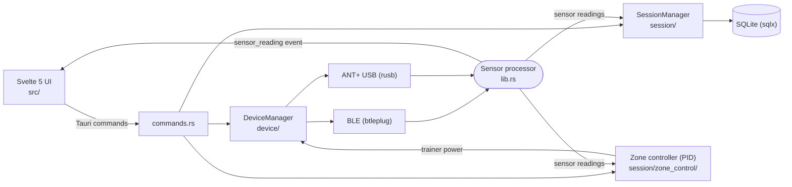

# Training App

A desktop app for indoor cycling. It reads heart rate, power, cadence, and speed sensors over BLE and ANT+, controls smart trainers, records sessions locally, and analyzes them. Your data stays on your machine in a local SQLite database. There is no account and no cloud sync.

> **Status:** beta (`v0.7.x-beta`). Builds are published for Linux x86_64 and macOS Apple Silicon.

## Features

### Sensors and devices

- Heart rate, power, cadence/speed sensors (separate or combined), and smart trainers over **BLE** and **ANT+** (direct USB stick driver, no vendor software)
- Cadence from power meters (pedal/crank) when there's no cadence sensor
- Remembers known devices and reconnects to them automatically; mark a device as primary, and it becomes the primary source for each metric it provides (power, heart rate, cadence, speed)
- Connection health and battery level per device

### Trainer control (BLE FTMS and ANT+ FE-C trainers)

- ERG mode (target watts), resistance mode, and simulation mode (grade)
- **Zone rides**: hold a target power or heart-rate zone, and the app adjusts trainer power automatically (PID control, with safety handling when a sensor drops out)

### Recording

- Start, pause, resume, and stop sessions, with live metrics and charts
- Periodic autosave, so a crash doesn't lose the ride in progress
- Session title, activity type, RPE, and notes

### Analysis

- Per session: Normalized Power, TSS, Intensity Factor, Variability Index, work (kJ), power curve, power/HR zone distribution, HR-to-power regression (PWC150/PWC170)
- Across sessions: best power curve, Performance Management Chart (CTL/ATL/TSB), weekly volume, HR trends, FTP progression
- **FIT export** that Garmin Connect and Strava can import

### Settings

- Athlete profile (FTP, weight, date of birth, sex, resting/max HR), metric or imperial units, custom HR and power zones

### Using the ride screen

- **Fit and scaling:** the ride screen fits any window from 800×600 up. The numbers grow with the space you give them, and Start/Stop, Pause and the trainer controls always stay visible.
- **Fullscreen:**
  - To enter, press **F11** on Linux or **⌃⌘F** on macOS, or use the fullscreen button.
  - To leave, press **Esc** or move the pointer and click **Exit fullscreen**.
- **Esc:** closes the open dialog first. Otherwise it leaves fullscreen.
- **Trainer:** with a trainer connected, **↑/↓** adjust the trainer target. Hold **Shift** for bigger steps.
- **Offline:** the app makes no network requests for its interface. It uses your system font plus a bundled monospace font for numbers.

## Install

Download the latest build from [Releases](https://github.com/onemorepereira/training-app/releases).

### macOS (Apple Silicon)

```bash
brew tap onemorepereira/training-app
brew install --cask training-app
```

The app isn't signed with an Apple Developer certificate. The cask clears the macOS quarantine attribute after installing. If macOS still blocks the app, clear it yourself:

```bash
xattr -cr /Applications/training-app.app
```

To update: `brew upgrade training-app`.

On first launch, macOS asks for Bluetooth permission. Grant it, or the app can't find any BLE sensors.

### Linux (x86_64)

Each release includes a `.deb` (Debian/Ubuntu), an `.rpm` (Fedora), and an `.AppImage`.

The app needs three things on Linux to talk to sensors: BlueZ, the `bluetooth` service, and a udev rule that gives your user access to ANT+ USB sticks. When something is missing, the **Devices** page shows a setup banner. Click its button to install whatever is missing via `pkexec`.

To set things up by hand instead, install BlueZ (`bluez`; on Arch also `bluez-utils`), run `sudo systemctl enable --now bluetooth`, and install the udev rule ([`src-tauri/resources/99-ant-usb.rules`](src-tauri/resources/99-ant-usb.rules)):

```bash
sudo curl -fsSL -o /etc/udev/rules.d/99-ant-usb.rules \
  https://raw.githubusercontent.com/onemorepereira/training-app/main/src-tauri/resources/99-ant-usb.rules
sudo udevadm control --reload-rules && sudo udevadm trigger
```

The rule grants access to Garmin/Dynastream ANT+ sticks (USB `0fcf:1008` and `0fcf:1009`) and stops the kernel's `usb_serial_simple` driver from claiming them. Unplug and replug the stick afterwards.

### Where data is stored

Data lives in the app data directory: `~/.local/share/com.training-app/` on Linux, `~/Library/Application Support/com.training-app/` on macOS. It holds:

- `training.db`: SQLite database (sessions, settings, known devices)
- `sessions/`: raw sensor recordings and autosave checkpoints
- `logs/`: application logs; attach these when reporting a bug
- `training.db.bak-*` / `training.db.pre-v*`: automatic backups taken before a one-time data repair or a schema upgrade

Development builds use the identifier `com.training-app.dev`, so they keep their data separate from an installed release.

## Architecture



- **Backend:** Rust, Tauri v2 (`src-tauri/`). `device/` holds the BLE and ANT+ transports, FTMS/FE-C trainer control, and reconnects. `session/` holds recording, metrics, analysis, zone control, FIT export, and storage.
- **Frontend:** Svelte 5 + TypeScript + ECharts (`src/`), built as a static SPA. The typed API wrappers are in `src/lib/tauri.ts`.
- **Storage:** SQLite via sqlx. The schema lives only in `src-tauri/migrations/` as numbered files, applied in order at startup by `session/storage/schema.rs`, which tracks progress in `PRAGMA user_version`. See [CONTRIBUTING.md](CONTRIBUTING.md#schema-changes) before changing it.

## Build from source

### Prerequisites

- Linux or macOS (Apple Silicon). Windows isn't built or tested.
- Rust **1.91+**. CI and release builds use 1.91.0; Tauri 2.12 requires at least 1.90
- Node.js **22** (CI version) and npm
- The Tauri v2 system dependencies for your OS: see [Tauri prerequisites](https://v2.tauri.app/start/prerequisites/). On Debian/Ubuntu, CI installs:

  ```bash
  sudo apt-get install -y libwebkit2gtk-4.1-dev libappindicator3-dev librsvg2-dev patchelf libusb-1.0-0-dev
  ```

  On other distros (including Fedora), use the package list from the Tauri prerequisites page. libusb is vendored and statically linked (`rusb` `vendored` feature), so the app doesn't need it at runtime.

### Run and build

```bash
npm install
npm run tauri dev       # development build with hot reload
npm run build:release   # production bundles in src-tauri/target/release/bundle/
```

`build:release` turns on the `production` Cargo feature and sets the release identifier and window title. Development builds also include a sensor **simulator** (dev toolbar) for working without hardware. Production builds leave it out.

### Test

```bash
cd src-tauri && cargo test   # Rust unit tests
npm test                     # Frontend unit tests (Vitest)
npm run check                # Svelte/TypeScript type checking
npm run ui:check             # UI rules in Chromium + WebKit (see tools/ui-harness)
```

## Contributing

See [CONTRIBUTING.md](CONTRIBUTING.md).

## License

GPL-3.0. See [LICENSE](LICENSE).
