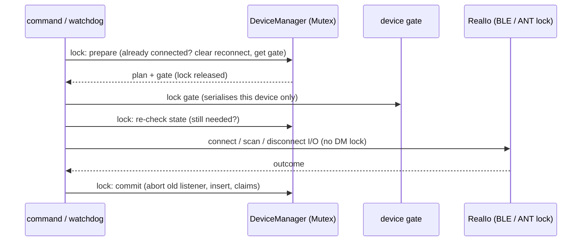

# Device layer (BLE / ANT+ / trainers) — Design

**Spec:** ./spec.md   **Last updated:** 2026-10-18 (rev 2, after design review 1)   **Status:** Draft (rev 3: NB1–NB3 + rulings folded in at build start)

> **Rev 2 changes (review 1).**
> - Lost-teardown and manual-connect-to-Reconnecting rules (ADR-2a/2b).
> - Single-lock `PrimaryState` with an atomic claim (ADR-3a).
> - Ranked, fresh fallback sources (ADR-3b).
> - Exclusion-list reset on scan-channel release (ADR-4).
> - Lock rules for the watchdog / `AntSlot` (ADR-1a).
> - Scan-merge precedence (ADR-1).
> - Cancellable connects and spawned, bounded reconnects (ADR-1b).
> - 10-minute give-up for ANT (ADR-2c).
> - FE-C retry skipped when the trainer is stale (ADR-5).
> - High-priority search 0 from the start (ADR-2).
> - Zero cadence/speed after 3 s without a new event (ADR-6).
> - No real-clock waits over 50 ms in tests (Testing rules).

## Overview

Two kinds of work:

1. **Protocol fixes.** These are pure functions with byte-level tests against cited spec tables: C1, C5, C9, C10, C11, C12, C13 (decode part), C14, C15, C16. Each one is small and low risk.
2. **Lifecycle and concurrency fixes.** These cover C2, C3, C4, C6, C7, C8 and C17, and they hinge on three structural changes:
   - **I/O seam plus two-phase locking.** `DeviceManager` gets an `Io` type parameter (default `RealIo` = BLE + ANT). Scan, connect, disconnect and reconnect run as *prepare (lock) → I/O (no lock) → commit (lock)*, driven by associated functions on the shared `Arc<Mutex<DeviceManager>>`. A per-device "gate" mutex serialises operations on one device. Trainer commands are never queued behind a 4 s scan. A fake `Io` makes connect-twice, stale, reconnect and lock-scope behaviour testable without hardware.
   - **Persistent ANT+ channels.** Connected ANT+ slave channels open with *high-priority search disabled and low-priority search infinite*. A device that drops out is re-acquired by the radio on the same channel, so there is no close/reopen, no duplicate channel and no duplicated readings. The watchdog only flips the status Connected ⇄ Reconnecting from the last-data timestamp. Connect reports Connected only after the first data page arrives.
   - **Primaries keyed by metric** (Power, HeartRate, Cadence, Speed, Trainer) instead of `DeviceType`. A device claims a metric on its first reading of that metric (lazy claim) if no primary exists. Non-claimable sources fall back by rank (pod > power meter > trainer) among fresh sources. The `set_primary_device` / `get_primary_devices` command contract stays backward compatible.

Note on the spec: primaries are **not persisted today**. They live only in memory (`Arc<RwLock<HashMap<DeviceType,String>>>`) and are re-derived on every connect. No stored primaries need migrating. Backward compatibility means the Tauri command contract plus the `known_devices.device_type` strings, which are unchanged. See ADR-3.

## Architecture

Components touched. All are under `src-tauri/src/device/` unless noted.

| Component | Change |
|---|---|
| `manager.rs` | Generic `DeviceManager<Io: DeviceIo = RealIo>`. Holds bookkeeping only: connected map, listener handles, trainer backends, reconnect targets, per-device gates, capabilities, primaries, storage. New associated fns `scan_shared`, `connect_shared`, `disconnect_shared`, `watchdog_tick` take `&Arc<Mutex<Self>>`. The existing sync getters and trainer command methods stay `&mut self`, which keeps the Area B call sites unchanged. |
| `io.rs` (new) | `trait DeviceIo` and `RealIo`, which owns `BleManager` (lazy init via `tokio::sync::OnceCell`) and `Arc<std::sync::Mutex<AntSlot>>`. A test-only `FakeIo` records an ordered event log. |
| `ant/manager.rs` | Dynamic scan-channel allocation. Multi-device scan via exclusion lists. Connect waits for the first page. Connect is idempotent. Unsolicited channel close is detected. Combined S&C profile. |
| `ant/channel.rs` | Search timeouts. `send_acknowledged_and_wait`. Channel-filtered drains. New message/event constants in `ant/usb.rs`. |
| `ant/listener.rs` | HR and legacy S&C background pages, with the toggle bit gate. Lazy primary claim. Combined S&C decode. Closed flag on exit. |
| `ant/protocol.rs` | 0xFFF power invalid. Power page 0x10 cadence. Combined S&C decoder. Background page decoders. |
| `fec.rs` | Page 0x33 layout. Page 0x32. Rounding. Ack wait plus one retry, using a per-channel send mutex. |
| `ftms.rs` | Grade rounding. Supported Resistance Level Range parse and scale. |
| `protocol.rs`, `listener.rs` (BLE) | `CscState` with initialised flags. CPS decoder becomes stateful (`CpsState`) with field walking and crank cadence. Unknown balance reference → `None`. Lazy primary claim. |
| `ble.rs` | Disconnect-on-error after `connect()`. `BleManager: Clone`, which is cheap because its fields are an `Adapter` plus `Arc`s. Read 0x2AD6 for trainers. |
| `types.rs` | `Metric`, `SourceClass`, `PrimaryState` (one lock: primaries + caps + freshness), `admit_reading()` replacing `is_dominated()`. |
| `dedup.rs` | Whole-token match. |
| **Outside `device/`** (minimal, unavoidable) | `lib.rs` watchdog becomes a single `DeviceManager::watchdog_tick(&dm, &tx)` call plus the existing emits. `commands.rs`: `scan_devices`, `connect_device` and `disconnect_device` call the `*_shared` fns; `set_primary_device` / `get_primary_devices` map through `PrimaryKey`. The `AppState.primary_devices` type changes. |

Existing patterns followed: blocking ANT work in `spawn_blocking`; lock-free `AtomicI64` last-seen; the router thread dispatching per-channel `mpsc`; the `ReconnectManager` backoff; inline `#[cfg(test)]` modules; `assert_approx`.



## Data and contracts

**Rust types (`types.rs`)**, rev 2 (ADR-3a/3b)

```rust
pub enum Metric { Power, HeartRate, Cadence, Speed, Trainer }
/// Source rank for a metric. Higher wins among *fresh* sources.
pub enum SourceClass { Dedicated /* claimable for this metric */, PowerMeter, Trainer }
pub struct DeviceCaps { claimable: MetricSet, class_for: fn(Metric) -> SourceClass /* table below */ }
/// ONE lock for primaries + capabilities + freshness, so claim/release are atomic.
pub struct PrimaryState {
    primaries: HashMap<Metric, String>,
    caps: HashMap<String /*device_id*/, DeviceCaps>,          // registered at connect-prepare
    last_reading: HashMap<(Metric, String), Instant>,          // freshness per source
}
pub type SharedPrimaryState = Arc<std::sync::RwLock<PrimaryState>>;
impl SensorReading { pub fn metric(&self) -> Option<Metric> }   // TrainerCommand → None
/// Replaces is_dominated. Takes the write lock once (O(devices), µs) and returns
/// whether to forward. `now` is injected for tests.
pub fn admit_reading(state: &SharedPrimaryState, r: &SensorReading, now: Instant) -> bool
```

`admit_reading` rules, all evaluated under one write lock:

1. An empty `device_id` (`TrainerCommand`) → forward.
2. A device with no `caps` entry (never registered, or already disconnected) → **drop**. Its listener is being torn down.
3. Record `last_reading[(m, d)] = now`.
4. If `m ∈ caps[d].claimable` and there is no primary for `m` → insert `primaries[m] = d`. This is a check-and-insert under the same lock and is conditioned on step 2.
5. Forward iff `d` is the *best fresh source* for `m`. Fresh means `now − last_reading ≤ SOURCE_FRESH = 5 s`.
   - Rank (rev 3 ruling): the primary for `m` (4) > other `Dedicated` sources (3, e.g. a second cadence pod) > `PowerMeter` (2) > `Trainer` (1).
   - While the primary is fresh it is the unique best, so a second pod is not forwarded. While the primary is stale, a fresh second pod outranks power-meter and trainer cadence.
   - Ties at the same rank (two power meters' cadence, with no primary) go to the lexicographically smallest `device_id`, so streams never interleave.
   - If the primary is stale (> 5 s), the next-ranked fresh source flows. When the primary resumes it outranks the fallback again.

- `DeviceType` stays as it is. `CadenceSpeed` is still the stored and displayed type, so `known_devices` rows and the TS `DeviceInfo.device_type` union are untouched.
- Capability table:

  | Device | Claimable metrics |
  |---|---|
  | HR | {HeartRate} |
  | Power (BLE CPS / ANT 11) | {Power}. Power-meter cadence is *not* claimable, so a dedicated cadence sensor wins. It still flows when no cadence primary exists. |
  | CadenceSpeed | {Cadence, Speed}. Lazy claim means a speed-only pod never claims Cadence. ANT 122 → {Cadence}, 123 → {Speed}, 121 → {Cadence, Speed}. |
  | FitnessTrainer | {Trainer}. Trainer power, cadence, HR and speed are not claimable, which matches today: trainer data flows only when no dedicated sensor is primary for that metric. |

`SourceClass` for the non-claimable metrics:
- Power-meter cadence → `PowerMeter`.
- Trainer power, cadence, speed and HR → `Trainer`.

Resulting cadence precedence (spec-owner ruling): dedicated or combo pod > power meter > trainer. Only the best *fresh* source is forwarded.

**Tauri commands (backward compatible)**

- `set_primary_device(device_type: PrimaryKey, device_id)`. `PrimaryKey` deserialises from the legacy strings `"HeartRate" | "Power" | "CadenceSpeed" | "FitnessTrainer"` and the new `"Cadence" | "Speed"`.
  - Legacy `"CadenceSpeed"` sets the primary for every metric in `capabilities(device_id) ∩ {Cadence, Speed}`. If capabilities are unknown, for example the device is not connected, it sets both.
  - `"FitnessTrainer"` → `Metric::Trainer`.
- `get_primary_devices() -> Record<string,string>` returns the legacy keys plus the new keys:
  - `HeartRate`, `Power`, `FitnessTrainer` as today.
  - `CadenceSpeed` = Cadence primary, falling back to Speed primary.
  - `Cadence`, `Speed`.
  - The existing Devices page `primaryDevices[device.device_type]` keeps working. Extra keys are ignored.
- **Cross-area (D):** to show "primary" correctly for two separate speed/cadence pods, the Devices page should look up `Cadence` / `Speed` for `CadenceSpeed` devices. That is optional; there is no breakage without it.

**Events (unchanged names and payloads):** `device_disconnected(id)`, `device_reconnecting{device_id, device_type, attempt}`, `device_reconnected(id)`, `device_list_updated(DeviceInfo[])`.
- An ANT+ device whose data goes stale emits `device_disconnected` once, then `device_reconnecting` on each watchdog tick while stale, then `device_reconnected` when pages resume.
- While stale it stays in `connected_devices` with `status: Reconnecting`, a value the TS union already includes.

**`DeviceIo` trait (`io.rs`), using return-position `impl Future` (stable since 1.75; MSRV 1.77.2)**

```rust
pub trait DeviceIo: Send + Sync + 'static {
    fn scan(&self) -> impl Future<Output = ScanOutcome> + Send;                 // BLE+ANT concurrently
    fn connect(&self, id: &str, ctx: ListenerCtx) -> impl Future<Output = Result<Connected, AppError>> + Send;
    fn disconnect(&self, id: &str) -> impl Future<Output = Result<(), AppError>> + Send;
    fn probe(&self, ids: Vec<String>) -> impl Future<Output = Vec<(String, LinkState)>> + Send; // BLE is_connected, ANT last_seen/closed
    /// ANT only: wait (async, polling the last_seen Arc, no AntSlot lock) for a page newer than `since`.
    fn await_data(&self, id: &str, since: Instant, timeout: Duration) -> impl Future<Output = bool> + Send;
    fn ant_metadata(&self) -> Option<Arc<StdMutex<HashMap<String, AntDeviceMetadata>>>>;
}
// connect() also receives a `CancelToken` (Arc<AtomicBool> + tokio::sync::Notify; no new crate).
// Async waits select! on it; blocking ANT loops check the flag every ≤ 50 ms. A cancelled connect
// undoes its own partial work (BLE peripheral.disconnect / ANT close_channel) before returning Err(Cancelled).
pub struct ListenerCtx { tx: broadcast::Sender<SensorReading>, primary_state: SharedPrimaryState }
/// RealIo keeps per-ANT-device link handles OUTSIDE the AntSlot lock (ADR-1a).
struct AntLinks(Arc<StdMutex<HashMap<String, AntLink>>>); // held only for map get/insert, never across I/O
struct AntLink { last_seen: Arc<AtomicI64>, closed: Arc<AtomicBool>, stale_since: Option<Instant> }
pub struct Connected { info: DeviceInfo, listener: Option<JoinHandle<()>>, trainer: Option<TrainerBackend>, caps: MetricSet }
pub enum LinkState { Alive, Stale /* ANT: no page > DEVICE_DISCONNECT_TIMEOUT_SECS, channel still searching */,
                     Lost /* BLE disconnected, or ANT channel closed */ }
```

`TrainerBackend` gains `#[cfg(test)] Fake(Arc<FakeTrainer>)`. `Fec { usb, channel, queue, send_lock: Arc<std::sync::Mutex<()>>, last_cw_raw: Option<u8> }`.

## Decisions

### ADR-1: Lock scope — two-phase prepare/IO/commit with a per-device gate
- **Context.** The scan (BLE 3 s sleep + ANT 4 s), the connect (`find_peripheral` up to 4 s scan + connect; ANT scan-before-connect) and the watchdog reconnect all run while holding `Arc<tokio::Mutex<DeviceManager>>`. Zone control's `command_trainer` (Area B, including SAFETY_POWER) waits behind them.
- **Options.**
  - **A. Per-transport locks.** Split `DeviceManager` into `Arc` fields each with their own lock, and change `AppState` to hold the pieces. This ripples into `zone_control/controller.rs` (Area B) and every command.
  - **B. Two-phase prepare/IO/commit.** Keep `Arc<Mutex<DeviceManager>>`. I/O runs on cloned `Arc<Io>` handles outside the lock. Correctness under interleaving comes from a per-device gate and a re-check at commit.
  - **C. Narrowest fix.** Drop the lock only around the BLE `sleep` in `scan_all` and in `find_peripheral`. This leaves the ANT scan, the ANT connect and the reconnects holding the lock.
- **Decision: B.** The BLE and ANT transports are internally synchronised: `BleManager` already uses inner `tokio::Mutex` maps, and ANT goes behind `Arc<std::sync::Mutex<AntSlot>>` with blocking work in `spawn_blocking`. That is "per-transport locks" *inside* `RealIo`, invisible to callers.
- **Why.** No `AppState` type change. Area B's `connected_trainer_id()` / `set_target_power()` call sites are untouched. AC8 becomes testable with `FakeIo` sleeping 4 s under `tokio::time::pause`. C fails AC8 for ANT and reconnect.
- **Interleaving rules:**
  1. `connect_shared(id, origin)`:
     - lock → if `connected[id].status == Connected` → return `Ok(info)`, a no-op (AC6).
     - If `origin == Manual`, `reconnect.remove(id)`.
     - Clone the gate `Arc` → unlock → lock the gate → lock DM and re-check: still not connected; for `AutoReconnect`, the target still registered. Otherwise return `Ok(existing)`, or `Skipped` for auto.
     - Unlock → `io.connect` → lock → commit. Commit aborts any existing listener handle for `id` before inserting the new one (AC6 defence in depth), inserts the trainer backend, and records caps.
  2. `disconnect_shared`:
     - Takes the gate.
     - Under the lock: removes bookkeeping, aborts the listener, clears primaries for `id`, removes the reconnect target.
     - Then `io.disconnect` without the DM lock.
  3. `scan_shared`: no gate (it touches no device). `io.scan()` runs unlocked. The merge with `connected_devices` and the storage persist happen under the lock, which is DB-fast. ANT scan and ANT connect serialise on the ANT slot lock, not on the DM lock.
     - **Merge precedence (rev 2, ruling 7).** For any id that has a live record (`Connecting` from `in_flight`, `Connected` or `Reconnecting` in `connected_devices`), the live record wins over the scan result. Only `in_range` and `rssi` come from the scan.
     - The scan result can never downgrade a live status to `Disconnected`.
     - The scan also never inserts into `connected_devices`.
  4. `watchdog_tick`:
     - Lock → snapshot ids → unlock.
     - `io.probe` (BLE `is_connected` is async D-Bus).
     - Lock → apply transitions → unlock.
     - Rev 2: Lost teardowns and due reconnects are **spawned** (ADR-1b), never awaited inline. The tick itself only does the snapshot, the probe and the transitions, and returns its report.
- **ADR-1a (rev 2, ruling 6): lock discipline.**
  - The ANT probe reads `AntLinks`: `Arc<AtomicI64>` last-seen and `Arc<AtomicBool>` closed. These are cloned at connect and stored outside `AntSlot`. The probe never touches the `AntSlot` mutex.
  - **Rule:** a `std::sync` lock is acquired on an async worker thread only for O(1)/O(n) in-memory map work: `AntLinks`, `PrimaryState`, the BLE metadata map. Any work that can block (USB I/O, `AntSlot`, sleeps, response polling) runs inside `spawn_blocking`.
  - `RealIo::disconnect` / `connect` / `scan` for ANT are `spawn_blocking(move || slot.lock()…)`.
  - Lock order:
    - DM (tokio) is never held while awaiting a gate or transport I/O. It is never held while awaiting `spawn_blocking`, **except trainer commands, whose blocking task never touches `AntSlot` or the DM lock** (rev 3 wording).
    - `PrimaryState` is a leaf: no other lock is taken while it is held.
    - `AntLinks` is a leaf.
    - `AntSlot` is taken only on blocking threads.
- **ADR-1b (rev 2): cancellation and spawned reconnects.**
  - `in_flight: HashMap<id, CancelToken>` in DM. **Rev 3 (NB2):** `connect_shared` registers its token and the device caps in the **post-gate re-check**, not in prepare, so only the gate holder owns them. It removes them at commit or failure only if `in_flight[id]` is still *its own* token (compared with `Arc::ptr_eq`), so a losing attempt can never remove the winner's token or caps.
  - `disconnect_shared`, under the DM lock, then:
    1. Cancels the in-flight token, if any.
    2. Removes the reconnect target.
    3. Removes caps and then primaries (ADR-3a).
    4. Releases the lock and takes the gate. The cancelled connect releases the gate within ≤ 50 ms of cancel plus its own undo, with no waiting for a 5 s first-page or 4 s BLE find.
    5. Tears down whatever was committed.
  - The cancelled connect's commit is skipped because the token is cancelled, and it undoes its partial I/O itself.
  - **Rev 3 (NB3):** if the cancel is observed at commit *after* `io.connect` succeeded, the connect aborts the returned listener and calls `io.disconnect(id)` **before releasing the gate**, then returns `Err(Cancelled)`. `cancelled_connect_does_not_commit_listener` asserts `Disconnect(id)` in FakeIo's event log after `Connect(id)`.
  - Reconnects: `watchdog_tick` spawns each due attempt as a task, bounded by a `Semaphore(RECONNECT_CONCURRENCY = 2)`.
    - The attempt uses `gate.try_lock_owned()`. If the device is busy (manual op or previous attempt still running), it is skipped this round and the backoff is not bumped.
    - A slow attempt therefore never delays the next tick's stale detection.
    - `report.reconnected` events are emitted by the spawned task via a callback/`mpsc` the watchdog loop in `lib.rs` drains each tick. The event payloads are unchanged.
- **Not addressed (record for B).** Trainer commands themselves still hold the DM lock across their own I/O: FTMS indication wait ≤ 2 s; FE-C ack ≤ 600 ms when the trainer is stale (no retry), ≈ 1.2 s otherwise (ADR-5). A slow trainer command blocks another trainer command. That is acceptable for now. A future `trainer_handle()` returning a cloneable backend would remove it, but that needs Area B call-site changes.
- **Reversibility: easy.** Internal API. Call sites outside `device/` change by one line each.

### ADR-2: ANT+ channel lifecycle — persistent channel with infinite low-priority search; Connected only after first page
- **Context (C2).** Today:
  - The watchdog marks stale but never closes the old channel.
  - Reconnect opens a *second* channel to the same device, which returns "success" immediately with `last_seen = 0`, so the watchdog never re-flags it.
  - The 30 s high-priority search timeout (`0x44 = 12`) silently closes the channel.
  - If the device returns, both channels deliver, so readings are duplicated.
- **Facts.** ANT Message Protocol & Usage D00000652 Rev 5.1:
  - §9.5.2.5: 0x44 is the high-priority timeout in 2.5 s units; 0 = disable HP search; 255 = infinite.
  - §9.5.2.15: 0x63 is the low-priority timeout in 2.5 s units, default 2; 255 = infinite. "A low priority search will not interrupt other open channels".
  - §9.5.6.1: after missed messages the channel drops to search (`EVENT_RX_FAIL_GO_TO_SEARCH` 0x08). When the search times out it is automatically closed (`EVENT_RX_SEARCH_TIMEOUT` 0x01). An explicit 0x07 may or may not follow.
  - §5.2.1.4.2: use low priority when other channels are open.
  - §9.4: the LP timeout is supported on nRF24AP2-USB / ANTUSB-m, i.e. both supported sticks.
- **Options.**
  - **A. Close and reopen.** On stale: close the channel, stop the listener, unregister, then reconnect via `ReconnectManager` with a new channel; reopen on `EVENT_CHANNEL_CLOSED`.
  - **B. Persistent channel.** Configure LP = 0xFF and HP = 0 on *connection* channels. The radio re-acquires indefinitely in the background; the listener and channel stay; the watchdog maps last-seen to Connected/Reconnecting.
  - **C.** B, but with HP infinite. Rejected: HP search interrupts other channels (§9.5.2.15), so it would drop HR/power pages while the trainer is missing.
- **Decision: B, with A as the fallback path.**
  - On `LinkState::Lost`, the channel actually closed: an `EVENT_RX_SEARCH_TIMEOUT`/`EVENT_CHANNEL_CLOSED` channel event for a connection channel we did not close ourselves, or the router exited. In that case the manager runs the full teardown *before* registering for reconnect: `io.disconnect` → listener stop flag, sender removed, `close_channel` tolerant of an already-closed channel, `last_seen` entry removed. Reconnect goes through `ReconnectManager` as for BLE.
  - The ordering is asserted with `FakeIo`'s event log.
  - **Connected only after first page.** `AntManager::connect` opens the channel, then blocks (inside `spawn_blocking`, under the ANT slot lock, not the DM lock) for up to `ANT_FIRST_PAGE_TIMEOUT = 5 s` for the first page on the channel's mpsc receiver. The page is forwarded to the listener, so it is not lost.
    - Implementation: the listener is spawned with a `first_page: oneshot`-like signal; simplest is `wait_first_page(&rx, timeout) -> Option<Vec<u8>>` *before* spawning the listener, then the page is handed to `listen_ant_channel` as `initial: Option<[u8;8]>`.
    - On timeout the channel is closed and `Err(AntError::Channel("no data from device"))` is returned. `last_seen` is set from the first page, so the watchdog can flag it later.
  - A device that never returns stays `Reconnecting` until the 10-minute give-up (ADR-2c), then becomes `Disconnected`. It is never shown as Connected and never silently becomes "Connected with no data".
  - The first-page wait loop checks the cancel token every ≤ 50 ms (ADR-1b).
  - `device_reconnecting.attempt` counts watchdog ticks while stale.
  - Primary claims for a stale device are released. A backup device can then take over via lazy claim, and the returning device re-claims only if the slot is free. This is the same semantics as today's `remove_primary`/`auto_set_primary`.
  - The **scan** wildcard channels keep a finite search: LP default, HP 0x44 = 2 (5 s). Their window is 4 s anyway.
- **Why.** No duplicate channels by construction. No reconnect churn on a USB stick with 8 channels. Re-acquisition latency is that of LP search. It fixes "dead after 30 s".
- **Risk.** Acquisition speed with HP disabled is unproven on hardware.
  - **Rev 2 (ruling):** connection channels use `HP = 0, LP = 0xFF` *from the start*.
  - A fast-acquire variant (`HP = 2` during the initial connect, then `0x44 = 0` after the first page) exists only behind `const ANT_FAST_ACQUIRE: bool = false`.
- **ADR-2a (rev 2, ruling 1): Lost teardown.**
  - On `LinkState::Lost`, the tick registers the reconnect target and marks the status `Reconnecting`, both under the DM lock. It then spawns the teardown task:
    1. Take the per-device gate.
    2. Re-check under the DM lock that the device is still in the same Lost episode. The record has an `episode: u64` counter, bumped on every connect commit and disconnect. If a manual disconnect or connect happened in between, the teardown is a no-op.
    3. Remove the listener handle and backend.
    4. Release the lock.
    5. `io.disconnect(id)`. ANT runs in `spawn_blocking`: stop flag, remove sender, `close_channel` tolerant of "already closed", remove the `AntLinks` entry.
  - The reconnect target is **kept**. Reconnect attempts need the same gate, so teardown always completes before any reopen.
  - **Rev 3 (NB1): the gate holder performs a pending teardown itself.**
    - Marking a record Lost sets `teardown_pending = true` on it.
    - Every path that wins the gate — the spawned teardown, `connect_shared`'s post-gate re-check (manual or reconnect) and `disconnect_shared` — first checks the flag. If it is set, the holder runs the teardown (`io.disconnect`, bookkeeping removal) and clears the flag before doing anything else.
    - A spawned teardown that later finds the flag cleared is a no-op.
    - `AntManager::connect`'s already-connected guard returns the existing record only if its `closed` flag is false. Otherwise it tears down the stale `ActiveConnection` and opens a fresh channel.
    - Test: `connect_wins_gate_before_spawned_teardown_reopens_cleanly` (FakeIo log: `Disconnect` before the second `Connect`, final state Connected on a fresh channel, one listener).
  - Concurrent manual disconnect: whoever takes the gate first acts. The other sees the episode change and does nothing. Manual disconnect also removes the target, so no reconnect follows.
- **ADR-2b (rev 2, ruling 2): manual connect to a `Reconnecting` ANT device whose channel is still alive** (Stale, not Lost).
  - Never open a second channel. `connect_shared` sees the record, takes the gate and calls `io.await_data(id, since = now, 5 s)`.
  - This polls the `last_seen` Arc asynchronously every 50 ms and selects on the cancel token. It holds no `AntSlot`.
  - Data received → status `Connected`, `device_reconnected` emitted, return `Ok(info{Connected})`.
  - Timeout → return `Ok(info{Reconnecting})`. It is not an error and never reports Connected.
  - `AntManager::connect` also has a defensive guard: if the id is already in `connected`, it returns the existing info without allocating a channel.
- **ADR-2c (rev 2): give-up.**
  - `AntLink.stale_since` is set on the Stale transition. If it exceeds `ANT_GIVE_UP = 10 min` (an injected clock in tests), the device goes through the ADR-2a teardown **without** registering a reconnect target.
  - Status → `Disconnected` (removed from `connected_devices`), and `device_disconnected` is emitted again so the frontend clears its "reconnecting" badge. The channel is freed.
  - The device stays in `known_devices`, so a manual connect opens a fresh channel.
- **Reversibility: easy.** These are constants and an internal state machine.

### ADR-3: Primaries keyed by metric, lazy claim, legacy command shape preserved
- **Context (C3).** Two `CadenceSpeed` pods: the first claims `CadenceSpeed`; every Cadence *and* Speed reading from the second is dominated.
- **Options.**
  - **A. Key by metric with lazy claim** (as in Data and contracts).
  - **B. Key by `(DeviceType, sub-type)`.** Split `CadenceSpeed` into `Cadence` and `Speed` device types. That changes the `known_devices` strings, the TS union and the dedup type-matching; one-way for stored rows.
  - **C. Keep `DeviceType` keys** but let each CadenceSpeed device claim based on the CSC Feature char (0x2A5C) or the ANT device type. This still breaks for a combo sensor plus a separate pod.
- **Decision: A.**
- **Why.** The de-duplication question is inherently per metric: trainer power vs power meter, trainer HR vs strap, power-meter cadence vs pod. Lazy claim needs no extra GATT reads, because a device claims only what it actually emits. CSC Feature (CSCS v1.0 §3.2, mandatory) is not needed.
- **Persistence.** Nothing is persisted today (verified: no `primary` in migrations or storage; `commands.rs` writes only the in-memory map). Keep in-memory. Persisting primaries is out of scope; it is noted for Area E if wanted.
- **ADR-3a (rev 2, ruling 3): atomic claim and ordered release.**
  - Primaries, capabilities and freshness live in **one** `RwLock<PrimaryState>`.
  - Caps are registered in the post-gate re-check (rev 3, NB2), before `io.connect` spawns any listener. They are removed if the connect fails or is cancelled, but only by the attempt that owns the current `in_flight` token.
  - **Rev 3 ruling: the trainer primary is claimed at connect commit.** `primaries[Trainer] = id` with or-insert, matching today's `get_primary_devices().FitnessTrainer`. Every other metric is claimed lazily.
  - Disconnect and teardown, in one write-lock section: remove `caps[d]` **first**, then every `primaries[m] == d`, then `last_reading[(·, d)]`.
  - A claim is the check-and-insert in `admit_reading` step 4, conditioned on `caps[d]` existing (step 2), all under the same write lock.
  - An in-flight reading after disconnect therefore finds no caps → dropped, no claim.
  - Stale-release (ADR-2) removes only the primaries (caps stay), so the returning device can re-claim a free slot.
- **ADR-3b (rev 2, ruling 5): ranked fallback.** The ranking and freshness rules are in Data and contracts (`admit_reading` step 5). `SOURCE_FRESH = 5 s`.
  - Because a single best source is chosen per reading under the lock, two sources of one metric never interleave.
  - Cost: one write lock per reading, roughly 4–8 Hz per device. That is negligible.
- **Behaviour change (intended).** Primary is set on the device's first reading rather than at connect. Between connect and the first reading, `get_primary_devices` may not list it. The Devices page reloads primaries on mount, which is acceptable.
- **Reversibility: easy.** In-memory only; the command shape is a superset of today's.

### ADR-4: ANT+ scan — dynamic scan channels and exclusion lists for multiple devices per profile (C12, C17)
- **Context.**
  - Scan channels are reserved as `0..ALL_SCAN_PROFILES.len()` permanently. Adding combo S&C (6 profiles) would leave 2 connection channels out of 8.
  - Each wildcard channel locks onto the first master and never sees a second one (C17).
- **Facts.** D00000652 Rev 5.1:
  - §9.5.2.10 Add Channel ID to List (0x59): `[ch, dev_lo, dev_hi, dev_type, trans_type, index 0..3]`.
  - §9.5.2.12 Config ID List (0x5A): `[ch, size 0..4, exclude=1]`; max 4 per channel; slave only.
  - §5.7 / §9.5.4.5 continuous scan mode (0x5B) requires all other channels closed. That makes it unusable while sensors are connected.
- **Options.**
  - **A. Close and re-open with an exclusion list.** On a Channel ID response, close that profile's wildcard channel, add the found IDs (up to 4) to its exclusion list, and re-open it for the rest of the 4 s window.
  - **B. Continuous scan.** Only works with nothing connected.
  - **C. Background-scan channel type.** One per device; still one master at a time.
- **Decision: A.** Scan channels are allocated dynamically from channels not used by connections. Scan and connect are serialised by the ANT slot lock, so connections can use all 8 channels.
  - If free channels < profiles, profiles are scanned in batches of `free` channels, 4 s each. That is rare: it needs ≥ 3 ANT connections.
  - Up to 5 devices per profile per scan: 1 locked plus 4 excluded, after which the channel stays closed.
  - **Rev 2 (ruling 4): channel release sequence.** Every scan channel is released with:
    1. `0x4C Close` → wait for `EVENT_CHANNEL_CLOSED`.
    2. **`0x5A Config ID List [ch, 0, 0]`** (size 0 = list disabled; D00000652 §9.5.2.12) → wait for the response. The channel must still be assigned at this point.
    3. `0x41 Unassign` → wait for the response.
  - Only then is the channel number returned to the free pool. A later connection on that number can never inherit an exclusion list.
  - `open_channel` also sends `0x5A [ch, 0, 0]` defensively on any channel it assigns, so a crash mid-scan cannot leak a list.
  - **Testability:** the channel functions take `&dyn AntTx` (`fn send(&self, &AntMessage) -> Result<()>`), implemented by `AntUsb` and by a test `RecordingStick`. The stick records sends and pushes `RESPONSE_NO_ERROR` / `EVENT_CHANNEL_CLOSED` into the response queue, so command sequences are asserted byte by byte.
  - The startup "cleanup" closes only non-connection channels. The `response_queue.clear()` becomes a per-channel drain, so it can no longer eat a concurrent FE-C TX event.
- **Reversibility: easy.**

### ADR-5: FE-C acknowledged sends — bounded wait, one retry, serialised per channel (C6)
- **Facts.** D00000652 Rev 5.1 §9.5.5.2: a slave ack is sent right after the next master message.
  - The outcome is `EVENT_TRANSFER_TX_COMPLETED` (0x05) or `EVENT_TRANSFER_TX_FAILED` (0x06). There is no automatic resend. If the channel drops to search, `EVENT_RX_FAIL_GO_TO_SEARCH` (0x08) arrives instead.
  - A second ack while one is in flight gets response `TRANSFER_IN_PROGRESS` (0x1F).
  - FE-C channel period 8192 → 4 Hz → ≤ 250 ms per attempt nominally.
- **Options.**
  - A. Fire and forget (today).
  - B. Wait on the shared `response_queue` for the channel-scoped event, with a timeout and one retry.
  - C. A dedicated per-channel event mpsc from the router.
- **Decision: B.** Implementation:
  - `send_acknowledged_and_wait(tx: &dyn Fn(&AntMessage)->Result<()>, queue, ch, page, per_attempt = 600 ms) -> Result<(), AppError>`.
  - Before sending, it purges stale TX events for `ch`.
  - It succeeds on 0x05. It fails the attempt on 0x06, 0x08, response 0x1F, or the timeout. It retries once, then returns `AntError::Channel("FE-C ack failed: …")`.
  - It runs inside the existing `spawn_blocking`.
  - **Rev 2: starvation guard.** The FE-C backend holds the trainer's `last_seen` Arc. If the first attempt fails and the trainer's last page is older than `FEC_RETRY_FRESH = 3 s`, the retry is **skipped** and the error is returned immediately (the trainer is gone; a retry would only burn 600 ms). Area B serialises controller commands with 3 s timeouts.
  - A per-backend `send_lock` serialises sends so `TRANSFER_IN_PROGRESS` cannot arise from our own concurrency.
  - The worst case is 1.2 s, which satisfies "≤ 1 s wait" per attempt.
- **Why not C.** It changes router fan-out for a small gain. B's queue is already channel-filtered everywhere after ADR-4.
- **Reversibility: easy.**

### ADR-6: CPS cadence and field walking (C11); CSC and CPS share a crank-delta helper (C9)
- **Facts.**
  - CPS v1.1 §3.2.1.1 / GSS §3.75 field order after flags (uint16): Instantaneous Power sint16 (2); then, each present only if its flag is set:
    - bit 0 → Pedal Power Balance uint8 (1)
    - bit 2 → Accumulated Torque uint16 (2)
    - bit 4 → Wheel Rev Data uint32 + uint16 at 1/2048 s (6)
    - bit 5 → Crank Rev Data uint16 + uint16 at 1/1024 s (4)
    - and so on.
  - Crank offset = `4 + (b0?1) + (b2?2) + (b4?6)`.
  - Crank event time rolls over every 64 s (§3.2.1.6).
  - ANT+ Bicycle Power D00001086 Rev 5.0 Table 8-1: page 0x10 byte 3 is instantaneous cadence, 0–254 rpm, 0xFF = invalid.
- **Decision.**
  - `struct CrankState { prev: Option<(u16 revs, u16 time)> }` with `fn update(revs, time) -> Option<f32 rpm>`. The first sample initialises and emits nothing. `time_diff == 0` means no new event, so nothing is emitted. `wrapping_sub` handles rollover. Out-of-range (≥ 200 rpm) emits nothing.
  - `CscState { wheel: Option<(u32,u16)>, crank: CrankState }` (C9). `CpsState { crank: CrankState }`.
  - `decode_cycling_power(&mut CpsState, data, id) -> Vec<SensorReading>` returns Power plus an optional Cadence.
  - Truncated payloads (flag set, bytes missing) skip only that field.
  - **Rev 2: zero on coasting.** `CrankState` and `WheelState` store `last_event_at: Instant` (the notification time at which the revs/time last changed).
    - On a notification with no new event, if `now − last_event_at ≥ ZERO_AFTER = 3 s`, emit `0 rpm` / `0 km/h`. This repeats on every such notification while the sensor keeps notifying.
    - The first new event resumes normal values.
    - `now` is an injected parameter: the decoders take `now: Instant`, and listeners pass `Instant::now()`.
    - The same rule is applied to the ANT+ speed, cadence and combined decoders for consistency. That is a small extension beyond the ruling, flagged for review.
  - ANT page 0x10 cadence ≠ 0xFF → Cadence reading on new event-count samples. It follows the same event-count gating as power. On the first sample both are emitted.
- **Reversibility: easy.**

### ADR-7: FTMS resistance range (C13)
- **Facts.**
  - FTMS v1.0 §4.13 + Table 4.1 C.3: Supported Resistance Level Range (0x2AD6) is mandatory if Resistance Target Setting is supported.
  - The format is **inconsistent across official sources**. The 2017 SIG XML gives `sint16 min, sint16 max, uint16 inc` at 0.1 (6 octets). GSS (2023–2026) §3.231 gives `uint8 ×3` (3 octets) with self-contradictory scaling.
  - The op 0x04 parameter is **SINT16 at 0.1** per Errata Service Release 11, E8991 (the original FTMS 1.0 Table 4.15 said UINT8). The current 3-byte encoding is therefore spec-correct and stays.
  - GoldenCheetah (`BT40Device.cpp`) uses the 6-octet parse and the 3-byte write.
- **Decision.**
  - Read 0x2AD6 once in `TrainerController::new` (now async, run during `io.connect`, outside the DM lock). Parse by length:
    - 6 octets → the 2017 layout, raw in 0.1 units.
    - 3 octets → uint8 levels, treated as whole units, raw = v × 10.
    - Anything else, or a read error → `None`.
  - `encode_resistance(pct, range: Option<Range>)` maps `pct ∈ [0,100]` → `raw = min + round((max-min) × pct/100 / inc) × inc`, clamped to `[min, max]`.
  - `None` → today's `pct × 10`.
  - The 3-octet interpretation is unproven, so hardware validation is listed in Risks.
- **Reversibility: easy.**

### ADR-8: ANT+ background pages (C14) and combo S&C (C12)
- **Facts.**
  - HRM D00000693 Rev 1.13 §5.3: byte 0 bit 7 is the page toggle; bits 0–6 are the page number. Bytes 1–3 must not be interpreted until the toggle has been seen as both 0 and 1.
    - Page 2: byte 1 = manufacturer ID; bytes 2–3 = serial upper 16 bits (the lower 16 = device number).
    - Page 3: byte 1 = HW version; byte 2 = SW version; byte 3 = model.
  - BSC pages 2/3 have the same layout per ANT's official `ant-nrfconnect/sdk-ant` `ant_bsc` encoders (the BSC profile PDF was not obtainable).
  - The combo sensor (type 121, period 8086, RF 57) has no page byte: `[cad_time u16, cad_revs u16, spd_time u16, spd_revs u16]` LE.
- **Decision.**
  - `PageToggleGate` (has-seen-0, has-seen-1) per listener. Once open, pages `data[0] & 0x7F ∈ {2, 3}` are decoded into `AntDeviceMetadata`:
    - `manufacturer_id = data[1] as u16`.
    - `serial_number = (u16(data[2..4]) << 16) | device_number`.
    - `hw_revision`, `sw_revision`, `model_number = data[3] as u16`.
  - Page 7 (HR battery) is decoded only if a spec copy confirms it (openant-only today). It is **not** in scope for AC14.
  - The device number is passed to the listener; it is parsed from `ant:<type>:<n>`.
  - The combo uses a new `PROFILE_SPEED_CADENCE` and `AntDecoder::decode_combined_sc` with independent cadence and speed state.
- **Reversibility: easy.**

### ADR-9: Grade and simulation encoding (C1, C10)
- **Facts.** FE-C D00001231 Rev 5.0:
  - Table 8-42, page 0x33: `[0x33, FF, FF, FF, FF, grade_lo, grade_hi, crr]`. Grade is 0.01 % with offset −200 % (0x4E20 = 0 %). Crr is in 5×10⁻⁵ units, 0xFF = default 0.004.
  - Table 8-38, page 0x32: `[0x32, FF, FF, FF, FF, cw, wind, draft]`. Cw is 0.01 kg/m, range 0–1.86, 0xFF = default 0.51. Wind = km/h + 127, 0xFF = default. Draft is 0.01, 0xFF = default 1.0.
- **Decision.**
  - FE-C:
    - `grade_raw = round((clamp(g, -200, 200) + 200) × 100) as u16`, at most 40000, so it cannot overflow.
    - NaN grade → 0 %.
    - `crr_raw = round(clamp(crr, 0, 0.0127) / 5e-5)`.
  - `set_simulation` sends 0x32 `[0x32, FF×4, cw_raw, 0xFF, 0xFF]` with `cw` clamped 0–1.86 and rounded, *only when `cw_raw` differs from the last successfully sent value*, then sends 0x33. Wind and draft are left at their defaults (no input for them).
  - FTMS 0x11 (FTMS v1.0 Table 4.20): `grade_raw = round(clamp(g, -100, 100) × 100) as i16`; NaN → 0; Crr and Cw rounded.
- **Reversibility: easy.**

### ADR-10: Small decode fixes
- **C5.** FE-C page 0x19: 12-bit power `== 0xFFF` → no Power reading (FE-C Rev 5.0 Table 8-25: "0xFFF = invalid").
- **C15.** CPS: balance-reference bit 1 = 0 (Unknown) → `pedal_balance = None`.
  - CPS v1.1 §3.2.1.3 does not define which side an unknown-reference value describes.
  - Reference = Left → `100 − left%`, as today.
  - Also fix the integer `raw / 2` truncation to `round(raw / 2)`.
- **C16.** `name_number_match`:
  - Split the BLE name on non-alphanumeric chars.
  - Match if any all-digit token parses to the same `u32` as the ANT device number (so leading zeros are tolerated).
  - A token like `4A3B` never matches `4`.
- **C8.** `ble.rs`: wrap everything after `peripheral.connect()` in `async fn finish_connect(&Peripheral, ...) -> Result<DeviceInfo>`. On `Err`, `peripheral.disconnect().await` (failure logged, not swallowed) and the error is returned. The policy lives in a generic `async fn disconnect_on_err<T, F, D>(work: F, cleanup: D)` so it is unit-testable with closures.

## Failure modes

| Failure | Detection | Behavior | Recovery |
|---|---|---|---|
| ANT device out of range | `last_seen` > 10 s | status Reconnecting, `device_disconnected` once, then `device_reconnecting` each tick; primary claims released (caps kept) | Pages resume → Connected, `device_reconnected`; LP search continues up to 10 min |
| ANT device never returns | `stale_since` > 10 min | Teardown (ADR-2a) without reconnect target; status Disconnected; `device_disconnected` re-emitted; channel freed | Manual connect from known devices |
| Manual connect to a Reconnecting ANT device | Live record + link not Lost | Reuse channel; wait 5 s for data → `Connected`, or `Ok(Reconnecting)` | — |
| ANT channel closed unexpectedly | Channel event 0x01/0x07 for a connection channel not being closed by us; or listener rx disconnected | `LinkState::Lost` → spawned teardown under gate (target kept) → `ReconnectManager` | Reconnect opens a fresh channel; Connected only after first page |
| Disconnect during in-flight connect | `in_flight` token present | Token cancelled; connect undoes partial I/O, skips commit; disconnect proceeds under gate within ~50 ms + undo | — |
| Slow reconnect attempt | — | Runs as a spawned task (≤ 2 concurrent; busy gate → skipped this round) | Next tick unaffected |
| Primary device goes quiet (< 10 s, not yet stale) | `last_reading` > 5 s | Next-ranked fresh source (PM → trainer) forwarded | Primary resumes → outranks again |
| Reading arrives after disconnect | No `caps` entry | Dropped, no claim | — |
| FE-C ack fails while trainer stale (> 3 s) | `last_seen` Arc | No retry; immediate `Err` | — |
| ANT stick unplugged / router exits | Router loop exit sets all connection `closed` flags | All ANT devices Lost → reconnect attempts fail (`NoUsbStick`) | Re-plug → `ensure_ant` re-init on next attempt |
| ANT first page never arrives on connect | 5 s timeout | Channel closed, connect returns error | User retries / reconnect backoff |
| FE-C ack fails | TX_FAILED / GO_TO_SEARCH / 600 ms timeout | Retry once; then `Err` to caller (zone control logs/handles) | Next command |
| Blocking ANT task panics | `spawn_blocking` JoinError / poisoned slot | Slot reset to `None`, AntManager dropped (router stopped) | `ensure_ant` re-inits on next use (as today) |
| BLE discovery/classify fails after connect | `Err` from `finish_connect` | Peripheral disconnected, error returned | User retry |
| Concurrent connect of same device | Per-device gate | Second caller waits, then sees Connected → no-op Ok | — |
| Scan finishes while a device is connecting/connected | Live record exists | Live status wins; scan contributes only `in_range`/`rssi` | — |
| 0x2AD6 missing / malformed | Read error or length ∉ {3, 6} | Range `None` → legacy 0–100 % mapping | — |
| Scan while ≥ 3 ANT devices connected | free channels < profiles | Profiles scanned in batches (scan takes longer) | — |

## Migration and rollback

- No schema change. `known_devices.device_type` strings are unchanged. Combo S&C devices are stored as `CadenceSpeed` with id `ant:121:<n>`.
- Primaries are in-memory. Upgrading resets nothing that was persisted, because nothing is.
- Rollback = revert the branch. There is no data migration to undo.
- **One-way decisions: none.**

## Traceability

| AC | Component(s) | Test(s) (planned names) |
|---|---|---|
| AC1 (C1) | `fec.rs` | `fec_track_resistance_zero_grade_layout`, `fec_track_resistance_minus_3_percent`, `fec_track_resistance_plus_5_percent`, `fec_track_resistance_crr_0_004_is_raw_80`, `fec_wind_resistance_page_layout_cw_0_51`, `fec_wind_page_sent_only_when_cw_changes` |
| AC2 (C10) | `fec.rs`, `ftms.rs` | `fec_grade_2_3_rounds_to_raw_20230`, `fec_grade_extremes_do_not_overflow`, `fec_grade_nan_encodes_zero_percent`, `ftms_grade_2_3_rounds_to_230`, `ftms_grade_clamped_to_plus_minus_100` |
| AC3 (C5) | `ant/protocol.rs` | `fec_page_0x19_power_0xfff_yields_no_power_reading`, `fec_page_0x19_power_4094_is_valid` (replaces `..._12bit_mask`, which asserted 4095 W) |
| AC4 (C3) | `types.rs`, `manager.rs`, `commands.rs` | `admit_speed_only_and_cadence_only_pods_both_forwarded`, `admit_second_cadence_device_dominated`, `admit_power_meter_cadence_not_claimable_but_forwarded`, `admit_trainer_power_dominated_by_power_meter_primary`, `primary_key_legacy_cadence_speed_sets_device_capabilities`, `get_primaries_includes_legacy_and_metric_keys` |
| AC5 (C2) | `ant/channel.rs`, `ant/manager.rs`, `manager.rs` | `ant_connection_channel_search_config_bytes` (0x44 = 0, 0x63 = 0xFF), `wait_first_page_times_out_without_data`, `wait_first_page_returns_first_page`, `watchdog_stale_ant_marked_reconnecting_not_connected`, `watchdog_stale_ant_recovers_without_new_channel`, `watchdog_lost_ant_tears_down_before_reconnect` (event-log order), `ant_reconnect_yields_single_listener` |
| AC6 (C4) | `manager.rs` | `connect_twice_spawns_one_listener`, `concurrent_connects_same_device_one_io_connect`, `manual_connect_clears_pending_reconnect`, `commit_aborts_existing_listener_handle` |
| AC7 (C6) | `ant/channel.rs`, `fec.rs` | `ack_wait_succeeds_on_tx_completed`, `ack_wait_retries_once_on_tx_failed_then_succeeds`, `ack_wait_errors_after_two_failures`, `ack_wait_times_out_within_bound`, `ack_wait_ignores_other_channel_events`, `ack_wait_treats_go_to_search_as_failure` |
| AC8 (C7) | `manager.rs` (FakeIo, paused time) | `trainer_command_during_scan_completes_within_500ms`, `trainer_command_during_reconnect_completes_within_500ms` |
| AC9 (C8) | `ble.rs` | `disconnect_on_err_runs_cleanup_on_failure`, `disconnect_on_err_skips_cleanup_on_success`, `disconnect_on_err_returns_original_error_when_cleanup_fails` |
| AC10 (C9) | `protocol.rs` | `csc_first_notification_emits_nothing`, `csc_second_notification_computes_cadence_60rpm`, `csc_new_state_after_reconnect_reinitialises` |
| AC11 (C11) | `protocol.rs`, `ant/protocol.rs` | `cps_crank_only_cadence_90rpm`, `cps_crank_offset_after_balance_torque_wheel`, `cps_crank_event_time_rollover`, `cps_crank_first_sample_initialises`, `cps_truncated_crank_field_still_yields_power`, `ant_power_page_cadence_byte3`, `ant_power_page_cadence_0xff_omitted` |
| AC12 (C12) | `ant/protocol.rs`, `ant/channel.rs` | `combined_sc_first_page_initialises`, `combined_sc_speed_and_cadence_from_one_page`, `combined_sc_counter_rollover`, `profile_speed_cadence_is_type_121_period_8086`, `scan_profiles_include_combined_sc` |
| AC13 (C13) | `ftms.rs` | `resistance_range_parse_6_octet_layout`, `resistance_range_parse_3_octet_layout`, `resistance_range_parse_bad_length_is_none`, `resistance_50pct_scaled_into_range_with_increment`, `resistance_without_range_uses_legacy_mapping` |
| AC14 (C14) | `ant/listener.rs` | `hr_page2_ignored_before_toggle_seen`, `hr_page2_manufacturer_and_serial_with_toggle_bit_set`, `hr_page3_hw_sw_model`, `sc_page2_serial_combines_device_number` |
| AC15 (C15) | `protocol.rs` | `cps_balance_unknown_reference_is_none` (replaces `decode_power_pedal_balance_right_ref`), `cps_balance_left_reference_inverted_rounded` |
| AC16 (C16) | `dedup.rs` | `name_number_requires_whole_token`, `name_number_matches_token_after_separator`, `name_number_leading_zero_token_matches` |
| AC17 (C17) | `ant/channel.rs`, `ant/manager.rs` | `exclusion_list_messages_bytes` (0x59 / 0x5A layout), `scan_channel_allocation_skips_connection_channels`, `scan_profiles_batched_when_channels_scarce` |
| AC18 | all | `cargo test` full suite green; every test above fails on the pre-change code (verified per slice) |
| Rev 2 / ruling 1 (AC5) | `manager.rs` | `lost_teardown_runs_under_gate_and_keeps_reconnect_target`, `lost_teardown_noop_after_concurrent_manual_disconnect`, `lost_teardown_then_manual_connect_opens_single_channel` |
| Rev 2 / ruling 2 (AC5) | `manager.rs`, `io.rs` | `manual_connect_reconnecting_ant_reuses_channel_and_connects_on_data`, `manual_connect_reconnecting_ant_without_data_returns_ok_reconnecting` |
| Rev 2 / ruling 3 (AC4) | `types.rs` | `reading_after_disconnect_cannot_reclaim_primary`, `disconnect_removes_caps_before_primaries` |
| Rev 2 / ruling 4 (AC17) | `ant/channel.rs` | `scan_channel_release_sends_close_reset_list_unassign_in_order`, `open_channel_resets_id_list_after_assign` |
| Rev 2 / ruling 5 (AC4) | `types.rs` | `cadence_pod_outranks_power_meter_outranks_trainer`, `stale_primary_falls_back_to_power_meter_cadence`, `primary_resume_reclaims_forwarding`, `two_power_meters_cadence_never_interleave` |
| Rev 2 / ruling 6 (AC8) | `io.rs`, `manager.rs` | `ant_probe_returns_while_ant_slot_locked`, `watchdog_tick_completes_within_50ms_during_scan` |
| Rev 2 / ruling 7 | `manager.rs` | `scan_merge_keeps_connecting_status`, `scan_merge_keeps_reconnecting_status`, `scan_merge_updates_in_range_only` |
| Rev 2 / cancellation | `manager.rs` | `disconnect_cancels_in_flight_connect_promptly`, `cancelled_connect_does_not_commit_listener` (asserts Disconnect in event log, NB3) |
| Rev 3 / NB1 | `manager.rs` | `connect_wins_gate_before_spawned_teardown_reopens_cleanly` |
| Rev 3 / NB2 | `manager.rs` | `concurrent_connects_disconnect_cancels_owner_attempt`, `losing_attempt_cannot_remove_winner_token_or_caps` |
| Rev 3 / trainer primary | `manager.rs` | `trainer_primary_claimed_at_connect_commit` |
| Rev 3 / ranking | `types.rs` | `stale_primary_second_pod_outranks_power_meter` |
| Rev 2 / spawned reconnects | `manager.rs` | `slow_reconnect_does_not_delay_next_tick`, `reconnects_bounded_to_two_concurrent`, `busy_gate_skips_reconnect_round` |
| Rev 2 / give-up | `manager.rs` | `ant_stale_ten_minutes_gives_up_to_disconnected`, `ant_give_up_frees_channel_and_registers_no_reconnect` |
| Rev 2 / FE-C starvation (AC7) | `ant/channel.rs` | `ack_retry_skipped_when_trainer_stale` |
| Rev 2 / HP search (AC5) | `ant/channel.rs` | `ant_connection_channel_search_config_bytes` (HP 0 from the start) |
| Rev 2 / zero cadence (AC10, AC11) | `protocol.rs`, `ant/protocol.rs` | `csc_zero_cadence_after_3s_without_crank_event`, `csc_zero_speed_after_3s_without_wheel_event`, `cps_zero_cadence_after_3s_without_crank_event`, `cadence_resumes_after_zero_on_new_event` |

## Testing rules (rev 2)

- **No real-clock wait longer than 50 ms in any test.**
- Async code (manager, `io.await_data`, reconnect backoff) uses `#[tokio::test(start_paused = true)]` and `tokio::time::advance`.
- Blocking ANT code (`wait_first_page`, `send_acknowledged_and_wait`, `close_channel`) takes its timeouts as `Duration` parameters. Production uses consts; tests pass ≤ 20 ms.
- Decoders and `admit_reading` take `now: Instant` explicitly.
- Upper-bound latency assertions (for example "probe returns within 50 ms while `AntSlot` is held") are the only real-clock checks. They wrap the call in `timeout(50 ms)`, so a passing run is fast.
- Watchdog give-up uses an injected `now` passed to `watchdog_tick_at(dm, tx, now)`. The production wrapper passes `Instant::now()`.

## Risks and spikes

1. **Riskiest: the ADR-1 refactor.** It introduces generics, re-entrancy and gate-ordering bugs into code that has no hardware tests. Mitigation:
   - Slice 3 lands the seam and two-phase flow first, with `FakeIo` tests for AC6 and AC8, *before* the ANT changes.
   - Lock order is always DM → (released) → gate → DM. The DM lock is never held while awaiting a gate.
   - A debug assertion helper documents this. Spike: write `trainer_command_during_scan_completes_within_500ms` first against current code; it must fail.
2. **ANT LP-only search acquisition latency (ADR-2).** This is unprovable in CI. Constants (`ANT_CONN_HP_TIMEOUT`, `ANT_CONN_LP_TIMEOUT`, `ANT_FIRST_PAGE_TIMEOUT`) are in `config.rs`-style consts in `ant/channel.rs`. Hardware check by the user after merge.
3. **0x2AD6 3-octet scaling ambiguity (ADR-7).** Hardware check; fallback is legacy behaviour.
4. **HR page 7 and BSC background page layouts** come only from implementation sources. Page 7 is excluded; BSC pages 2/3 are cited to ANT's own SDK.
5. **Exclusion-list behaviour on real sticks (ADR-4).** It is spec-supported (§9.4 table); hardware check.

## Implementation plan

Each slice is one commit with its tests (failing first).

1. **FE-C/FTMS grade and track resistance (C1, C10).** Page 0x33 layout, page 0x32 with cw cache (`TrainerBackend::Fec.last_cw_raw`), rounding, NaN, clamps. Update the existing `encode_simulation_*` tests to the spec layout.
2. **FE-C 0xFFF invalid power (C5).** Replace the test that asserted 4095 W.
3. **Spike + seam: `DeviceIo`, `RealIo`, `FakeIo`, two-phase `scan_shared`/`connect_shared`/`disconnect_shared`/`watchdog_tick`, per-device gates, idempotent connect (C7, C4).**
   - Move the BLE/ANT ownership from `DeviceManager` into `RealIo`. The ANT slot becomes `Arc<StdMutex<Option<AntManager>>>` with poison → reset.
   - Update `lib.rs` and `commands.rs` call sites (one line each).
   - Rev 2 additions in this slice:
     - `AntLinks` outside `AntSlot`.
     - `in_flight` cancel tokens.
     - Spawned, bounded reconnects with `try_lock` gates; the `lib.rs` loop drains a report `mpsc`.
     - Scan-merge precedence.
     - The `episode` counter.
   - Tests: AC6, AC8, rulings 6 and 7, cancellation, spawned reconnects.
   - Behaviour is otherwise unchanged; the old ANT reconnect logic is retained for now.
4. **ANT persistent channel lifecycle (C2).**
   - Search timeout messages (HP 0, LP 0xFF from the start; `ANT_FAST_ACQUIRE` const): add `MSG_SET_LP_SEARCH_TIMEOUT = 0x63` and the event constants.
   - `AntTx` trait + `RecordingStick`.
   - `wait_first_page`; listener `initial` page.
   - `closed` flag via router channel events / listener exit; `LinkState` probe.
   - Watchdog Stale/Recovered/Lost transitions.
   - Spawned Lost teardown under the gate (ADR-2a).
   - Manual connect to Reconnecting → `await_data` (ADR-2b).
   - 10-minute give-up (ADR-2c).
   - `AntManager::connect` idempotence guard.
5. **Metric primaries (C3).** `Metric`, `PrimaryState` (single lock), `admit_reading` with ranked/fresh fallback and an injected `now`, caps registered at prepare / removed first at disconnect, lazy claim in the BLE and ANT listeners, `PrimaryKey` commands, release on stale/disconnect. Remove `is_dominated` and migrate its tests to `admit_reading`.
6. **FE-C ack wait (C6).** `send_acknowledged_and_wait` with timeouts passed as parameters, the stale-trainer retry skip, `send_lock`, queue + `last_seen` in the backend, per-channel drains.
7. **BLE connect cleanup (C8).** `disconnect_on_err` + `finish_connect`.
8. **Crank/CSC state (C9, C11).** `CrankState`, `WheelState`, `CscState`, `CpsState`, zero-after-3 s (injected `now`), CPS field walking, ANT page 0x10 cadence.
9. **ANT scan rework (C12, C17).** Dynamic scan channels, batching, exclusion lists with the close → `0x5A` size 0 → unassign release sequence, combo S&C profile and decoder.
10. **Background pages (C14).** `PageToggleGate`, pages 2/3 for HR and legacy S&C; device number passed to the listener.
11. **FTMS resistance range (C13).** Async `TrainerController::new` reads 0x2AD6; range-aware `encode_resistance`.
12. **Small fixes (C15, C16).** Balance unknown → None plus rounding; whole-token dedup.

## Cross-area dependencies

- **B (zone control).** It may add a power clamp near `DeviceManager::set_target_power`. That signature is kept (`&mut self, &str, i16`), so a clamp inside or before it merges cleanly. Area B must not take the DM lock around scans; it does not today. A trainer command can still wait behind *another* trainer command: FE-C ≤ 600 ms when the trainer is stale (retry skipped), ≈ 1.2 s otherwise; FTMS ≤ 2 s (ADR-1 note).
- **D (frontend).** Optional: use the `Cadence`/`Speed` keys from `get_primary_devices` for `CadenceSpeed` devices, and `setPrimaryDevice('Cadence' | 'Speed', id)`. No breaking change. The ANT stale device now appears with `status: 'Reconnecting'` in `device_list_updated` (already in the TS union).
- **A (session metrics).** No contract change. Readings may now include power-meter cadence and both pods' speed and cadence; `SensorReading` variants are unchanged.
- **E (storage/infra).** Nothing required. If primaries should survive restarts, that is a new storage feature (not requested).
- **Files outside `device/` touched:** `src-tauri/src/lib.rs` (watchdog body), `src-tauri/src/commands.rs` (`scan_devices`, `connect_device`, `disconnect_device`, `set_primary_device`, `get_primary_devices`, `AppState.primary_devices` type). Merge-conflict risk with B and E is in `commands.rs`.

## References

- Bluetooth SIG: Cycling Power Service v1.1 §3.2.1; Cycling Speed and Cadence Service v1.0 §3.1–3.2; Fitness Machine Service v1.0 §4.13, §4.16, Tables 4.1/4.15/4.20; Errata Service Release 11 (E8991, E9135); GATT Specification Supplement (2026-09-09) §3.75, §3.70–3.71, §3.231.
- ANT: ANT Message Protocol and Usage D00000652 Rev 5.1 §5.2.1.4.2, §5.3, §5.7, §9.4, §9.5.2.5, §9.5.2.10, §9.5.2.12, §9.5.2.15, §9.5.5.2, §9.5.6.1; ANT+ Fitness Equipment D00001231 Rev 5.0 Tables 8-25, 8-36, 8-37, 8-38, 8-42; ANT+ Bicycle Power D00001086 Rev 5.0 Tables 8-1, 10-1; ANT+ Heart Rate Monitor D00000693 Rev 1.13 §5.3, Tables 6–7; ANT `ant-nrfconnect/sdk-ant` `ant_bsc` (BSC pages, combined-sensor layout). ANT+ profile PDFs are adopter-only; they are cited here, not vendored.
