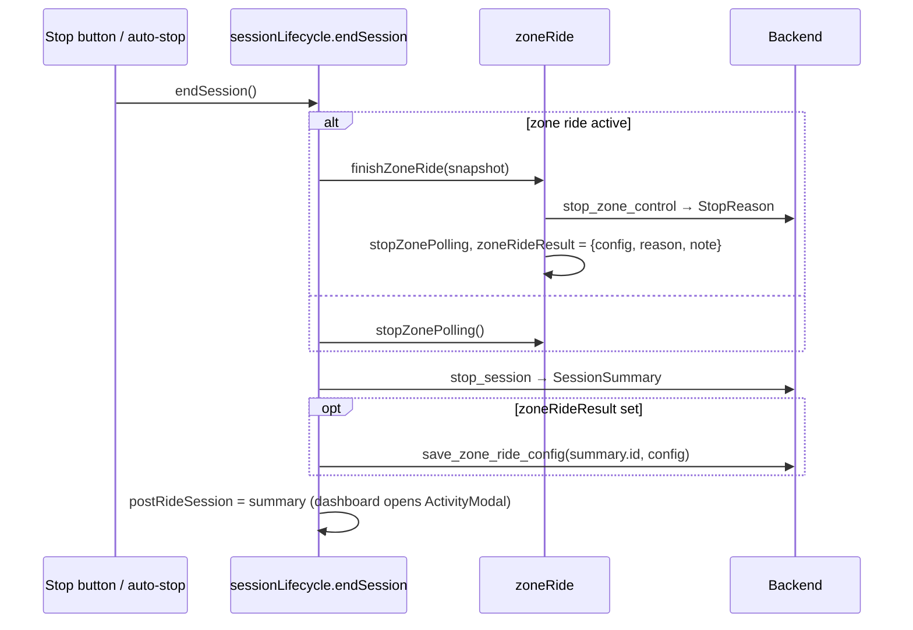

# Frontend correctness — Design
**Spec:** ./spec.md   **Last updated:** 2026-10-18   **Status:** Current

## Overview
Fix the dashboard, zone-ride, trainer, history, analytics and settings defects D1–D16 by moving
logic out of Svelte components into plain TypeScript modules (stores and utils) that vitest can
test. Only two small backend changes are made: a read-only `get_session_status` command, and
full-replace semantics for `update_session_metadata`.

The central change is a new `sessionLifecycle.ts` store module. It owns `endSession()`, the only
way a session ends (Stop button, auto-stop). Zone-ride finalisation (`finishZoneRide()`) lives in
`zoneRide.ts` and runs in three cases: when the backend controller stops itself (an
active→inactive status transition), when the user stops the zone ride, and inside `endSession()`.
Time zones are handled with the native `Date` local getters plus UTC-calendar arithmetic on
`YYYY-MM-DD` keys, with no new dependencies. The live chart samples at 1 Hz from a timer instead
of on every event.

## Architecture
Components touched, and the modules they will delegate to:

| Module (new = ★) | Role |
|---|---|
| ★ `src/lib/stores/sessionLifecycle.ts` | `endSession()`, `rehydrateSession()`, `postRideSession` store, `lifecycleError` store |
| `src/lib/stores/session.ts` | `requestStart` also resets chart history; otherwise unchanged |
| `src/lib/stores/zoneRide.ts` | `resolveZoneBounds` fix; `finishZoneRide()`, `zoneRideResult` store, completion detection inside polling; pure `buildZoneRideConfig`, `completionSnapshot`, `describeZoneStop` |
| `src/lib/stores/autoSession.ts` | pure `isRiderIdle()`; tick uses `sessionPaused` and calls `endSession()` |
| `src/lib/stores/sensor.ts` | 1 Hz sampler timer; per-metric `lastSeenAt`; exported `getSensorSnapshot()` |
| ★ `src/lib/utils/metricHistory.ts` | pure `appendSample`, `buildSample`, `MAX_HISTORY = 600` |
| ★ `src/lib/utils/liveChart.ts` | pure `zoneMarkArea(zoneBand)` (always returns a markArea, empty when no band) |
| `src/lib/utils/analytics.ts` | local-TZ `localDateKey`, `addDaysToKey`, `weekStartKey`, `currentWeekTss`; weighted weekly averages and empty-week fill |
| ★ `src/lib/utils/latestWins.ts` | `createLatestWinsSender()`, a single-flight sender that keeps only the latest pending value (trainer commands) |
| ★ `src/lib/utils/disposeGuard.ts` | `createDisposeGuard()` for async component initialisation (listeners, ECharts, ResizeObserver) |
| ★ `src/lib/utils/zones.ts` | `hrZoneForBpm(bpm, zones)`, using the same `<=` rule as Rust `MetricsCalculator::hr_zone` |
| `src/lib/stores/units.ts` | `convertDisplayedWeight(value, from, to)` |
| `src/lib/stores/devices.ts` | `reconnectDevice(id)`: `api.connectDevice` followed by `handleDeviceReconnected` |
| `src/lib/utils/session.ts` | `displayTitle` treats an empty or whitespace title as no title |
| `src/lib/tauri.ts` | `ActiveSessionStatus` type, `api.getSessionStatus` |
| Components | `+page.svelte` (dashboard), `+layout.svelte`, `MetricsChart`, `TrainerControl`, `ActivityModal`, `HrHistogram`, `PowerGauge`, `PowerCurve`, `ConnectionHealth`, `routes/devices`, `routes/settings`, `routes/analytics`. They become thin wiring around the modules above |
| Backend | `session/manager.rs` (`status()`), `session/types.rs` (`ActiveSessionStatus`), `commands.rs` (`get_session_status`), `lib.rs` (register in both handler lists), `session/storage/sessions.rs` (metadata SQL) |

### Session end flow

Zone self-completion: the 1 s polling callback compares the previous and next `ZoneControlStatus`.
On `prev.active && !next.active` it calls `finishZoneRide(completionSnapshot(prev, next))`. That
call collects the reason with `stop_zone_control`, stops polling and sets `zoneRideResult`, which
shows a notice on the dashboard. **The session keeps running** (ADR-1). The result is persisted
when `endSession()` runs.

Existing patterns followed: single-flight promises (`requestStart`/`requestStop`), the
generation/`disposed` guard (`sensor.ts`, `MetricsChart.svelte`), svelte/store writables for
cross-component state, and typed `api` wrappers in `tauri.ts`.

## Data and contracts
- **New command `get_session_status`**, returning `Option<ActiveSessionStatus>`:
  ```rust
  #[derive(Debug, Clone, Serialize)]
  pub struct ActiveSessionStatus { pub session_id: String, pub paused: bool }
  ```
  - `SessionManager::status()` returns `Some` while a session is Running or Paused and `None`
    otherwise.
  - The TS type is `{ session_id: string; paused: boolean } | null`.
  - The command is additive, so it breaks nothing.
  - It must be registered in **both** `generate_handler!` lists in `lib.rs` (production and dev).
- **`update_session_metadata` becomes full-replace** (ADR-2).
  - The IPC signature does not change: `title, activityType, rpe, notes`, all `Option`.
  - The meaning of `None` changes from "keep the existing value" to "clear the field".
  - SQL: `UPDATE sessions SET title = ?, activity_type = ?, rpe = ?, notes = ? WHERE id = ?`.
    Strings that are empty after trimming are stored as NULL.
  - Callers: `+page.svelte` (post-ride) and `history/[id]/+page.svelte`. Both pass the full
    `ActivityModal` form state, so both keep working.
  - The existing Rust test `update_session_metadata_coalesce` asserts the old semantics. It is
    replaced.
- **`ZoneControlStatus` / `stop_zone_control`**: no change. The frontend relies on these existing
  behaviours (controller.rs:241-252, :485-517, :282-301):
  - After a self-stop, `stop_zone_control` returns the stored `StopReason`.
  - After a self-stop, `get_zone_control_status` still reports the target, `time_in_zone_secs`
    and `safety_note`, with `active=false`.
- **Zone-ride config JSON** (`ZoneRideConfig`): no shape change. It is still saved after
  `stop_session`, because `save_zone_config` is an `UPDATE` on the session row
  (sessions.rs:306), which exists only after stop.
- **Frontend stores added:**
  - `postRideSession: Writable<SessionSummary|null>`
  - `lifecycleError: Writable<string>`
  - `zoneRideResult: Writable<ZoneRideResult|null>`, where
    `ZoneRideResult = { config: ZoneRideConfig; reason: StopReason | null; safetyNote: string | null }`

## Decisions

### ADR-1: Shared end-of-session path and zone-ride completion
- **Context.** Stop button, auto-stop and zone completion each did something different (D2, D7).
  A zone config can only be saved once the session row exists (sessions.rs:306).
- **Options.**
  - (A) Zone completion calls `endSession()` and ends the whole ride.
  - (B) Zone completion runs `finishZoneRide()`: it collects the reason, stops polling, shows a
    notice and holds the config. `endSession()` calls the same `finishZoneRide()` when a zone ride
    is still active, then persists the held result after `stop_session`.
  - (C) Add a backend command that saves the zone config during the session.
- **Decision.** B.
- **Why.**
  - SafetyStop, SensorLost and TrainerDisconnected are not the rider ending the ride. Ending the
    session on an HR-strap dropout would be a regression.
  - The rider can keep riding (free ride, cool-down) after a timed interval.
  - Every path still shares the same finalisation code, so the spec goal "every way a session
    ends goes through one stop path" holds.
  - C would need a new storage path for a session that is not yet saved, which belongs to Area E.
- **Agreed.** The spec owner agreed in design review: zone-ride self-completion finishes the zone
  ride and does not end the session. AC2 in spec.md has been amended to match.
- **Consequences.**
  - The held result is lost on webview reload or crash before Stop.
  - There is one `zone_config` column, so if a session has several zone rides the last one wins.
    This matches today's behaviour.
- **Reversibility:** easy. Switching to A is one call in the polling callback.

### ADR-2: Clear contract for `update_session_metadata`
- **Options.**
  - (A) Full-replace: every call writes all four fields, and `None` clears.
  - (B) Tri-state per field (`Option<Option<T>>`, absent = keep, null = clear). This needs
    `serde_with::rust::double_option` or a custom deserialiser on Tauri command args, plus
    per-field conditional SQL.
  - (C) A separate `clear_session_metadata` command.
- **Decision.** A.
- **Why.**
  - Both callers already send the complete form.
  - It is the smallest backend diff: one SQL statement and no new dependency.
  - Normalising empty strings to NULL on the backend makes "emptied title shows the default title"
    hold even for older rows.
- **Risk.** A future partial-update caller would clear fields by accident. This is documented in
  the doc comment.
- **Reversibility:** easy. There is no schema change.

### ADR-3: `get_session_status` shape and rehydration
- **Options.**
  - (A) Return `Option<{session_id, paused}>`.
  - (B) Return the `SessionStatus` enum plus id.
  - (C) Reuse `live_metrics` arrival as the signal that a session is active.
- **Decision.** A. `rehydrateSession()` runs once from `+layout.svelte` `onMount`:
  - It sets `sessionId`, `sessionActive` and `sessionPaused`.
  - It then calls `get_zone_control_status`. If that reports active, it seeds `zoneStatus` and
    starts polling, so the zone ride can still be stopped and saved.
- **Why.**
  - The frontend needs only id + paused, and a boolean is unambiguous for TS.
  - C is indirect, and it can't express paused, because `live_metrics` is still emitted while
    paused.
- **Reversibility:** easy. The command is additive.

### ADR-4: Local-time-zone date maths (no new dependencies)
- **Options.**
  - (A) Native `Date` local getters, plus calendar stepping on `YYYY-MM-DD` keys using
    `Date.UTC`, which is free of DST.
  - (B) `date-fns` / `date-fns-tz`.
  - (C) `Temporal` polyfill.
- **Decision.** A.
- **How each value is computed:**
  - `localDateKey(x) = getFullYear/getMonth/getDate` (local).
  - `addDaysToKey(key, n)` parses the key as UTC midnight, adds n days in UTC and formats with
    the UTC getters. A key is a calendar date, so DST can't skip or duplicate a day.
  - `weekStartKey(key)` uses the weekday of the UTC-parsed key, giving the Monday.
  - `computePmc(sessions, now = new Date())` and `computeWeeklyTrends(sessions, now = new Date())`
    take an injected `now` so tests are deterministic.
  - `currentWeekTss(weekly, now)` replaces the page's inline UTC logic.
- **Tests pin the time zone.** `vite.config.ts` sets `test: { env: { TZ: 'America/Chicago' } }`
  (imported from `vitest/config`).
  - Spike verified: with `TZ: 'Asia/Tokyo'`, `getTimezoneOffset()` returned −540 in a test, even
    though the host was CDT. Node re-reads `process.env.TZ` at runtime.
  - The dev machine runs CDT and CI runs UTC. A guard test asserts
    `new Date('2025-01-15T12:00:00Z').getTimezoneOffset() === 360`, so a missing pin fails loudly
    in CI once Area E's E7 (adds `npm test` to ci.yml/release.yml) lands. Today CI does not run
    vitest.
- **Weekly trends** fill weeks from the first ride's week to the current local week (or the last
  ride's week if later):
  - Empty weeks have `sessionCount: 0`, `totalTss: 0`, `totalDurationSecs: 0` and null averages.
  - `avgPower = Σ(avg_power·duration) / Σduration` over sessions with non-null `avg_power` and
    `duration_secs > 0`; it is null when the denominator is 0. HR works the same way.
- **Reversibility:** easy.

### ADR-5: 1 Hz chart sampling source
- **Options.**
  - (A) A `setInterval(1000)` in `sensor.ts` that, while active and not paused, appends one
    sample of the latest values.
  - (B) Sample on `live_metrics` events, which arrive at 4 Hz from lib.rs:265, throttled by
    timestamp.
  - (C) Keep sampling per event and down-sample at render.
- **Decision.** A.
- **Why.**
  - It is independent of how many sensors are connected and doesn't depend on backend emission.
  - It is simple to test with `vi.useFakeTimers()`.
- **Details.**
  - Each field is null if its last reading is older than 5 s (`buildSample`), matching
    `READING_FRESHNESS_SECS` in config.rs. Without that, a dead sensor would draw a flat line
    forever.
  - `MAX_HISTORY = 600`, which is 10 min at 1 Hz.
  - `requestStart()` clears `metricHistory` on success.
  - `MetricsChart` drops the per-update `chart.resize()`. The existing `ResizeObserver` covers
    sizing; per the spec, its first observation fires once the element has a non-zero size.
- **Reversibility:** easy.

### ADR-6: Removing the zone band
- **Context.** ECharts `setOption` merges by default. Omitting `markArea` leaves the old one in
  place.
- **Decision.** Always send `markArea` from `zoneMarkArea(zoneBand)`, with `data: []` when there
  is no band. ECharts' merge replaces arrays rather than deep-merging them (zrender
  `util.merge`).
- **Proof.** An ECharts SSR test in Node:
  `echarts.init(null, null, { renderer: 'svg', ssr: true, width: 400, height: 300 })`, then set
  the band, clear it, and assert `getOption().series[0].markArea.data` has length 0.
- **Reversibility:** easy.

### ADR-7: Trainer command coalescing
- **Decision.** `createLatestWinsSender<Cmd>(send, onError)`:
  - `submit(cmd)` sends at once when idle.
  - While a send is in flight, `submit` overwrites a single pending slot.
  - When the in-flight send settles (resolve or reject), the pending value is sent, giving
    exactly one follow-up.
- **Commands.** One sender per `TrainerControl` instance carries a union:
  `{kind:'erg',watts} | {kind:'resistance',level} | {kind:'sim',grade,crr,cw}`. The latest
  command across modes wins, which is the correct final trainer state.
- **Cleanup.** This replaces the `sending` early-returns and removes the unused `throttledSend`.
- **Reversibility:** easy.

### ADR-8: Auto-stop rule (superseded in part by ADR-13)
- **Decision.** Pure function `isRiderIdle(snapshot)` → `boolean | null`. "Fresh" comes from
  frontend `lastSeenAt` within 5 s (`getSensorSnapshot()`), not `liveMetrics.stale_*`. Backend
  staleness needs at least one in-session reading (manager.rs `is_stale` requires `Some`) and goes
  stale during pause. See ADR-13 for the agreed rule.
- **Tick.** While `sessionPaused` the idle counter resets and nothing fires. After 3 consecutive
  idle ticks, the tick calls `endSession()`. Errors surface through `lifecycleError` and are no
  longer swallowed.
- **Reversibility:** easy.

### ADR-9: Proving component-only ACs
- **Decision.** Every behaviour with logic is extracted to a module and tested in vitest (node
  environment, `vi.mock('$lib/tauri')` and `vi.mock('@tauri-apps/api/event')`). Store tests use
  `vi.resetModules()` and a dynamic `import()` per test, to isolate module-level state.
- **Component wiring** (calling the module, removing `resize()`) is verified by a recorded manual
  check in `npm run tauri dev`; steps are in Traceability.
- **No new devDependencies.** `@testing-library/svelte`, jsdom and happy-dom are not justified for
  wiring checks, and ECharts testing uses its own SSR mode.
- **Hardware limit.** The dev simulator has no virtual trainer, and `start_zone_control` requires
  a connected trainer (controller.rs:137-142). Zone-ride manual checks (AC2, AC7) therefore need
  real hardware; their logic is covered by store tests.

### ADR-10 (design review): Known limitation, multiple zone rides per session
Stopping a zone ride manually saves its result too (intended). There is a single `zone_config`
column, so the last zone ride in a session wins. Follow-up: a per-session list of zone rides
(storage change, Area E territory).

### ADR-11 (design review): `zoneRideResult` lifecycle
- Set by `finishZoneRide()` (self-completion, manual zone stop, or inside `endSession()`).
- A new zone ride's result replaces the previous one.
- Cleared after a successful `save_zone_ride_config`.
- If the save or the session stop fails: kept, the error is shown, and it is cleared at the next
  session start.
- Cleared on session start. `startSession()` in `sessionLifecycle.ts` wraps `requestStart()` and
  resets `zoneRideResult` and `metricHistory` on success. Callers (dashboard, auto-start) use it.
  This avoids a `session.ts` ↔ `sensor.ts` import cycle.
- Tests: `zone_ride_result_cleared_after_successful_save`, `zone_ride_result_cleared_on_session_start`,
  `new_zone_ride_result_replaces_previous`, `zone_ride_result_kept_when_save_fails`,
  `zone_ride_result_kept_when_stop_fails`.

### ADR-12 (design review): `completionSnapshot` sources
`commanded_power` comes from `prev` (the last active status), because the backend reports
`commanded_power: None` once inactive (controller.rs `status()`). Mode, zone, bounds and duration
also come from `prev`. `time_in_zone_secs`, `elapsed_secs` and `safety_note` come from `next` when
present. Test: `self_completed_ride_saves_non_empty_commanded_power_series`.

### ADR-13 (design review): Auto-stop rule (supersedes spec AC1 wording; spec amended)
A channel is fresh if it had a reading within the last 5 s, from frontend last-seen timestamps.
- Speed fresh → idle when `speed === 0`.
- Else cadence fresh → idle when `cadence === 0`.
- Else (nothing fresh: no sensors or a sensor dropout) → never auto-stop.
- Auto-stop after 3 consecutive idle ticks; never while paused.

### ADR-14 (design review): `stop_session` failure
On a `stop_session` error, `requestStop()` resets `sessionActive`, `sessionPaused` and `sessionId`
and rethrows. `endSession()` puts the backend error text into `lifecycleError`. `autoSession.ts` no
longer swallows errors.

### ADR-15 (design review): New UI states
The zone-stop notice, `lifecycleError` and "Zone ride not saved" render inline in the existing
dashboard zone-ride area (`dash-controls`). They are dismissible and use existing CSS variables
(`--accent`, `--danger`, `--bg-elevated`, …). They get a manual check in `npm run tauri dev` for
each state reachable without hardware, in both themes if the app has themes.

### ADR-16 (Area B alignment): extended zone stop contract
Area B's revised design adds `SessionStopped`, `AppClosing`, `ControllerFault` and
`TrainerUnresponsive` to `StopReason`, and an optional `stop_reason` to `ZoneControlStatus`. The
phase may also be `paused`, `trainer_lost` or `stopped`. During finalize the status stays
`active: true`, then flips to inactive with `stop_reason` set. The frontend changes are:
- The TS types gain these as optional fields. They are absent on main until B merges.
- Completion is still the active→inactive transition.
- `completionSnapshot` carries `next.stop_reason`. `finishZoneRide` prefers it over the
  `stop_zone_control` reply, so a later "UserStopped" reply can't mask the real reason.
- `describeZoneStop` has a message for every reason.
- Tests: `status_stop_reason_takes_precedence_over_stop_command_reply`,
  `status_with_active_true_during_finalize_is_not_completion`, and `describe_zone_stop_*` for the
  new reasons.

## Failure modes
| Failure | Detection | Behavior | Recovery |
|---|---|---|---|
| `stop_zone_control` errors inside `endSession` | caught in `finishZoneRide` | reason = null, config still held, session stop proceeds | error shown via `lifecycleError` |
| `stop_session` errors | caught in `endSession` | per Area E's contract the backend has ended the session and kept data on disk: `requestStop` resets `sessionActive`/`sessionPaused`/`sessionId` and rethrows; `lifecycleError` shows the backend error text; zone result kept until next start (ADR-11) | rider starts a new session |
| `save_zone_ride_config` errors | caught | post-ride modal still opens; inline "Zone ride not saved: …" notice; result kept until next session start | none (best effort, visible) |
| Stop button and auto-stop at the same time | single-flight `ending` promise | one stop | n/a |
| Polling sees completion while `endSession` is finishing | single-flight in `finishZoneRide` | one `stop_zone_control` call | n/a |
| Webview reload with zone result held but not saved | — | result lost (ADR-1) | documented limitation |
| `get_session_status` fails on reload | caught; `console.error` + `lifecycleError` | UI shows Start; Start returns "Session already active" | reload again |
| Trainer send rejects | `onError` → `trainerError` banner | pending command still sent | automatic |
| Component unmounts before async init | dispose guard | late-arriving listener/chart is disposed immediately | n/a |

## Migration and rollback
- No schema migration. The metadata change is SQL-only. Rollback means reverting the commit;
  rows cleared while it was live simply stay NULL.
- `get_session_status` is additive.
- Frontend and backend ship in one build (spec constraint).

## Traceability
| AC | Component(s) | Test(s) (planned names) |
|---|---|---|
| AC1 | `autoSession.ts`, `sensor.ts` | `autoSession.test.ts`: `paused_with_zero_speed_never_auto_stops`, `zero_speed_for_three_ticks_ends_session_once`, `two_idle_ticks_then_moving_resets_counter`, `stale_speed_counts_as_idle`, `no_speed_source_falls_back_to_zero_cadence`, `no_speed_or_cadence_source_never_auto_stops`; pure `isRiderIdle_*` cases |
| AC2 | `sessionLifecycle.ts`, `zoneRide.ts`, `+page.svelte` | `sessionLifecycle.test.ts`: `end_session_stops_active_zone_ride_before_session`, `end_session_saves_zone_config_with_summary_id`, `end_session_sets_post_ride_session`, `concurrent_end_session_calls_stop_once`, `end_session_save_failure_still_opens_modal`; `zoneRide.test.ts`: `self_completion_collects_reason_and_stops_polling`, `self_completion_holds_config_with_final_time_in_zone`, `completion_snapshot_falls_back_to_previous_target`, `describe_zone_stop_*` per reason; manual: stop button and auto-stop with simulator (non-zone parts) |
| AC3 | `zoneRide.ts` | `zoneRide.test.ts`: `power_zone_N_default_bounds` for N=1..7, `hr_zone_N_default_bounds` for N=1..5, `hr_zone5_is_z4_upper_to_z5_upper`, `power_zone7_upper_exceeds_lower_with_custom_150pct`, `power_zone7_upper_is_two_ftp_when_above_lower`, custom-config cases |
| AC4 | `sessions.rs`, `ActivityModal`, `utils/session.ts` | Rust: `update_session_metadata_none_clears_field`, `update_session_metadata_empty_string_stored_as_null`, keep `update_session_metadata_round_trip`; vitest `session.test.ts`: `display_title_empty_falls_back_to_auto_title`, `display_title_whitespace_falls_back`; manual: clear notes/RPE/type in History edit → reload page → cleared |
| AC5 | `analytics.ts`, analytics page | `analytics.test.ts`: `timezone_is_pinned_to_chicago`, `sunday_2100_cdt_ride_counts_toward_that_sunday_week`, `local_date_key_uses_local_calendar_day`, `pmc_spring_forward_has_no_skipped_day`, `pmc_fall_back_has_no_duplicate_day`, `today_key_is_local`, `current_week_tss_uses_local_monday` |
| AC6 | `latestWins.ts`, `TrainerControl` | `latestWins.test.ts`: `idle_submit_sends_immediately`, `rapid_submits_during_flight_send_only_latest_once`, `rejected_send_still_sends_pending`, `no_follow_up_when_nothing_pending`; manual: hold ArrowUp in ERG with simulator — final target shown = last sent (trainer needed for the send itself) |
| AC7 | `liveChart.ts`, `MetricsChart` | `liveChart.test.ts`: `zone_mark_area_empty_when_band_null`, `echarts_ssr_mark_area_removed_after_band_cleared` |
| AC8 | `manager.rs`, `commands.rs`, `sessionLifecycle.ts`, `+layout.svelte` | Rust: `status_none_without_session`, `status_running_after_start`, `status_paused_after_pause`, `status_none_after_stop`; vitest: `rehydrate_sets_active_paused_and_id`, `rehydrate_with_no_session_leaves_inactive`, `rehydrate_starts_zone_polling_when_zone_active`, `stop_after_rehydrate_calls_stop_session`; manual: reload during ride (steps below) |
| AC9 | `sensor.ts`, `metricHistory.ts`, `MetricsChart` | `sensor.test.ts`: `ten_events_in_one_second_produce_one_sample`, `history_caps_at_600_samples`, `no_samples_while_paused`, `stale_metric_sampled_as_null`, `request_start_clears_history`; `metricHistory.test.ts` for pure helpers; manual: Graphs view resizes with window |
| AC10 | `disposeGuard.ts`, Devices, PowerGauge, PowerCurve | `disposeGuard.test.ts`: `cleanup_added_after_dispose_runs_immediately`, `dispose_runs_cleanups_once_in_reverse_order`; manual smoke (steps below) |
| AC11 | `analytics.ts` | `weekly_avg_power_is_duration_weighted` (3600 s @200 W + 1800 s @110 W → 170.0 ±0.1), `weekly_avg_hr_is_duration_weighted`, `empty_week_between_rides_has_zero_volume`, `weeks_filled_through_current_week`, `zero_duration_sessions_give_null_average` |
| AC12 | `zones.ts`, `HrHistogram` | `zones.test.ts`: `bpm_equal_to_z1_upper_is_zone1`, `bpm_one_above_z1_upper_is_zone2`, `bpm_above_all_is_zone5` |
| AC13 | `devices.ts`, `ConnectionHealth` | `devices.test.ts`: `manual_reconnect_marks_reconnected_then_clears_after_3s`, `failed_manual_reconnect_keeps_disconnected_banner` |
| AC14 | `units.ts`, settings page | `units.test.ts`: `convert_75kg_to_imperial_is_165_3`, `convert_165_3lbs_to_metric_is_75_0`, `same_unit_conversion_is_identity`, `non_finite_weight_passes_through`; manual (below) |
| AC15 | all | `npm test`, `npm run check`, `cd src-tauri && cargo test` |

**Manual checks.** Run `npm run tauri dev`. The DevToolbar simulator provides power, HR, cadence
and speed; there is no trainer. Results are recorded in `## Verification` at build time.

- **M-AC1.** Enable Auto. Start the sim; the session auto-starts after 5 s. Press Pause and stop
  the sim; wait 10 s. The session stays paused. Resume, stop the sim, wait about 8 s
  (5 s freshness + 3 ticks). The session ends and the post-ride modal opens.
- **M-AC2.**
  - Press Stop. The modal opens.
  - With a real trainer, if available:
    - Start a 1-min zone ride and let it complete. A notice shows and the badge disappears.
    - Press Stop. History detail shows the zone analysis.
- **M-AC8.** Start a session with the sim and press Pause. Reload with Ctrl+R in the dev
  webview. Within 1 s the button reads Stop and Resume. Press Stop; the modal opens and the ride
  appears in History.
- **M-AC9.** Open the Graphs view during a sim ride and resize the window. The chart follows. The
  x-axis advances 1 label per second.
- **M-AC10.** Open devtools. Click Devices, then Dashboard within ~100 ms, 10×; repeat with
  Dashboard ↔ History detail (PowerCurve). There must be no console errors, and the Devices
  sensor preview must not keep updating, checked with a `console.count` breakpoint in the
  listener via devtools Sources.
- **M-AC13.** Connect a sim-unavailable real sensor if any, otherwise skip. Disconnect it, press
  Reconnect. The banner shows "reconnected" then disappears after 3 s.
- **M-AC14.** In Settings with metric units, type 80 in Weight and click Imperial. The field
  shows 176.4. Go to Dashboard without saving; speed still shows km/h. Return, switch to
  Imperial, Save; speed shows mph.

## Risks and spikes
- **Riskiest assumption: Area B keeps the controller's post-self-stop contract.**
  - The contract is that `stop_zone_control` returns the stored reason and the status keeps the
    target and time-in-zone after a self-stop.
  - Mitigation: `completionSnapshot(prev, next)` falls back to the last active snapshot for
    mode/zone/bounds/duration, and uses `next` only for `time_in_zone_secs` and `safety_note`
    when non-null. The reason may then be `UserStopped` or null, which the notice handles.
  - To recheck at build time, read B's branch diff of `zone_control/controller.rs` and
    `commands.rs`.
- **ECharts SSR in Node** (ADR-6) is unverified. Spike it at the start of slice 6. If it fails,
  fall back to asserting the option object from `zoneMarkArea` and add M-AC7 with a real trainer.
- **TZ pin verified** (ADR-4).
- **Merge conflicts.**
  - `lib.rs` handler lists (all areas).
  - `session/manager.rs` (A).
  - `storage/sessions.rs` and `storage/mod.rs` tests (E).
  - Each diff is kept additive and minimal.
- **Cross-area dependencies.**
  - E (E7): adds `npm test` to ci.yml and release.yml. Until that lands, vitest (including the TZ
    guard) runs only locally. This area does not edit workflows.
  - E: on a `stop_session` error the backend keeps the data on disk and ends the session; the
    frontend resets its session stores (ADR-14).
  - B: the controller contract above. B also makes `stop_session` stop zone control; this is
    compatible, since the frontend stops it first anyway.
  - A: owns `src/lib/utils/zoneAnalysis.ts`; this area does not touch it.
  - E: storage refactors must keep `update_session_metadata` full-replace semantics.
  - C: if C makes `connect_device` emit `device_reconnected`, the AC13 fix is idempotent.

## Implementation plan
Each slice is one commit with its tests, ordered riskiest first. Run `npm test`, `npm run check`
and (for backend slices) `cargo test` before each commit.

1. **Shared end path and zone completion (AC2).**
   - Add `sessionLifecycle.ts` (`endSession`, `postRideSession`, `lifecycleError`).
   - In `zoneRide.ts`, add `finishZoneRide`, `zoneRideResult`, `buildZoneRideConfig`,
     `completionSnapshot`, `describeZoneStop`, and completion detection in the poll.
   - Dashboard: `toggleSession` stop branch → `endSession()`. `handleStopZoneRide` →
     `finishZoneRide`. The modal renders from `$postRideSession`. Show the `zoneRideResult`
     notice and `$lifecycleError`.
   - Tests: `sessionLifecycle.test.ts`, `zoneRide.test.ts` (completion part).
2. **Auto-stop (AC1).** Add `isRiderIdle`. In `sensor.ts`, add per-metric `lastSeenAt` and
   `getSensorSnapshot()`. Refactor `autoSession.ts` to use the paused check, call `endSession()`,
   and stop swallowing errors. Tests: `autoSession.test.ts`.
3. **Session rehydration (AC8).**
   - Rust: `ActiveSessionStatus`, `SessionManager::status()` + tests, the `get_session_status`
     command, registered in both lists.
   - TS: type + `api.getSessionStatus`. `rehydrateSession()` is called from `+layout.svelte`
     `onMount`.
   - Tests: Rust status tests, vitest rehydrate tests. Run M-AC8.
4. **Metadata clear (AC4).**
   - SQL full-replace with empty→NULL normalisation and a doc comment on the contract.
   - Replace the Rust test `update_session_metadata_coalesce`.
   - `ActivityModal` sends `title.trim() || null`.
   - `displayTitle` falls back for an empty title.
   - Add `session.test.ts`.
5. **Zone bounds (AC3).** Fix `resolveZoneBounds`:
   - HR zones are clamped to 1..5, and zone k ≥ 2 = `[hz[k-2], hz[k-1]]`.
   - Power Z7 = `[b5, max(b5+1, round(2·ftp))]`.
   - Clamp out-of-range zone numbers.
   - Exhaustive tests.
6. **Chart sampling and zone band (AC9, AC7).**
   - Spike ECharts SSR first.
   - Add `metricHistory.ts`, the 1 Hz timer in `sensor.ts`, and the history reset in
     `requestStart`.
   - Add `liveChart.ts`. `MetricsChart` uses `zoneMarkArea` and drops `resize()` from the data
     effect.
   - Tests: `sensor.test.ts`, `metricHistory.test.ts`, `liveChart.test.ts`.
7. **Local TZ analytics and weekly weighting (AC5, AC11).**
   - Pin TZ in `vite.config.ts`.
   - Rewrite the key helpers; inject `now` into `computePmc`/`computeWeeklyTrends`.
   - Add `currentWeekTss`; the analytics page uses it.
   - Update the existing `toDateKey`/`weekMonday` tests to the new local helpers.
8. **Trainer coalescing (AC6).** Add `latestWins.ts` + tests and refactor `TrainerControl` onto
   it.
9. **Async-init leaks (AC10).** Add `disposeGuard.ts` + tests, and wire it into the Devices page,
   `PowerGauge` and `PowerCurve`. Run M-AC10.
10. **HR histogram rule (AC12).** Add `zones.ts` + tests; `HrHistogram` uses `hrZoneForBpm`.
11. **Manual reconnect banner (AC13).** Add `reconnectDevice` in `devices.ts` + tests;
    `ConnectionHealth` uses it.
12. **Settings units (AC14).**
    - Add `convertDisplayedWeight` + tests.
    - The settings page converts the typed value and calls `unitSystem.set` only after a
      successful Save.
    - Run M-AC14.
13. **Close-out.** Run the full suites. Write `## Verification` (AC → tests/commands, manual
    results), set design Status: Current and spec Status: Built.

### ADR-17 (build): How the manual checks were run
- **Context.** The manual checks were planned in `npm run tauri dev`, but this machine's display
  is the user's live desktop.
  - Driving the WebKitGTK window would take over their mouse and keyboard.
  - xdotool does not reach native Wayland windows.
- **Decision.** Run the real SvelteKit frontend (`npx vite dev --port 5299`) in headless Chromium
  via Playwright.
  - A mock of `window.__TAURI_INTERNALS__` stands in for IPC: `invoke`, `transformCallback` and
    the event plugin.
  - The mock is scriptable: session status, stop errors, zone status, save errors and emitted
    `sensor_reading` events.
  - This exercises the real components, stores and ECharts against controlled backend responses.
- **Not covered.** The real Rust backend and WebKitGTK are not exercised. Those are covered by
  `cargo test` and the steps in "Still to run in `npm run tauri dev`" below.
- **Reversibility:** n/a (verification method only).

### ADR-18 (build): Dismissing a notice
The dismissed zone result is stored with `$state.raw`. A deep `$state` proxy never compares equal
to the store value (Svelte `state_proxy_equality_mismatch`), so the first build's Dismiss did
nothing. The manual check caught it.

## Verification
- **Commands** (at commit `444ce17`):
  - `npm test`: 16 files, 203 tests passed. The baseline was 71.
  - `npm run check`: 0 errors, 0 warnings.
  - `cd src-tauri && cargo test`: 294 passed.
  - `TZ=UTC npx vitest run` passes too, which shows the TZ pin overrides the host zone.
- **CI.** Vitest does not run in CI until Area E's E7 lands. The TZ guard
  (`timezone_is_pinned_to_chicago`) fails in CI once it does, if the pin is lost.

| AC | Proof |
|---|---|
| AC1 | `autoSession.test.ts`: `paused_with_zero_speed_never_auto_stops`, `zero_speed_for_three_ticks_ends_session_once`, `two_idle_ticks_then_moving_resets_counter`, `fresh_speed_takes_precedence_over_zero_cadence`, `no_speed_source_falls_back_to_zero_cadence`, `stale_speed_falls_back_to_cadence`, `sensor_dropout_never_auto_stops`, `no_sensors_never_auto_stop`, `is_rider_idle_0..5` |
| AC2 | `sessionLifecycle.test.ts` (endSession ordering, saving under the summary id, a previously completed zone ride saved, modal, single-flight, save and stop failures, all four `zoneRideResult` lifecycle rules); `zoneRide.test.ts` (self-completion reason + polling stop, final time in zone, `self_completed_ride_saves_non_empty_commanded_power_series`, safety note, status `stop_reason` precedence, `active: true` during finalize is not completion, manual stop, replacement, `describe_zone_stop_*`). Manual (Playwright): self-stop with `TrainerUnresponsive` showed "Trainer stopped responding — zone ride ended for safety (Trainer not responding) · 4:55 in zone"; the badge disappeared; polling stopped (2 → 2 calls over 2.5 s); Stop opened the modal and saved the config with `commanded_power_series: [165]` |
| AC3 | `zoneRide.test.ts`: `power_zone_{1..7}_default_bounds`, `power_zone_{1..6}_custom_bounds`, `power_zone7_upper_exceeds_lower_when_z6_above_two_ftp`, `power_zone_above_7_clamps_to_7`, `hr_zone_{1..5}_default_bounds`, `hr_zone_{1..5}_custom_bounds`, `hr_zone_above_5_clamps_to_5` |
| AC4 | Rust: `update_session_metadata_none_clears_field`, `update_session_metadata_empty_string_stored_as_null`, `update_session_metadata_round_trip`. Vitest `session.test.ts`: `display_title_empty_falls_back_to_auto_title`, `display_title_whitespace_falls_back_to_auto_title` |
| AC5 | `timezone.test.ts`: `timezone_is_pinned_to_chicago`. `analytics.test.ts`: `local_date_key_*`, `today_key_is_local`, `add_days_across_spring_forward_is_one_calendar_day`, `evening_ride_counts_on_local_day`, `pmc_spring_forward_has_no_skipped_day`, `pmc_fall_back_has_no_duplicate_day`, `sunday_2100_cdt_ride_counts_toward_that_sunday_week`, `current_week_tss_uses_local_monday` |
| AC6 | `latestWins.test.ts`: `rapid_submits_during_flight_send_only_latest_once`, `rejected_send_reports_error_and_still_sends_pending`, `no_follow_up_when_nothing_pending`, `idle_submit_sends_immediately`, `submit_after_idle_sends_again`. Wiring in `TrainerControl` was checked by review only, because it needs a trainer |
| AC7 | `liveChart.test.ts`: `zone_mark_area_empty_when_band_null`, `echarts_ssr_mark_area_removed_after_band_cleared` (a throwaway spike confirmed the old omit-key pattern keeps the band). Manual (Playwright, Graphs view): ECharts `markArea.data` went from 1 to 0 after the zone ride ended |
| AC8 | Rust: `status_none_without_session`, `status_running_after_start`, `status_paused_after_pause`, `status_none_after_stop`. Vitest: `rehydrate_sets_active_paused_and_id`, `rehydrate_with_no_session_leaves_inactive`, `rehydrate_starts_zone_polling_when_zone_active`, `rehydrate_failure_surfaces_error`, `stop_after_rehydrate_calls_stop_session`. Manual (Playwright): after a warm reload, Pause/Stop were visible about 264 ms after navigation start; with a paused session, Resume/Stop showed and Stop opened the modal |
| AC9 | `sensor.test.ts`: `ten_events_in_one_second_produce_one_sample`, `one_sample_per_second_regardless_of_sensor_count`, `history_caps_at_600_samples`, `no_samples_while_paused`, `no_samples_without_active_session`, `stale_metric_sampled_as_null`. `sessionLifecycle.test.ts`: `session_start_clears_chart_history`. Manual (Playwright): 16 events/s gave about 1 point/s; after a viewport resize the canvas width matched its container (754 px) with no per-update `resize()` |
| AC10 | `disposeGuard.test.ts`: `cleanup_added_after_dispose_runs_immediately`, `dispose_runs_cleanups_once_in_reverse_order`, `cleanup_added_before_dispose_runs_on_dispose`, `throwing_cleanup_does_not_skip_others`. Wiring in Devices, PowerGauge and PowerCurve was checked by review; the leak itself was not observed in a real webview (unproven at runtime) |
| AC11 | `analytics.test.ts`: `weekly_avg_power_is_duration_weighted` (170.0), `weekly_avg_hr_is_duration_weighted` (135.0), `groups_sessions_into_correct_week_buckets` (212.0), `empty_week_between_rides_has_zero_volume`, `weeks_filled_through_current_week`, `zero_duration_sessions_give_null_average` |
| AC12 | `zones.test.ts`: `bpm_equal_to_z1_upper_is_zone1`, `bpm_one_above_z1_upper_is_zone2`, `bpm_equal_to_z4_upper_is_zone4`, `bpm_above_all_is_zone5`, `bpm_below_z1_upper_is_zone1` |
| AC13 | `devices.test.ts`: `manual_reconnect_marks_reconnected_then_clears_after_3s`, `failed_manual_reconnect_keeps_disconnected_banner` |
| AC14 | `units.test.ts`: `convert_75kg_to_imperial_is_165_3`, `convert_typed_80kg_to_imperial_is_176_4`, `convert_165_3lbs_to_metric_is_75_0`, `same_unit_conversion_is_identity`, `non_finite_weight_passes_through`. Manual (Playwright): typed 80 kg → Imperial showed 176.4; `unitSystem` stayed `metric` after the toggle and after leaving the page without saving; after Save it was `imperial`, and 165.3 lbs was saved as 75 kg |
| AC15 | The command results above |

**New UI states (ruling 6).** Checked in Playwright against the app's single theme. The app is
dark-only (`color-scheme: dark`); there is no light theme.
- `lifecycleError`: the stop failure showed "Database error: database is locked" inline. The
  button returned to Start, no modal opened, and Dismiss removed the error.
- Zone-stop notice: shown, and Dismiss works.
- "Zone ride not saved: disk full": appended to the notice after Stop, and Dismiss works.
- Screenshots in the scratchpad: `D-m-ac8-rehydrated.png`, `D-m-lifecycle-error.png`,
  `D-m-zone-notice.png`, `D-m-zone-not-saved.png`, `D-m-ac7-band.png`, `D-m-ac7-noband.png`,
  `D-m-ac14-settings.png`.

**Still to run in `npm run tauri dev` (needs the user's desktop and/or hardware):**
- M-AC1: auto-stop with the simulator.
- M-AC8: reload in the real WebKitGTK webview.
- M-AC10: quick-navigation smoke test.
- M-AC2 and M-AC6: these need a real trainer.
