# Session metrics, pauses & FIT export — Design

**Spec:** ./spec.md   **Last updated:** 2026-10-18   **Status:** Draft

## Overview

All time-series maths gets one shared **gap rule** (`session/gap.rs`): two consecutive samples of a channel more than 5000 ms apart are separated by a gap. Integrals (work, distance, zone time) count at most 5 s across a gap. 1 Hz curves hold the last value across a hole of 5 s or less, and have no data across a gap. Live metrics (`metrics.rs`), analysis (`analysis.rs`) and FIT export (`fit_export.rs`) all call this helper. None of them keeps its own threshold.

The stored summary is built by one function, `MetricsCalculator::summary_metrics`. It runs on readings fed one at a time, the same way the live session feeds them. The one-time repair (A11) replays each raw `.bin` log through a fresh `MetricsCalculator` and calls that same function, so live and repaired numbers cannot diverge. A parity test checks this. The repair runs in the background after startup. It backs up the DB first with `VACUUM INTO`, recomputes idempotently, and records completion as `app_meta.metrics_version = 2`.

FIT export changes from "one record per power reading" to a merged 1 Hz stream over all sensor channels. Each channel goes invalid after 5 s without a reading. The export writes timer `stop_all`/`start` events around gaps and keeps elapsed time and timer time separate. Field numbers are checked against the official Garmin profile, and an independent decoder (`fitparser` crate) checks the output in `cargo test`.

Zones in effect at recording time are saved per session in a new nullable `sessions.zones` JSON column. Older sessions fall back to the current zones.

## Architecture

```mermaid
flowchart LR
  BLE[device readings] --> MGR[SessionManager.process_reading]
  MGR -->|record&#40;reading&#41;| CALC[MetricsCalculator]
  MGR --> LOG[sensor_log]
  CALC -->|summary_metrics| SUM[SessionSummary]
  LOG --> BIN[(raw .bin)]
  SUM --> DB[(sessions)]
  BIN --> REPAIR[repair::run_metrics_repair]
  REPAIR -->|summarize_readings = same record + summary_metrics| DB
  BIN --> ANA[analysis.rs] --> UI
  BIN --> FIT[fit_export.rs]
  GAP[gap.rs] -.used by.-> CALC & ANA & FIT
```



Components touched (all Area A unless noted):

| File | Change |
|---|---|
| `session/gap.rs` (new) | `MAX_READING_GAP_MS = 5000`, `is_gap(prev_ms, next_ms)`, `capped_interval_ms(prev_ms, next_ms)`, `resample_1hz_segments(&[(u64 ms, f64)]) -> Vec<Segment>` (a `Segment` is `{start_sec: u64, values: Vec<f64>}` covering contiguous seconds, holding values across holes of 5 s or less and splitting at gaps). |
| `session/manager.rs` | `MAX_READING_GAP_SECS` re-exported from `gap.rs` (it is no longer a separate constant). `process_reading` calls `metrics.record(&reading)`. Stop and autosave snapshot share one private `build_summary(&ActiveSession)` that calls `metrics.summary_metrics(active_secs)` and adds `zones` from `session.config`. |
| `session/metrics.rs` | NP fix (A1), gap-capped work and distance (A2), exclusive rolling window (A7), rounding (A8). Adds `record(&SensorReading)`, `SummaryMetrics`, `summary_metrics(active_secs)` and the free function `summarize_readings(readings, ftp, active_secs)`. |
| `session/analysis.rs` | Power curve over gap-split segments (A3). Timeseries sized by wall-clock span, sparse (A4). Zone distribution uses `gap::capped_interval_ms` and the session zones (A9). `build_timeseries_from_readings` loses its unused `duration_secs` argument. |
| `session/fit_export.rs` | Merged 1 Hz records, staleness, timer events, elapsed vs timer time, gap-rule distance (A5). `threshold_power` moves to field 45, and device_info `manufacturer` moves to field 2 (A6). |
| `session/repair.rs` (new) | One-time recompute (A11). |
| `session/storage/mod.rs` | Two inline idempotent schema objects: `app_meta` and `sessions.zones`. |
| `session/storage/meta.rs` (new) | `get_meta`, `set_meta`, `backup_db_to(path)` (`VACUUM INTO`). |
| `session/storage/sessions.rs` | `zones` is read and written. New `replace_session_metrics(id, &SummaryMetrics, &curve) -> Result<bool>`, which runs as one transaction. |
| `session/storage/power_curves.rs` | `save_power_curve` deletes the session's old rows before inserting, so durations that are no longer valid don't keep stale bests. |
| `commands.rs` | `get_session_analysis` resolves zones from `session.zones` or the config. The `build_timeseries_from_readings` call site loses its argument. **Cross-area: B also edits this file.** |
| `lib.rs` | Spawns the repair task after `Arc::new(storage)`. **Cross-area: E (logger, panic hook) and B (window close) also edit this file.** |
| `src/lib/utils/zoneAnalysis.ts` | `computeTimeToZone` uses `elapsed_secs` (A10). |
| `src/lib/components/ZoneRideAnalysis.svelte`, `src/routes/history/[id]/+page.svelte`, `src/lib/tauri.ts` | One- or two-line changes: pass `elapsed_secs` through, use `analysis.zones` for zone bounds, add optional TS fields. **Cross-area: D owns these files. The diffs are kept minimal.** |

Existing patterns followed: inline `run_alter_ignore_duplicate` / `CREATE TABLE IF NOT EXISTS` migrations in `Storage::new`; `spawn_blocking` for `load_sensor_data`; background `tokio::spawn` as already done for power-curve saves; tests in inline `mod tests` with `assert_approx`.

## Data and contracts

**SQLite (idempotent, inline in `Storage::new`, after the existing ALTERs):**
```sql
CREATE TABLE IF NOT EXISTS app_meta (key TEXT PRIMARY KEY, value TEXT NOT NULL);
ALTER TABLE sessions ADD COLUMN zones TEXT;   -- via run_alter_ignore_duplicate; NULL = unknown (pre-change)
```
- `app_meta('metrics_version')`: missing means legacy (version 1). `'2'` means the repair has completed. Area E's consolidation must include both objects (the spec already agrees this).
- `sessions.zones` holds JSON `{"power_zones":[u16;6],"hr_zones":[u8;5]}`. It is written only at save time, from the `SessionConfig` captured at `start_session`, and is never written by the repair.

**Rust types:**
- `pub struct ZoneSnapshot { power_zones: [u16; 6], hr_zones: [u8; 5] }` (Serialize/Deserialize), in `session/types.rs`.
- `SessionSummary` gains `#[serde(default)] pub zones: Option<ZoneSnapshot>`. Because of `serde(default)`, autosave JSON written by an older build still deserializes, and the recovered session keeps `zones = None`.
- `SessionAnalysis` gains `pub zones: ZoneSnapshot`. This always holds the zones the analysis actually used (the session snapshot, or the current config as fallback), so the UI draws bounds that match the distribution.
- `SummaryMetrics { avg_power: Option<u16>, max_power, normalized_power: Option<u16>, tss: Option<f32>, intensity_factor, variability_index, work_kj, distance_km, avg_hr: Option<u8>, max_hr, avg_cadence, avg_speed }`. This is the single source for both the summary and the repair.

**Frontend TS (additive, optional):** `SessionSummary.zones?: {power_zones, hr_zones} | null`; `SessionAnalysis.zones: {...}`; `TimeseriesPoint` already has `elapsed_secs`.

**Changed semantics (callers depend on these):**
- `TimeseriesPoint.elapsed_secs` stays seconds since the first reading, in **wall-clock** time. A pause shows up as missing points. That is unchanged, but the series is no longer cut off at `duration_secs`.
- `PowerCurvePoint` no longer appears for durations longer than the longest contiguous gap-free segment. The UI already handles missing durations, because short rides have them today.
- `LiveMetrics.avg_power_3s/10s/30s` contain at most N samples at 1 Hz.
- FIT files differ structurally (more records, extra events). FIT consumers are external.

**Backward compatibility:** old `.bin` files are read unchanged. Old DBs gain a nullable column and a new table. A DB downgraded to an older build ignores both.

## Decisions

### ADR-1: One gap-rule module shared by metrics, analysis and FIT
- Context: today there are three different thresholds: NP resets after more than 2 s, analysis caps at 5000 ms, and work, distance and FIT have no cap.
- Options: A) a `const` in each module; B) a shared `session/gap.rs` with `is_gap`, `capped_interval_ms` and `resample_1hz_segments`; C) pre-processing the raw log into a cleaned stream once, so every consumer reads that.
- Decision: **B**.
- Why: it keeps one definition, and each primitive can be unit tested with a hand-computed reference. C would need the live path to buffer and post-process, which conflicts with incremental live metrics. The threshold is **ms-based** (`next_ms - prev_ms > 5000`). Second-quantized consumers (NP, FIT) derive their decision from the ms timestamps, not from second indices, so the rule is identical everywhere. A hole that is not a gap spans at most 5 epoch-seconds, so at most 4 seconds are held.
- Reversibility: easy.

### ADR-2: NP handling of holes and gaps
- Context (A1): today a gap clears the whole-ride accumulators, and it also drops the last second before the gap.
- Options: A) on a gap, clear only the 30 s buffer, and skip missing seconds inside short holes; B) the same, but hold the previous second's average for missing seconds inside a hole of 5 s or less; C) zero-fill holes.
- Decision: **B**.
- Why: it uses the same hold semantics as the power curve (ADR-3), so the 1 Hz series that NP sees is the same one the curve sees. Zero-fill would penalise brief radio dropouts. On a gap, the pending second is flushed first, and then `np_buffer` is cleared. `fourth_power_sum` and `fourth_power_count` are never reset.
- Reversibility: easy (a one-function change, and it would be followed by a re-repair, see ADR-6).

### ADR-3: Power curve over gap-split segments
- Options: A) zero-fill gaps; B) split into contiguous segments and run the sliding window inside each segment only.
- Decision: **B**, using `gap::resample_1hz_segments`.
- Why: the spec says curves get "no data" across a gap. Zero-fill would still produce a non-existent "20-min best" built from 10 minutes of riding. Segments also bound memory by data size instead of by wall-clock span: a corrupt epoch can no longer allocate gigabytes. Per-second value = mean of the samples in that second, as today.
- Reversibility: easy (the repair re-runs).

### ADR-4: Analysis timeseries indexed sparsely by wall-clock second
- Decision: replace the `Vec` sized by `duration_secs` with a `BTreeMap<u64 sec, Slot>` keyed by `(epoch_ms - t0)/1000`. Emit only the seconds that have data.
- Why: this fixes the truncation (A4) without a dense allocation over the whole wall-clock span.
- Reversibility: easy.

### ADR-5: FIT record emission model
- Context (A5): today a record is written only on a Power reading, HR and cadence are held forever, and elapsed time is the same as timer time.
- Options: A) one record per raw reading of any type; B) one record per epoch-second that has at least one sample (merged 1 Hz stream), with each channel valid while its last reading is 5 s old or less; C) a dense 1 Hz stream that includes empty seconds.
- Decision: **B**.
- Why: it matches "one record per second of data". It doesn't write data during pauses ("Record messages should not be encoded to the file when the timer is paused" — Garmin, *Encoding FIT Activity Files*, https://developer.garmin.com/fit/articles/cookbook/encoding_activity_files.html). File size is bounded at 1 record/s.
- Details:
  - Per-second aggregation: power = mean of the samples in that second; HR, cadence and speed = last sample in that second.
  - Staleness: a channel is invalid (`0xFF` / `0xFFFF`) in record second `s` if its last sample is more than 5000 ms before the end of `s`. The check uses `gap::is_gap(last_ms, s_ms)`.
  - Distance: cumulative, built by integrating speed with `gap::capped_interval_ms`. It is written in every record, held from the last speed sample. It is omitted (`0xFFFFFFFF`) until the first speed sample.
  - Timer events: one `event` message type (21): `event=timer(0)`. The first event is `event_type=start(0)` at `start_ts`. When consecutive data seconds are separated by a gap (`is_gap(last_ms of prev second, first_ms of next)`), the export writes `stop_all(4)` at the previous record's timestamp and `start(0)` at the next record's timestamp. At the end it writes `stop_all(4)` at `end_ts`. `stop_all` is the type the existing file already uses for the final stop; one type is used throughout.
  - `end_ts = max(last record ts, start_ts + duration_secs)`.
  - Session and lap: `timestamp = end_ts`; `total_elapsed_time = (end_ts - start_ts) × 1000`; `total_timer_time = min(duration_secs, elapsed) × 1000`.
  - The activity message's `total_timer_time` (field 0) holds timer time. Messages appear in time order, with summary messages last ("Devices typically use the summary last message sequencing" — same cookbook page).
- Reversibility: easy (export is stateless).

### ADR-6: FIT field numbers checked against the official profile, plus an independent decoder
- Evidence: Garmin FIT JavaScript SDK `@garmin/fitsdk@21.217.0` (official, published by Garmin), `src/profile.js`, dumped by script:
  - session(18): 7 `total_elapsed_time` u32 ×1000; 8 `total_timer_time` u32 ×1000; 34 `normalized_power` u16; 35 `training_stress_score` u16 ×10; 36 `intensity_factor` u16 ×1000; **38 `end_position_lat` sint32**; **45 `threshold_power` u16 watts**.
  - lap(19): 7, 8, 25 `sport`, 39 `sub_sport`.
  - record(20): 3 HR u8, 4 cadence u8, 5 distance u32 ×100, 6 speed u16 ×1000, 7 power u16.
  - event(21): 0 `event`, 1 `event_type` (0 start, 1 stop, 4 stop_all). The enum value `timer` is 0.
  - activity(34): 0 `total_timer_time` ×1000, 1 `num_sessions`, 2 `type` (0 manual), 3 `event` (26 activity), 4 `event_type`.
  - **device_info(23): 2 `manufacturer` u16, 3 `serial_number` uint32z.** The current exporter writes manufacturer=255 into field 3 with size 2 and base type uint16. This is a second profile violation of the same kind as A6 (not in the findings list), and it is fixed in the same slice. The existing test `fit_export_includes_device_info` asserts the wrong field and will be updated.
- Decision: write field 45 and don't write field 38. Add code comments that cite the profile version.
- Independent decoder (automated): add dev-dependency `fitparser = "=0.11.0"` (crates.io, published 2026-05-01, MIT, generated from the FIT SDK profile, independent of our writer). Tests in `fit_export.rs` decode exported bytes with it and assert named fields (`threshold_power`, `total_elapsed_time`, record count, timer events).
- Independent decoder (recorded manual check): `fitdecode==0.11.0` (PyPI, 2025-08-06) in the scratchpad venv. An `#[ignore]` test `write_fit_fixtures` writes three fixtures (power+HR, HR+speed only, paused) to `$FIT_FIXTURE_DIR`. A script, not committed, decodes them with `fitdecode`, and its output goes into the Verification section of this document.
- Reversibility: easy. The dev-dependency can be dropped if it misbehaves; the fallback is the existing hand parser plus the fitdecode check.

### ADR-7: Zone snapshot per session
- Options: A) a new nullable JSON column `sessions.zones`; B) 11 integer columns; C) reuse `zone_config` (this is the zone-*ride* target, written only for zone rides, and owned by the zone-ride flow, so it is unsuitable).
- Decision: **A**.
- Why: it is one idempotent `ALTER`, there is nothing to backfill, NULL means "unknown, use current zones" (AC9 fallback), and it stays easy to absorb into Area E's single schema.
- Data flow: `start_session` already copies `SessionConfig` into `ActiveSession`. `build_summary` sets `zones: Some(ZoneSnapshot::from(&config))`, and `save_session` binds it as JSON. Autosave goes through `SessionSummary`, so it carries the snapshot.
- Reversibility: **costly, not one-way.** The column is additive, but once written it is user data that Area E has to keep.

### ADR-8: One-time recompute (A11)
- Where: `session/repair.rs::run_metrics_repair(storage: Arc<Storage>)`. It is spawned with `tauri::async_runtime::spawn` in `lib.rs` after autosave recovery and `Arc::new(storage)`, so it never blocks start-up, and recovered autosaves are repaired too.
- Same code path: `summarize_readings(readings, ftp, duration_secs)` = `MetricsCalculator::new(ftp)`, then `record(r)` for each reading in log order, then `summary_metrics(duration_secs)`. The live session calls the same `record` and `summary_metrics`. The raw log contains exactly the readings the live calculator processed, in the same order, because paused readings are dropped before both. Power curve = `compute_power_curve_from_readings`, as on stop. Parity test: run readings through `SessionManager`, stop, and assert that the summary metrics equal `summarize_readings(sensor_log, ftp, duration)` field by field.
- Algorithm:
  1. If `get_meta("metrics_version") >= 2`, return.
  2. `list_sessions()`. If there are no sessions, `set_meta("metrics_version","2")` and return. A fresh install gets no backup.
  3. Backup: if `<data_dir>/training.db.bak-metrics-v2` doesn't exist, run `VACUUM INTO '<path>'`. If the backup fails, log an error and **abort without setting the marker**, so it retries on the next launch. An existing backup is never overwritten, so a resumed run keeps the pre-repair copy.
  4. For each session, run `load_sensor_data` in `spawn_blocking`:
     - Err (missing or corrupt log): skipped, warn.
     - Empty log: skipped.
     - Otherwise compute the metrics and curve, then call `replace_session_metrics`. It runs one transaction: `UPDATE sessions SET avg_power, max_power, normalized_power, tss, intensity_factor, variability_index, work_kj, distance_km, avg_hr, avg_cadence, avg_speed WHERE id=?`. If `rows_affected == 0`, the session was deleted meanwhile: roll back and count it as skipped. Otherwise `DELETE FROM session_power_curves WHERE session_id=?`, then insert the new curve, then commit. A DB error counts as failed.
  5. If `failed == 0`, `set_meta("metrics_version","2")`.
  6. `info!("Metrics repair: repaired={} skipped={} failed={}")`.
- Untouched columns: `duration_secs`, `ftp`, title/type/RPE/notes, `zones`, `zone_config`, `max_hr`.
- FTP used: `session.ftp`. If that is NULL (pre-migration-004 rows), use the current config FTP for computing IF and TSS only, without writing `ftp`. This matches what `compute_analysis` already does for such rows. **Open question for the user**, see Risks.
- Resumability: each session's recompute is a pure function of (raw log, ftp, duration), so re-running is idempotent. An interrupted run simply runs again in full on the next launch, and no per-session cursor is needed. Each session's update is atomic.
- Why `VACUUM INTO` instead of `fs::copy`: it gives a consistent snapshot while the pool's other connections may be writing (a session stop or autosave during startup), and the copy is a single file. Bundled SQLite is 3.46.0, and `VACUUM INTO` requires 3.27 or later. sqlx 0.8.6 does not force WAL; it sets journal_mode only on request.
- Reversibility: **one-way for users' stored numbers** (old values are overwritten). It is mitigated by the backup file, which can be restored by hand. The marker can be cleared to re-run.

### ADR-9: Rolling window is exclusive at the old edge (A7)
- Decision: include `ts > last_ms - window*1000`.
- Why: at 1 Hz, a 3 s window then holds exactly 3 samples (t-2, t-1, t). The test `avg_power_window_boundary_is_inclusive` is renamed `avg_power_window_excludes_sample_exactly_window_old` and asserts 200.0 (only the 10000 ms sample).
- Reversibility: easy.

## Failure modes

| Failure | Detection | Behavior | Recovery |
|---|---|---|---|
| Raw log missing or corrupt during repair | `load_sensor_data` Err | Session skipped, warning logged, stored values kept | None needed; marker still set |
| DB error writing one session | sqlx Err | Transaction rolled back, `failed += 1`, marker not set | Retried on next launch (idempotent) |
| Backup fails (disk full, permissions) | `VACUUM INTO` Err | Repair aborts before touching any row | Retried on next launch |
| App quits mid-repair | none | Sessions done so far are committed, the rest unchanged | Full re-run on next launch; backup kept |
| Session deleted mid-repair | `rows_affected == 0` | Rollback (no orphan curve rows), counted as skipped | n/a |
| Corrupt epoch_ms (e.g. 0) in a log | n/a | Sparse timeseries and segmented curve avoid huge allocations; FIT emits records at that timestamp | n/a |
| Old autosave JSON without `zones` | serde default | `zones = None`, falls back to current zones | n/a |
| User edits metadata during repair | n/a | Repair updates only metric columns, so there is no lost update | n/a |
| `fitparser` rejects a file we believe is valid | test failure | Investigate against the SDK profile; fitdecode cross-check | Fix exporter or document the decoder bug |

## Migration and rollback
- Schema: additive only (`app_meta`, `sessions.zones`), inline and idempotent. Area E consolidates later.
- Data: one-time repair, guarded by the marker, with the backup at `training.db.bak-metrics-v2`.
- Rollback of the app version: an older build ignores the new table and column and reads the repaired numbers (same columns, same types).
- Rollback of the data: quit the app, then replace `training.db` with the `.bak-metrics-v2` file. This will be documented in the PR description.
- Future algorithm changes: bump `CURRENT_METRICS_VERSION` and use a new backup suffix. The repair is written generically for this.

## Traceability

| AC | Component(s) | Test(s) (planned names) |
|---|---|---|
| AC1 | metrics.rs NP | `np_short_dropout_keeps_whole_ride_np` (60 min 200 W, 3 s hole at 3585 s, NP 200 ± 0.1, IF 1.0 ± 0.01, VI 1.0 ± 0.01, TSS 100 ± 0.5 for 3600 s); `np_gap_clears_only_rolling_buffer` (100 W/gap/300 W, NP = hand-computed ≈ 253.0 ± 0.1); `np_hole_within_5s_holds_previous_second`; replaces `np_gap_resets_buffer` |
| AC2 | metrics.rs + gap.rs | `work_gap_contributes_at_most_5s` (720.6 ± 1 kJ); `distance_gap_contributes_at_most_5s` (30 ± 0.1 km); `capped_interval_caps_at_5000ms`; `is_gap_boundary_5000ms_is_not_gap` |
| AC3 | analysis.rs + gap.rs | `power_curve_not_carried_across_gap` (no 1200 s point, 300 s = 300 W); `power_curve_holds_value_across_short_hole`; `resample_splits_segments_at_gap` |
| AC4 | analysis.rs | `timeseries_includes_readings_after_pause` (last point at 4499 s, 3600 points with duration 3600) |
| AC5 | fit_export.rs | `fit_hr_speed_only_ride_has_one_record_per_second`; `fit_paused_ride_end_ts_not_before_last_record`; `fit_paused_ride_elapsed_is_wall_clock_timer_is_active`; `fit_writes_timer_stop_start_around_gap`; `fit_record_distance_follows_gap_rule`; `fit_hr_invalid_after_5s_without_reading` |
| AC6 | fit_export.rs | `fit_session_threshold_power_is_field_45` (and field 38 absent); `fit_device_info_manufacturer_is_field_2`; `fit_export_decodes_with_fitparser` (named fields); existing CRC/structure tests; recorded fitdecode check |
| AC7 | metrics.rs | `avg_power_3s_uses_exactly_last_3_samples_at_1hz`; renamed `avg_power_window_excludes_sample_exactly_window_old` |
| AC8 | metrics.rs | `summary_rounds_avg_power_half_up` (199.5 → 200); `summary_rounds_avg_power_down` (199.4 → 199); `summary_rounds_np` |
| AC9 | analysis.rs, storage, manager, commands | `zone_distribution_uses_session_zones_snapshot`; `analysis_falls_back_to_config_zones_when_snapshot_missing`; `save_session_round_trips_zones`; `legacy_row_has_no_zones`; `stop_summary_captures_zones_from_session_config` |
| AC10 | zoneAnalysis.ts | `computeTimeToZone uses elapsed_secs when a second is missing`; existing tests updated to the new signature |
| AC11 | repair.rs, storage/meta.rs, sessions.rs | `repair_recomputes_metrics_from_raw_log`; `repair_leaves_duration_ftp_and_metadata_untouched`; `repair_rebuilds_power_curve_dropping_stale_durations`; `repair_runs_once` (marker set, second run doesn't touch rows); `repair_creates_backup_before_writing`; `repair_rerun_after_interruption_is_idempotent`; `repair_skips_missing_raw_log_and_still_sets_marker`; `repair_does_not_set_marker_when_a_write_fails`; `repair_fresh_db_sets_marker_without_backup`; `live_summary_equals_replayed_summary` (parity); `app_meta_and_zones_schema_is_idempotent` (Storage::new twice) |
| AC12 | all | `cd src-tauri && cargo test`, `npm test`, `npm run check` |

## Risks and spikes
1. **Riskiest: `fitparser` compiles in this workspace and decodes our files.** Spike in slice 1: add the dev-dependency, decode the *current* exporter's output, and expect it to show field 38 as `end_position_lat` and device_info field 3 as `serial_number`. If the crate doesn't build or misbehaves, fall back to the hand parser plus a recorded `fitdecode` check (the spec allows a recorded manual check).
2. Live/replay parity: `SessionManager` computes `duration_secs` from `Instant`, while metrics use reading `epoch_ms`. The parity test compares metrics given the same `active_secs`, so the duration source is not a variable in it. Readings dropped by the broadcast channel (`Lagged`) are missing from both the live calculator and the log, so parity still holds.
3. AC2 tolerance: the hand computation gives 3603 s × 200 W = 720.6 kJ, inside ±1, as the spec intends (gap ≤ 5 s).
4. **Open question (user):** for sessions with NULL `ftp`, the design computes IF and TSS with the current FTP (same as analysis today). The alternative is to leave IF and TSS as they are for those rows. The default is the current FTP, and the count is logged.
5. Repaired numbers change PMC history. This is intended by the user's decision, and the backup protects it.

## Implementation plan
Each slice is one commit with its tests, test first.
1. **FIT decoder spike and A6.** Add `fitparser = "=0.11.0"` as a dev-dependency. Write `fit_export_decodes_with_fitparser`. Move threshold_power to 45 and device_info manufacturer to 2; update `fit_export_session_summary_fields` and `fit_export_includes_device_info`; add profile-citation comments.
2. **`gap.rs`.** `is_gap`, `capped_interval_ms`, `resample_1hz_segments` with boundary tests. Manager and analysis switch their constants to it with no behaviour change.
3. **metrics.rs A1, A2, A7.** NP (ADR-2), gap-capped work and distance, exclusive window. Update `np_gap_resets_buffer` and `np_one_second_gap_no_reset` to the new contract.
4. **Summary refactor and A8.** `record()`, `SummaryMetrics`, `summary_metrics`, `summarize_readings`, manager `build_summary`, rounding, parity test.
5. **analysis.rs A3, A4.** Segmented power curve, sparse timeseries, `build_timeseries_from_readings` signature (commands.rs call site). `save_power_curve` deletes before inserting.
6. **Zone snapshot (A9).** `ZoneSnapshot`, `SessionSummary.zones`, `sessions.zones` column, save and read, `SessionAnalysis.zones`, command fallback, TS types, history page uses `analysis.zones`.
7. **A10.** `computeTimeToZone` by `elapsed_secs`; `ZoneRideAnalysis.svelte` passes `elapsed_secs`.
8. **FIT A5.** Merged 1 Hz stream, staleness, distance, timer events, elapsed vs timer time; `#[ignore] write_fit_fixtures`; run the fitdecode check in the scratchpad venv and record the output here.
9. **Repair (A11).** `app_meta`, `meta.rs` (get, set, `VACUUM INTO`), `replace_session_metrics`, `repair.rs`, the `lib.rs` spawn, and all AC11 tests (tempdir DBs with real `.bin` files written via `save_session`).
10. **Finish.** Full suites; Verification section; statuses updated.
