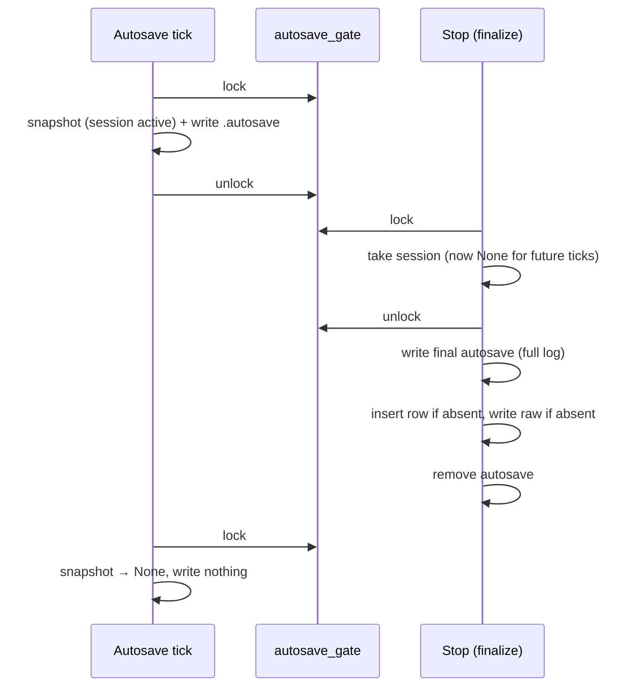

# Storage, infra & security — Design

**Spec:** ./spec.md   **Last updated:** 2026-10-18   **Status:** Current

## Overview

Seven small fixes. Two of them change on-disk behaviour that can't be undone, and both are flagged below.

1. **Schema (E6, one-way door).** The schema gets one ordered migration list. Each step runs once, inside a transaction, and is tracked by `PRAGMA user_version`. Step 1 is a frozen **baseline** that replays exactly what `main` runs today (001 + the inline ALTERs, ignoring duplicate columns, + `session_power_curves` + Area A's `app_meta`). Because of that, every shipped DB state converges to the same schema, and later steps can be plain SQL. We do not use `sqlx::migrate!`: it can't adopt existing DBs that have no `_sqlx_migrations` table, and its checksum check can stop the app from starting (ADR-1).
2. **Ride data (E1/E2/E4).** Persisting a ride becomes "ensure, never overwrite". The row is inserted only if absent, and the raw file is written only if absent, atomically (tmp + rename). The autosave writer and stop are serialized by one *autosave gate*, so no autosave can appear after stop. Stop writes a full final autosave **before** it touches the DB, so a failed save loses nothing. Delete removes the autosave first, then runs one DB transaction, then removes the raw file. With that ordering no tombstones are needed (ADR-3).
3. **Privileged setup (E3).** One `pkexec` call runs a constant script compiled into the binary. The script gets fixed tokens as argv and the udev rule on **stdin**: `install -m 0644 /dev/stdin /etc/udev/rules.d/…`. No path is ever written to disk before install, no path comes from outside the binary, and it works the same for deb, rpm, AppImage and dev builds (ADR-4).
4. **Logging (E5).** The `LoggerHandle` lives in a `static OnceLock`. It is flushed on `RunEvent::Exit` and in a panic hook that logs message + location at error level before chaining to the default hook (ADR-5).
5. **CI (E7).** `npm test` runs in `ci.yml` and `release.yml`.

## Architecture

| Component | File(s) | Change |
|---|---|---|
| Migration runner | `src-tauri/src/session/storage/schema.rs` (new), `storage/mod.rs` | `MIGRATIONS: &[Migration]` + `migrate(&pool)`; `Storage::new` calls it in place of the inline DDL |
| Migration SQL | `src-tauri/migrations/0001_baseline.sql` (new); delete `001_init.sql`…`008_work_and_vi.sql` | Single source of schema |
| Session persistence | `storage/sessions.rs` | `save_session` → returns `SaveOutcome`; atomic write-if-absent raw file; `delete_session` reordered + transaction |
| Autosave | `storage/autosave.rs` | `remove_autosave` returns `Result` (NotFound = Ok); recovery uses ensure-semantics, cleans stale autosaves; new `finalize_session` |
| Autosave gate | `session/manager.rs` | `autosave_gate: tokio::sync::Mutex<()>`; `stop_session_with_log` takes it; new `autosave_ticket()` |
| Autosave task | `lib.rs` → `session/autosave_task.rs` (new, small) | Loop body extracted as `autosave_tick(&SessionManager, &Storage, &mut Accumulator)` so it can be tested |
| Stop / close paths | `commands.rs::stop_session`, `lib.rs` `CloseRequested` | Both call `Storage::finalize_session` |
| Prereq fix | `prerequisites.rs`, `commands.rs::fix_prerequisites`, `resources/linux-setup.sh` (new) | Single invocation builder; no `/tmp`, no resource dir |
| Logger | `lib.rs` | `static LOGGER: OnceLock<LoggerHandle>`; `Builder::build(..).run(|_, ev| …)`; panic hook + pure `format_panic` |
| CI | `.github/workflows/ci.yml`, `release.yml` | `npm test` step after `npm run check` |
| Docs | `CONTRIBUTING.md`, `CLAUDE.md` | "Schema changes" section |

Existing patterns are kept: `AppError` everywhere, `tokio::fs` in async code, inline `#[cfg(test)]` modules, `tempfile` in tests only, and argv vectors for privileged commands.

### Lock order (deadlock-free by construction)

`autosave_gate` → `current_session`. Both the stop path and the autosave tick take the gate first. No code takes the gate while it holds `current_session`.



## Data and contracts

### Schema

- **`PRAGMA user_version`** now carries meaning: 0 = "legacy / unknown", N = the last migration applied. All shipped DBs read 0 (the app has never set it). **Area A and every other area must not use `user_version` for anything else.**
- **`0001_baseline.sql`** holds, in order: the exact contents of today's `001_init.sql`, then every inline ALTER from `Storage::new` on `main` (002…"009" distance_km), then `CREATE TABLE IF NOT EXISTS session_power_curves (…)` (copied verbatim), then `CREATE TABLE IF NOT EXISTS app_meta (key TEXT PRIMARY KEY, value TEXT)`. The `app_meta` DDL must match Area A's byte-for-byte in column definition; see Cross-area. Column order on a fresh DB is therefore identical to an upgraded legacy DB.
- **Baseline execution**: split on `;` at end of statement (the baseline has no `;` inside literals; a test pins the statement count). Each statement runs on the migration transaction. `duplicate column name` errors are tolerated **in step 1 only**. Spike: SQLite keeps the transaction open after that statement error (verified on SQLite 3.51.2, see Risks).
- **Steps ≥ 2** run as one `sqlx::raw_sql` batch with no error tolerance.
- **Runner**: `pool.begin_with("BEGIN IMMEDIATE")` (sqlx-core 0.8.6 `Pool::begin_with`) per step. The runner re-reads `user_version` inside the transaction, so a second app instance starting at the same moment waits on the write lock (busy_timeout) and then sees the step already applied. It applies the step, runs `PRAGMA user_version = N`, and commits. `user_version` changes are transactional: the spike showed a rollback restoring 0.
- **DB newer than the binary** (`user_version > MIGRATIONS.len()`, i.e. a downgrade): log a `warn!` and continue without applying anything. Migrations are additive by policy, so older code keeps working.

### Rust API changes (all `pub(crate)` within the backend; no Tauri command or TS type changes)

```rust
pub enum SaveOutcome { Inserted, AlreadyExisted }
Storage::save_session(&self, &SessionSummary, raw: &[u8]) -> Result<SaveOutcome, AppError>
Storage::finalize_session(&self, &SessionSummary, &[SensorReading]) -> Result<(), AppError>
Storage::remove_autosave(&self, id: &str) -> Result<(), AppError>   // was: fn -> ()
Storage::delete_session(&self, id: &str) -> Result<(), AppError>    // same signature, new ordering
SessionManager::autosave_ticket(&self) -> Option<AutosaveTicket<'_>> // holds gate guard + id/summary/delta
prerequisites::build_fix_invocation(&PrereqStatus, Option<PackageManager>) -> Option<FixInvocation>
// FixInvocation { program: "pkexec", args: Vec<String>, stdin: Option<&'static str> }
fn format_panic(payload: &(dyn Any + Send), location: Option<&Location>) -> String
```

`stop_session`'s error text changes (see ADR-2). Its success contract is unchanged.

### Raw file write contract

`<data>/sessions/<id>.bin` is written only when it does not exist. The write goes to `<id>.bin.tmp`, then `rename`. A single writer per session id is guaranteed: recovery runs in `setup` before `app.manage(state)`, so no command can run yet, and a live session's id is a fresh UUIDv4. That makes check-then-rename sufficient.

## Decisions

### ADR-1 — Migration mechanism (**ONE-WAY DOOR**)

**Context.** Shipped DBs exist in several states: only `001` (first release), partially ALTERed, fully current, and current + `app_meta` if Area A lands first. None has `_sqlx_migrations`. SQLite has no `ADD COLUMN IF NOT EXISTS`.

**Options.**
- **A: `sqlx::migrate!` with a baseline.** `Migrator::run` creates `_sqlx_migrations` and applies every migration whose version isn't recorded (sqlx-core 0.8.6 `migrate/migrator.rs` `run_direct`). On a legacy DB the baseline's `ALTER TABLE ADD COLUMN` would fail with a duplicate column, and the whole migration fails because sqlx executes the file as one statement batch. Adopting legacy DBs would mean pre-seeding `_sqlx_migrations` rows ourselves, with sqlx's private table layout and SHA-384 checksums. Every later start also re-validates the checksums: `if migration.checksum != applied_migration.checksum { return Err(MigrateError::VersionMismatch) }`, where the checksum is `Sha384::digest(sql.as_bytes())`. Any byte edit to a shipped migration (a comment, CRLF from git `autocrlf`) then makes the app refuse to open the user's DB.
- **B: hand-rolled ordered list keyed by `PRAGMA user_version`, frozen idempotent baseline as step 1.** About 60 LOC. No hidden tables. A legacy DB at 0 runs the baseline, which is safe for every state because it *is* today's startup code.
- **C: keep inline ALTERs, add `IF NOT EXISTS` checks via `pragma_table_info`.** Idempotent but still not ordered. Schema lives in Rust strings, and each future change needs ad-hoc guards.

**Decision.** B.

**Why.** It is the only option that adopts every shipped DB without guessing its state. Startup has no checksum failure mode, the dependency surface is minimal, and from step 2 on each change is one plain `.sql` file.

**Reversibility: one-way.** Once a release ships with `user_version = 1`, the meaning of `user_version` and the content of `0001_baseline.sql` are frozen forever. Moving to sqlx later is still possible: a future step N would seed `_sqlx_migrations`. Re-numbering or editing shipped steps is not. Guard tests: `migration_files_match_registry` (no dead files) and `upgraded_main_db_columns_equal_fresh_db`.

### ADR-2 — Stop ordering for E2

**Context.** Today `save_session(...)?` fails, the session is already `take()`n, and the log is dropped. Only the last periodic autosave (up to 30 s old) survives.

**Options.** (A) write a full final autosave first, then save, then remove the autosave. (B) write the raw `.bin` first, then insert the row. (C) put the session back into the manager on failure.

**Decision.** A, inside `Storage::finalize_session`:
1. Write a full autosave.
2. `save_session`.
3. `remove_autosave`.

A failure at step 1 is logged and the save still proceeds. A failure at step 2 returns `AppError::Session("Ride could not be saved: {e}. It was kept on disk and will be recovered next time the app starts.")`. If step 1 also failed, the message says the last autosave (up to 30 s old) will be recovered. A failure at step 3 is logged at warn and returns Ok, because recovery cleans up.

**Why.** It reuses the existing recovery channel, needs no new format, and works for the window-close path too. B produces a file without a row, plus a stale-summary problem. C resurrects a stopped session in the UI and still loses data on crash.

**Reversibility: easy.**

### ADR-3 — E1 safety: ordering + ensure-semantics, no tombstones

**Context.** Two problems:
- `INSERT OR IGNORE` followed by an unconditional file write lets a stale autosave overwrite the final log.
- The writer can recreate an autosave after stop removed it (race: snapshot → stop → remove → rename). Recovery can then re-insert a session the user deleted.

**Options.** (A) tombstone table `deleted_sessions(id)` checked by recovery and save. (B) close every path that lets a stale autosave outlive the session's DB row, and make recovery never overwrite. (C) check row existence only.

**Decision.** B:
- **Gate**: the writer holds `autosave_gate` across snapshot + write, and stop takes the gate before `take()`. No autosave write can start after stop, and none is in flight once stop proceeds.
- **Ensure-semantics**:
  - Recovery inserts the row only if absent and writes the raw file only if absent. A row that is present but has no file gets its file from the autosave (crash between INSERT and write).
  - The autosave is then deleted. Only `Inserted` counts as recovered.
- **Delete ordering**:
  1. Remove `.autosave_<id>.bin` (NotFound ok; any other error aborts with nothing changed).
  2. One transaction: delete `session_power_curves`, then `sessions`.
  3. Remove `<id>.bin`. Failure is `log::error!` with the path and Ok, since the DB is already consistent and an orphan file is invisible.
- **Recovery runs before the UI exists**, so it always settles leftovers before any delete can happen.

**Why.** Every stale autosave is either removed by stop or removed at the next startup, while the row still exists and before the user can delete. A delete can't leave one behind (step 1 aborts). Tombstones would add a table and a forever-growing list to defend a path that ordering already closes. C alone leaves the race.

**Reversibility: easy.** Tombstones can be added later as migration 0002 if a new path appears.

Note: this reverses #38's "file first" delete order. The spec requires the DB to be atomic first, and the orphan-file cost is accepted and logged.

### ADR-4 — Privileged install with one prompt, no world-writable path

**Context.**
- The current code copies the rule to the predictable `/tmp/99-ant-usb.rules`, then runs 3–5 separate `pkexec` calls.
- The upstream polkit policy for `org.freedesktop.policykit.exec` is `auth_admin`, not `auth_admin_keep` (checked in `/usr/share/polkit-1/actions/org.freedesktop.policykit.policy`, polkit 127), so **each call prompts**.
- Tauri resource dir on Linux is `/usr/lib/<exe>` for deb/rpm and `${APPDIR}/usr/lib/<exe>` for AppImage (tauri-utils 2.8.2 `platform::resource_dir` docs). `${APPDIR}` is the user's FUSE mount, which root can't read without `allow_other`, which is why the `/tmp` copy exists.

**Options.**
- **A: `pkexec /bin/sh -c "$SCRIPT" training-app-setup <tokens…>`**, with `$SCRIPT = include_str!("../resources/linux-setup.sh")` and the rule body piped on stdin.
  - The script is a compile-time constant. All variable data is argv tokens from a fixed allowlist (`udev`, `bluez=apt-get|dnf|pacman`, `bluetooth`) and stdin. Nothing is interpolated into a shell string.
  - No file is created anywhere, so no FUSE or noexec issue.
  - pkexec leaves fds 0–2 open; only fds ≥ 3 are set close-on-exec (`fdwalk_close_on_exec (3)` in polkit `src/programs/pkexec.c`).
  - `install -m 0644 /dev/stdin <dest>` works with GNU coreutils 9.10 (spike).
- **B: helper script bundled as a resource and run with `pkexec <path> <tokens>`.** Root can't read it on AppImage (FUSE), so it would need a copy into a private `0700` `tempfile::TempDir`. `/tmp` may be `noexec`, which forces `pkexec /bin/sh <path>` anyway. That leaves two code paths plus a TOCTOU window on the copied script.
- **C: `pkexec install … <read-only bundle path>` per step.** Fixes the `/tmp` path for deb/rpm only, fails on AppImage, and still prompts several times.

**Decision.** A.

**Note on the brief.** The brief said "one `pkexec sh -c` is NOT acceptable because of interpolation". That concern applies to building the script from paths. Here the script text is a constant compiled into the binary, verbatim from a reviewed file, and every argument is passed as `$1…$n` with no `eval`. The prompt shows `/bin/sh` as the program, which is the one UX cost. If the lead still rejects A, the fallback is B with a private `0700` TempDir, executed via `pkexec /bin/sh <tmpdir>/linux-setup.sh <tokens>`. That fallback is about +40 LOC.

**Script contract** (`resources/linux-setup.sh`, POSIX sh):
- `set -eu`; `PATH=/usr/sbin:/usr/bin:/sbin:/bin`.
- **Validate all args first** with a `case` statement. An unknown token exits 2 before any change is made.
- Then, in order:
  - `udev`: `install -m 0644 -o root -g root /dev/stdin /etc/udev/rules.d/99-ant-usb.rules`, then `udevadm control --reload-rules`, then `udevadm trigger`.
  - `bluez=<pm>`: the fixed install line for that package manager.
  - `bluetooth`: `systemctl enable --now bluetooth`.
- Each step `echo`s its name to stderr and exits with a distinct code (10/11/12/20/30). pkexec reserves 126 (dialog dismissed) and 127 (not authorized) per pkexec(1).
- **Rust side**: the rule content becomes `include_str!("../resources/99-ant-usb.rules")`, so the resource dir is no longer needed for the fix. The resource stays bundled for manual install, and `tauri.linux.conf.json` is unchanged. `fix()` maps the exit code to a message: 126 → "Authentication cancelled".

**Reversibility: easy.**

### ADR-5 — Logger flush and panic hook

**Context.**
- flexi_logger 0.29.8 `WriteMode` docs: "for all options except `Direct` you should keep the `LoggerHandle` alive up to the very end of your program to ensure that all buffered log lines are flushed out (which happens automatically when the `LoggerHandle` is dropped)".
- `BufferAndFlush` = 8 KiB buffer + 1 s flusher thread.
- Tauri 2.10.2 `App::run`: "This function never returns. When the application finishes, the process is exited directly using `std::process::exit`." So a leaked or static handle is never dropped.

**Options.** (A) keep `BufferAndFlush`, store the handle in `static LOGGER: OnceLock<LoggerHandle>`, and call `flush()` on `RunEvent::Exit` and in the panic hook. (B) switch to `WriteMode::Direct` (no buffer, no flush needed).

**Decision.** A. Replace `builder.run(ctx)` with `builder.build(ctx).expect(..).run(|_app, ev| if let RunEvent::Exit = ev { flush_logger() })`.
- The panic hook is installed right after `start()`. It does `prev = take_hook()`, then `set_hook(move |info| { log::error!("{}", format_panic(info.payload(), info.location())); flush_logger(); prev(info) })`.
- `format_panic` downcasts `&str`, then `String`, else returns `"<non-string panic payload>"`, and appends ` at file:line:col`.

**Why.** A keeps the current I/O profile and meets the spec literally. B is a one-line alternative if A misbehaves on macOS, where `Exit` is delivered before `process::exit`. Hook and flush are both unit-tested at the `format_panic` level only; flush on exit is a manual check.

**Reversibility: easy.**

### ADR-6 — Upgrade test fixtures

**Decision.**
- **Fixture.** Generate `src-tauri/src/session/storage/testdata/main_<sha>.sql`, a full `.dump` (schema + rows) of a DB created by **unmodified `main` code** with seeded data (two sessions with every column populated, a custom `user_config`, a known device with metadata, power-curve rows, and an `app_meta` row if A has landed).
- **Generation.** Produce it in slice 1 *before* changing `Storage::new`: a throwaway `#[ignore]` test that runs today's `Storage::new` and inserts the rows, then `python3 -I` `iterdump`. The one-off script stays in the scratchpad.
- **Hand-written fixtures.** `legacy_v001_only.sql` (only `001_init` tables + one session) and `legacy_partial_005.sql` (ALTERs 002–005 only), for older shipped states.
- **Rebase rule.** Whichever of A/E merges second regenerates `main_<sha>.sql` from latest `main`.

**Reversibility: easy.**

## Failure modes

| Failure | Detection | Behavior | Recovery |
|---|---|---|---|
| Baseline statement fails (not dup column), e.g. disk full | `sqlx::Error` | Transaction rolled back, `user_version` stays 0, `Storage::new` errors, app shows startup failure as today | Next launch retries the whole step |
| Two instances start together | `BEGIN IMMEDIATE` blocks | Second waits (busy_timeout 5 s), re-reads version, skips | n/a |
| DB `user_version` > known | Compare at startup | `warn!`, continue | Upgrade binary |
| Stop: final autosave write fails | `Err` from `write_autosave` | `warn!`, continue to DB save | Previous ≤30 s autosave still on disk |
| Stop: DB insert / raw write fails | `Err` from `save_session` | Command returns explanatory `Err`; autosave (full) retained | Startup recovery inserts row / writes missing file |
| Stop: autosave removal fails | `Err` (not NotFound) | `warn!`, Ok | Startup recovery sees row exists and deletes autosave |
| Crash between any two stop steps | Autosave present at startup | Recovery ensures row + file, never overwrites | Automatic |
| Recovery: corrupt / invalid-id autosave | Parse / validate | Delete file, `warn!` (unchanged) | n/a |
| Recovery: autosave removal fails | `Err` | `error!`, file left | Retried next startup; delete aborts if still present |
| Delete: autosave removal fails | `Err` | Delete aborts before DB is touched; error to UI | User retries |
| Delete: DB transaction fails | `sqlx::Error` | Rolled back, no partial state; raw file untouched | User retries |
| Delete: raw file removal fails after commit | `io::Error` | `error!` with path, Ok | Orphan file (invisible), manual cleanup |
| pkexec dismissed / denied | Exit 126 / 127 | `FixResult{success:false, "Authentication cancelled/denied"}` | Retry |
| Setup step fails | Exit 10–30 + stderr | Message names failing step; status re-checked | Retry / manual |
| Panic in any thread | Panic hook | Logged at error + flushed, then default hook | n/a |

## Migration and rollback

- **Forward.**
  - First launch of the new build on any legacy DB runs step 1 (no-op on a current DB, adds columns on older ones) and sets `user_version = 1`.
  - No data is rewritten. Existing autosave files are handled by the new recovery on that same launch.
- **Rollback to an older build.** Older code ignores `user_version` and re-runs its idempotent inline DDL against the same tables, so it works unchanged. A later re-upgrade sees `user_version = 1` and skips the baseline.
- **Future schema changes.** Add `migrations/000N_<name>.sql`, register it in `MIGRATIONS`, never edit a shipped file, additive changes only. This is documented in `CONTRIBUTING.md` and `CLAUDE.md`.

## Traceability

| AC | Component(s) | Test(s) (planned names) |
|---|---|---|
| AC1 | sessions.rs, autosave.rs, manager.rs, autosave_task.rs | `save_session_existing_row_keeps_original_raw_file`, `save_session_returns_inserted_then_already_existed`, `recovery_for_existing_session_keeps_final_log_and_deletes_autosave`, `recovery_for_existing_row_without_file_writes_file_from_autosave`, `deleted_session_is_not_resurrected_by_restart` (save → stale autosave left → restart recovery → delete → restart → absent), `delete_session_removes_leftover_autosave`, `stop_waits_for_in_flight_autosave_ticket`, `autosave_tick_after_stop_writes_nothing`, `remove_autosave_missing_file_is_ok` |
| AC2 | autosave.rs `finalize_session`, commands.rs, lib.rs | `finalize_with_failed_db_save_keeps_full_log_on_disk` (close pool → finalize Err → reopen Storage → recover → `load_sensor_data` has all N readings), `finalize_error_message_mentions_recovery`, `finalize_success_removes_autosave` |
| AC3 | prerequisites.rs, resources/linux-setup.sh, commands.rs | `fix_invocation_all_missing_is_single_pkexec_call`, `fix_invocation_udev_pipes_embedded_rule_on_stdin`, `fix_invocation_args_contain_no_paths`, `fix_invocation_all_met_is_none`, `fix_invocation_script_arg_is_embedded_constant`, `setup_script_rejects_unknown_token_before_any_change` (runs `/bin/sh -c SCRIPT x bogus` unprivileged, asserts exit 2), `pkexec_exit_126_maps_to_cancelled`; **manual**: deb + AppImage on Fedora, one prompt, rule installed 0644 root:root |
| AC4 | sessions.rs | `delete_session_failed_transaction_leaves_row_and_curves` (a test-only `BEFORE DELETE ON sessions` trigger does `RAISE(ABORT)`, so the second DELETE fails. Assert the row and the power-curve rows are still present and the raw file is untouched.), `delete_session_removes_row_curves_and_file` |
| AC5 | lib.rs | `format_panic_str_payload_includes_location`, `format_panic_string_payload`, `format_panic_non_string_payload`; **manual**: log ends with "Application exiting" line after window close; forced test panic appears in log file |
| AC6 | schema.rs, 0001_baseline.sql, docs | `fresh_db_reaches_latest_user_version`, `migrate_twice_is_noop`, `upgrade_from_main_dump_preserves_all_rows` (row-by-row equality of every table), `upgraded_main_db_columns_equal_fresh_db`, `upgrade_from_v001_only_db_adds_all_columns_and_keeps_session`, `upgrade_from_partial_005_db_succeeds`, `baseline_tolerates_only_duplicate_column_errors` (non-dup failure rolls back, `user_version` stays 0), `newer_user_version_is_left_untouched`, `migration_files_match_registry`, `baseline_statement_count_is_pinned` |
| AC7 | ci.yml, release.yml | CI run on the PR shows "Run frontend tests" step with 71+ tests |
| AC8 | all | `cargo test`, `npm test`, `npm run check` green before every commit; each new test above seen failing before its fix |

## Risks and spikes

- **Riskiest assumption:** the baseline really is a no-op on every shipped DB and SQLite keeps the transaction usable after a duplicate-column error. *Spike done (Python sqlite3, SQLite 3.51.2):* the error leaves `in_transaction=True`, later statements commit, and `PRAGMA user_version` rolls back with the transaction. sqlx bundles its own libsqlite3, so the slice-1 tests re-prove this under sqlx.
- **pkexec stdin pass-through:** confirmed from source (fds 0–2 inherited). The textual agent fallback (no GUI agent) reads `/dev/tty`, not stdin. **Manual check required** on GNOME (Fedora) for the GUI agent. `install /dev/stdin` was verified with GNU coreutils 9.10. Non-GNU `install` (BusyBox) is out of scope (not a target distro).
- **`RunEvent::Exit` on macOS:** Tauri docs state that Exit fires before `process::exit`. Manual check on macOS CI artifact; fall back to ADR-5 B if it doesn't.
- **Forcing DB failures in tests:** use `storage.pool.close().await` for save failures and a `BEFORE DELETE` trigger `RAISE(ABORT)` for transaction rollback. Both are public SQL, no internals.

## Implementation plan

1. **Fixture capture (no behaviour change).** Generate `testdata/main_3b10a73.sql` from unmodified code (ADR-6) and hand-write the two legacy fixtures. Commit: "Add legacy database fixtures for schema upgrade tests".
2. **Migration runner + baseline (riskiest).** Add `schema.rs` and `0001_baseline.sql`, delete `001`–`008`, and switch `Storage::new` to `migrate()`. Tests: all AC6 tests. Commit: "Consolidate schema into ordered user_version migrations".
3. **Ensure-semantics save + recovery.** `SaveOutcome`, atomic write-if-absent, recovery rules, `remove_autosave -> Result`. Tests: AC1 storage tests. Commit: "Never overwrite ride logs during autosave recovery".
4. **Autosave gate + task extraction.** Gate in `SessionManager`, `autosave_ticket`, `autosave_tick` extracted from `lib.rs`. Tests: `stop_waits_for_in_flight_autosave_ticket`, `autosave_tick_after_stop_writes_nothing`. Commit: "Serialize autosave writes with session stop".
5. **finalize_session + stop/close wiring.** Tests: AC2. Commit: "Keep ride data on disk when saving on stop fails".
6. **Delete ordering + transaction.** Tests: AC4 + `delete_session_removes_leftover_autosave` + `deleted_session_is_not_resurrected_by_restart`. Commit: "Delete sessions atomically and remove leftover autosaves".
7. **Privileged setup.** `linux-setup.sh`, `build_fix_invocation`, `fix_prerequisites` without `/tmp`. Tests: AC3 + manual check recorded in design.md Verification. Commit: "Install udev rule via single pkexec call without temp files".
8. **Logger.** `OnceLock` handle, `RunEvent::Exit` flush, panic hook, `format_panic`. Tests: AC5 + manual. Commit: "Flush logs on exit and log panics".
9. **CI + docs.** `npm test` in both workflows; "Schema changes" sections in CONTRIBUTING.md and CLAUDE.md. Commit: "Run frontend tests in CI and document schema changes".

## Cross-area dependencies

- **Area A (`app_meta`).** E's baseline contains `CREATE TABLE IF NOT EXISTS app_meta (key TEXT PRIMARY KEY, value TEXT)`.
  - If A merges first, E removes A's inline DDL on rebase, keeps the definition identical, and regenerates the `main` fixture with an `app_meta` row.
  - If E merges first, A drops its inline `CREATE` (the table already exists) and only reads and writes rows. Any further schema A needs goes in `migrations/0002_*.sql`.
  - A must not use `PRAGMA user_version`.
- **Area D (frontend).** After a stop error, `requestStop` (`src/lib/stores/session.ts`) leaves `sessionActive = true` although the backend already dropped the session, and `autoSession.ts` swallows the error with `.catch(() => {})`. D should reset the session stores on error and surface the backend message (toast or banner). E only guarantees the backend `Err` text.
- **Area C (device).** None. `prerequisites.rs` is E's.

## Amendments (design review, 2026-10-18)

The spec owner reviewed the design and these changes are binding. Earlier ADR text is kept for history. Where an amendment contradicts it, the amendment wins.

### ADR-4 note — approved
Approved: a constant script via `pkexec /bin/sh -c` with allowlisted positional args and the rule on stdin. The UX cost of `/bin/sh` appearing in the prompt is accepted. Additions:
- `stdin = Stdio::null()` when there is no `udev` token.
- When writing the rule to the child's stdin, a `BrokenPipe` is not an error of its own. The outcome comes from the exit status: 126 means dismissed, 127 means denied. pkexec exits before reading stdin when auth fails.
- Package-manager lines are non-interactive and are set inside the script: `DEBIAN_FRONTEND=noninteractive apt-get install -y bluez`, `dnf install -y bluez`, `pacman -S --noconfirm bluez bluez-utils`.

### ADR-1 amendment 1 — existence guards, not error tolerance
- Every `ALTER TABLE <t> ADD COLUMN <c> …` statement, in **any** step, is preceded by `SELECT COUNT(*) FROM pragma_table_info(?) WHERE name = ?`. The statement is skipped when the column exists.
- All other statement errors propagate and roll the step back. We no longer rely on continuing a transaction after an error, and `run_alter_ignore_duplicate` is deleted.
- The SQL-file constraints are: statements end in `;`; no `;` inside literals or inline comments; `--` comments only on their own lines; ADD COLUMN must spell out `COLUMN` and use unquoted identifiers. Tests pin these constraints.

### ADR-1 amendment 2 — column sets, not column order
- Legacy DBs created by v0.6.10-beta (before `zone_config` existed) end with `distance_km` **before** `zone_config`. A fresh DB has the opposite order.
- Upgrade tests therefore compare column **sets** (name, declared type, notnull, default) per table.
- Rule (CONTRIBUTING): no code may depend on column order. No `SELECT *` and no positional `INSERT … VALUES` without a column list. A grep of `src-tauri/src` found none today.

### ADR-1 amendment 3 — pinned checksums
- A test pins the SHA-256 of every shipped migration file, after CRLF→LF normalization, in a constant table (`sha2` 0.10.9 as a dev-dependency; it is already in `Cargo.lock` via sqlx).
- Editing a shipped step fails CI. Adding a new step requires adding its hash.

### ADR-1 amendment 4 — backup before upgrade steps
- Before the first pending step ≥ 2 in a run, the runner executes `VACUUM INTO '<data>/training.db.pre-v<N>'`, where N is that step's version.
- An existing backup file is never overwritten.
- The backup is skipped when the DB had no user tables at the start of the run (a fresh install), so new users don't get a pointless file.
- If the backup fails, the step is not applied and startup errors. This is safer than upgrading without a copy.

### ADR-1 amendment 5 — Area A's `app_meta` and `sessions.zones`
- Rule when **A lands first**: its inline DDL moves into `0001_baseline.sql` (ADD COLUMN guarded by amendment 1). The `main` fixture is regenerated and must populate `zones` and an `app_meta` row.
- Rule when **E lands first** (current state; A is not on `main` at 3b10a73): E ships them as new steps, `0002_session_zones.sql` (`ALTER TABLE sessions ADD COLUMN zones TEXT;`) and `0003_app_meta.sql` (`CREATE TABLE IF NOT EXISTS app_meta (key TEXT PRIMARY KEY, value TEXT);`, exact DDL). A then drops its inline DDL on rebase.
- Either way the final schema is identical, and every step is exercised by the fixture tests.

### ADR-6 amendment — fixtures
These are dumps (`sqlite3.iterdump`) of DBs seeded with every column populated, including a note containing `'`, `"` and `;`:
- `testdata/legacy_initial_e0d85f4.sql`: the first commit's `Storage::new`.
- `testdata/legacy_v0_6_10.sql`: tag `v0.6.10-beta`, no `zone_config`.
- `testdata/main_3b10a73.sql`: built by running the unmodified `main` `Storage::new` and storage API in a throwaway test, with raw paths normalized to `/legacy/sessions/…`.

How they were made: the two legacy fixtures come from `testdata/genfx.py`. It replays, in source order, the SQL literals a tagged `Storage::new` executes, with the same duplicate-column handling. Its replay of `main` was checked to produce a `sqlite_master` identical to the Rust-built DB.

The partial-005 fixture is dropped, because no shipped tag ever had that state: the first commit already ran 002–006.

**Rule (CONTRIBUTING + harness):** every new step must run against all legacy fixtures plus the `main` fixture. The upgrade tests iterate a single `FIXTURES` table, so a new step is covered automatically.

### ADR-2/3 amendment — invariant: a row's summary always describes the raw file on disk
The ordering is **raw file durable first, then row**. A single function, `save_session(summary, raw)`, serves both stop and recovery:

| Row | Raw file | Action | Outcome |
|---|---|---|---|
| exists | exists | nothing | `AlreadyExisted` |
| exists | absent (legacy crash: old code inserted first) | write raw durably, then UPDATE the row's metric columns from `summary` (user metadata kept) | `RepairedRaw` |
| absent | absent | write raw durably, INSERT row | `Inserted` |
| absent | exists, bytes == `raw` | INSERT row | `Inserted` |
| absent | exists, bytes differ | rename existing to `<id>.bin.orphan-<unix_ms>` (kept, `warn!`), write raw durably, INSERT row | `Inserted` |

- **Durable write:** tmp file `write_all` + `sync_all`, then `rename`, then `sync_all` on the parent directory (unix; a no-op elsewhere). The autosave writer uses the same helper.
- **Ordering in `finalize_session`:** the final autosave is durable before any raw or row write, and the raw file plus the committed row are durable before `remove_autosave`. SQLite commit is durable with sqlx's defaults: rollback journal, `synchronous=FULL`, since sqlx-sqlite 0.8.6 sets neither unless asked.
- **Stray tmp files:** recovery removes `<id>.bin.tmp` and `.autosave_<id>.tmp` with an `info!` line.
- **Crash-point tests:**
  - `crash_after_final_autosave_before_raw_recovers_full_ride`
  - `crash_after_raw_before_row_inserts_row_and_keeps_raw`
  - `crash_after_raw_before_row_with_stale_autosave_keeps_orphan_and_consistent_pair`
  - `crash_after_row_before_autosave_removal_keeps_final_raw`
  - `legacy_row_without_raw_is_repaired_from_autosave`

### Rulings recorded
- Migrations are additive only: no DROP, no RENAME, no NOT NULL without a default (CONTRIBUTING).
- AC2: a backend `Err` with clear text is enough for E. Area D surfaces it.
- The README, CONTRIBUTING and CLAUDE.md "schema changes" guidance is updated.
- Area B adds the tokio `test-util` dev-dependency on its own branch. E does not add it, so expect a trivial `Cargo.toml` conflict.

## Build notes (deviations from the plan)

- **Slices 3, 5 and 6 landed in one commit.** That covers ensure-semantics save/recovery, `finalize_session` with the stop/close wiring, and delete ordering. They share the new `save_session` / `remove_autosave` signatures, so splitting them would have left intermediate commits that don't compile. Every test was still mutation-checked: 6 targeted tests fail when the old behaviours are reintroduced, namely unconditional raw overwrite, no final autosave, no autosave removal on delete, and power-curve delete outside the transaction.
- **Migration names.** These are `0002_session_zones.sql` and `0003_app_meta.sql`, one concern per file. Amendment 5 said "0002" for zones, and app_meta followed as 0003.
- **The partial-005 fixture was dropped** (see the ADR-6 amendment). The fixtures are the first commit, v0.6.10-beta and main@3b10a73.
- **The shell-metacharacter test needed fixing.** The first version of `setup_script_treats_shell_metacharacters_as_data` asserted the wrong thing: the rejected token is echoed back in the error message. It now checks that no output line equals the injected command's output.
- **`fix_prerequisites` no longer takes an `AppHandle`.** The TS call `invoke('fix_prerequisites')` is unchanged.
- **Unchanged pre-existing behaviour:** corrupt or invalid autosaves are still deleted with a `warn!`, and the window-close path still does not compute a power curve; the existing backfill covers it.

## Verification

Commands, run on the final commit:
- `cd src-tauri && cargo test`: 342 passed, 0 failed (main had 289).
- `cd src-tauri && cargo build --features production`: OK. Its only warning (`integral` never used) was already there.
- `npm test`: 71 passed. `npm run check`: 0 errors, 0 warnings.

| AC | Proven by |
|---|---|
| AC1 | `stop_waits_until_autosave_write_completes` (a gated fake writer proves the ticket is held through the write; it fails if the gate is released before the write), `save_session_existing_row_keeps_original_raw_file`, `save_session_returns_inserted_then_already_existed`, `crash_after_row_before_autosave_removal_keeps_final_raw`, `crash_after_final_autosave_before_raw_recovers_full_ride`, `crash_after_raw_before_row_inserts_row_and_keeps_raw`, `crash_after_raw_before_row_with_stale_autosave_keeps_orphan_and_consistent_pair`, `legacy_row_without_raw_is_repaired_from_autosave`, `delete_session_removes_leftover_autosave_so_restart_cannot_resurrect`, `stop_waits_for_in_flight_autosave_ticket`, `autosave_tick_after_stop_writes_nothing`, `ticks_accumulate_full_log_across_deltas`, `recovery_removes_stray_tmp_files`, `remove_autosave_missing_file_is_ok`, `write_durable_replaces_content_and_leaves_no_tmp`, `remove_durable_reports_missing_file_as_false` |
| AC2 | `finalize_with_failed_db_save_keeps_full_log_on_disk` (DB closed: error text says the ride will be recovered; after restart all 10 readings are recovered, not the 6 from the stale autosave), `finalize_success_persists_and_removes_autosave` |
| AC3 | `fix_invocation_all_missing_is_single_pkexec_call`, `fix_invocation_without_udev_step_has_no_stdin`, `fix_invocation_passes_no_paths_or_temp_files`, `fix_invocation_all_met_is_none`, `fix_invocation_only_bluez_missing_without_package_manager_is_none`, `embedded_udev_rule_satisfies_the_check`, `setup_script_rejects_unknown_step_before_any_change`, `setup_script_treats_shell_metacharacters_as_data`, `setup_script_requires_a_step`, `setup_script_has_non_interactive_package_installs`, `closed_stdin_is_judged_by_exit_status`, `describe_failure_maps_pkexec_denied_and_step_codes`. **Manual check: Deferred to user.** It needs an interactive polkit prompt on the user's desktop; the steps are in *Manual checks* below. |
| AC4 | `delete_session_failed_transaction_leaves_row_curves_and_file`, `delete_session_removes_row_curves_and_file`, `delete_session_aborts_when_autosave_cannot_be_removed`, existing `delete_session_removes_power_curves` |
| AC5 | `format_panic_str_payload_includes_location`, `format_panic_string_payload`, `format_panic_non_string_payload`, `format_panic_on_real_panic_payload`. `logging_scope_blocks_nested_entry_and_resets_on_drop`, `log_format_functions_run_inside_logging_scope` (re-entrancy guard). **Manual check: Deferred to user.** It needs a real window close on the user's desktop; the steps are in *Manual checks* below. |
| AC6 | `fresh_db_reaches_latest_user_version`, `fresh_db_gets_no_backup_file`, `reopening_migrated_db_changes_nothing`, `every_fixture_upgrades_preserving_all_values`, `every_fixture_upgrades_to_fresh_column_sets`, `upgraded_main_fixture_is_readable_through_storage_api`, `legacy_upgrade_writes_one_backup_before_step_two`, `existing_backup_is_not_overwritten`, `failed_step_rolls_back_and_keeps_version`, `add_column_is_skipped_when_column_exists`, `newer_user_version_is_left_untouched`, `split_statements_drops_comment_lines_and_empty_chunks`, `parse_add_column_extracts_table_and_column`, `baseline_statement_count_is_pinned`, `every_add_column_spells_out_column_with_plain_identifiers`, `migration_files_match_registry`, `shipped_migrations_match_pinned_sha256`, `backup_path_appends_version_suffix`. The guard and hash tests were mutation-checked: disabling the existence guard fails 6 tests, and editing a shipped file fails the hash pin. The old `001`–`008` files are deleted. README, CONTRIBUTING and CLAUDE.md are updated. |
| AC7 | `ci.yml` and `release.yml` now have a "Run frontend tests" step (`npm test`). `ci.yml` also gained the "Forbid edits to shipped migrations" step, which runs on pull_request only with `fetch-depth: 0`, via `.github/scripts/check-migrations-immutable.sh`. The guard script was checked in a throwaway repo: adding a migration passes (exit 0), retiring a legacy 3-digit file passes (exit 0), and modifying, deleting or renaming a 4-digit migration fails (exit 1). It also passes against `main` on this branch. Both workflows parse as YAML. Not yet proven on GitHub, which needs a PR run. |
| AC8 | Full suites are green as above. Each new behaviour test was seen failing, either against the old behaviour (mutation) or before its implementation existed. |

### Manual checks (deferred to user)

These checks need an interactive desktop session, which an agent can't do. They have **not** been performed.

**AC3: single privileged prompt (Linux, GNOME/Fedora with a graphical polkit agent)**

1. Build the bundles: `npm ci && npm run build:release`. The outputs are in `src-tauri/target/release/bundle/{appimage,rpm,deb}/`.
2. Recreate the "everything missing" state:
   - `sudo rm -f /etc/udev/rules.d/99-ant-usb.rules`
   - `sudo udevadm control --reload-rules`
   - `sudo systemctl disable --now bluetooth`
3. Start the AppImage: `chmod +x src-tauri/target/release/bundle/appimage/*.AppImage`, then run it. The setup banner appears. Click **Fix All**.
4. **Expect exactly one** polkit authentication dialog, naming `/bin/sh` as the program. Authenticate. The banner then reports "All prerequisites fixed successfully."
5. Verify:
   - `stat -c '%a %U:%G' /etc/udev/rules.d/99-ant-usb.rules` → `644 root:root`
   - `cmp /etc/udev/rules.d/99-ant-usb.rules src-tauri/resources/99-ant-usb.rules` → no output
   - `systemctl is-active bluetooth` → `active`
   - `ls /tmp/99-ant-usb.rules` → "No such file or directory"
6. Repeat steps 2–5 with the package-installed binary: `sudo dnf install ./src-tauri/target/release/bundle/rpm/*.rpm` (or the `.deb` via `apt` on Debian/Ubuntu), then launch it from the app menu.
7. Cancel path: repeat step 2, click **Fix All**, then dismiss the dialog. Expect a single dialog and the message "Authentication was cancelled."

**AC5: log flush on exit and panic logging**

1. Run `npm run tauri dev` and use the app briefly, e.g. open Devices.
2. Close the window with the title-bar close button.
3. Open the newest log file:
   - Linux: `~/.local/share/com.training-app.dev/logs/training-app*.log`
   - macOS: `~/Library/Application Support/com.training-app.dev/logs/`
   - Release builds use `com.training-app` in place of `com.training-app.dev`.
4. Expect the last line to read `<date> <time> INFO  [app_lib] Application exiting`, with every earlier line of the run present (nothing truncated). Repeat on macOS.
5. Panic logging: temporarily add `std::thread::spawn(|| panic!("manual panic check"));` just before `log::info!("Application startup complete");` in `src-tauri/src/lib.rs`, and **don't commit it**. Run `npm run tauri dev`.
6. Expect the log file to contain `ERROR [app_lib] panic: manual panic check at src/lib.rs:<line>:<col>`, with the usual "thread ... panicked" message still on stderr. Revert the edit.

## Known limitations / follow-ups

- **Double-failure recovery isn't shown to the user.** This happens when the final autosave write fails *and* the process crashes after the raw file was written but before the row was inserted. Recovery then keeps the row and raw consistent with the older periodic autosave, for example 6 readings in the test. The full log survives only as `sessions/<id>.bin.orphan-<ms>`, with a `warn!` in the log. Nothing in the UI mentions or restores it. Possible follow-up: list orphans in the UI, or recompute the summary from the orphan once Area A's recompute lands.
- **A failed pre-migration backup stops the app from starting.** For example, if `VACUUM INTO training.db.pre-v<N>` fails because the disk is full, `Storage::new` returns an error and `lib.rs` setup calls `.expect("Failed to initialize storage")`. The app then exits with a panic, which is now logged, instead of showing a message. That is safer than migrating without a copy, but the experience is poor. Possible follow-up: show a startup error dialog explaining the free-space requirement, and/or allow opening the DB read-only at its current version.

