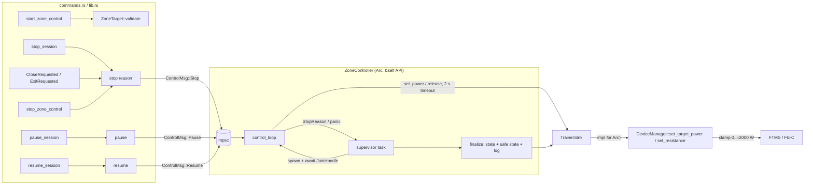

# Zone control & trainer safety — Design
**Spec:** ./spec.md   **Last updated:** 2026-10-18   **Status:** Draft

## Overview

The HR controller is rewritten as a **positional PID around a base power**, with the integral kept in watts and **conditional integration** (clamping) for anti-windup. Today's code adds a full P+I+D output to the commanded power on every tick, so it behaves like a double integrator. A Python prototype of the same plant shows today's law overshooting by 23 bpm and swinging 98–158 bpm (±150 W) forever. With the new law and retuned gains it settles with ≤ 1 bpm overshoot on 27 plant variants (see Risks).

The control task gets three changes:
1. A **supervisor task** catches every way the task can end: panic, error, duration complete, sensor lost, or a stop request. Every ending goes through one `finalize()` that sets the status and puts the trainer in a **safe state**.
2. **Trainer I/O goes through a `TrainerSink` trait.** Each command has a 2 s timeout, and tests can swap in a fake trainer.
3. **A single "send if different" step.** On every tick the loop compares the power it wants with the power it last confirmed sending, and sends again when they differ. This one rule handles power restore after the cadence cut, resend after a reconnect, and restore on resume.

The **safe state** is "Set Target Resistance Level 0 %" (FTMS 0x04 / FE-C page 0x30). If the trainer rejects that, the fallback is target power 0 W. The backend calls this itself from `stop_session`, `pause_session`, window close and app exit, and from the controller's own self-stops.

Tests are deterministic. The HR settle test is a pure synchronous plant simulation with no clock. Task-level tests use `tokio::time::Instant` together with `#[tokio::test(start_paused = true)]`.

## Architecture



Files touched (Area B):

| File | Change |
|---|---|
| `session/zone_control/pid.rs` | Replace `PidController` with `HrPid` (positional, integral in watts, conditional integration, dt guard, derivative on measurement); `adaptive_gains` gets new values; `HrSmoother` unchanged |
| `session/zone_control/controller.rs` | Supervisor, `ControlMsg` channel, `TrainerSink` usage, `tokio::time::Instant`, reconcile-send, pause dt fix, smoothed-HR ceiling, trainer-lost grace, power band function |
| `session/zone_control/trainer.rs` (new) | `TrainerSink` trait, `DeviceManagerSink` impl, `FakeTrainer` (`#[cfg(test)]`) |
| `session/zone_control/types.rs` | `ZoneTarget::validate()`, `ZoneTarget::midpoint()`, new `StopReason` variants, `ZoneControlStatus.stop_reason` |
| `commands.rs` | Validation in `start_zone_control`/`save_user_config`; `stop_session`/`pause_session`/`resume_session` drive the controller; `set_trainer_power` keeps the clamp; `AppState.zone_controller: Arc<ZoneController>` |
| `lib.rs` | `CloseRequested` and `RunEvent::ExitRequested` stop zone control; `Arc<ZoneController>` construction |
| `config.rs` | `MAX_TRAINER_WATTS`, `clamp_trainer_watts()` plus its tests |
| `device/manager.rs` | **One line only** (see ADR-5) |
| `Cargo.toml` | dev-dependency `tokio` feature `test-util` (needed for `start_paused`) |

Existing patterns followed:
- `AppError::Session(String)` for validation errors.
- `info!`/`warn!` logging.
- Inline `#[cfg(test)] mod tests` with `assert_approx`.
- The DeviceManager stays behind a `tokio::Mutex`, and no new lock is held across awaits.

## Data and contracts

**`ZoneTarget`**: no shape change.
- New `fn validate(&self) -> Result<(), AppError>`. Rules:
  - `zone` is 0 (custom) or 1..=7 for Power, 0 or 1..=5 for HR.
  - `lower_bound < upper_bound`.
  - Power `upper_bound ≤ 2000`; HR `upper_bound ≤ 250`.
- New `fn midpoint(&self) -> u16`, computed as `((lower as u32 + upper as u32) / 2) as u16`.
- Error messages name the field and the limit, e.g. `"HR zone must be 0 (custom) or 1-5, got 6"`.

**`ZoneControlStatus`**: adds `stop_reason: Option<StopReason>` (additive).
- It is `None` while active.
- After the controller ends, it holds the reason until the next start.
- `phase` gains the values `"paused"`, `"trainer_lost"` and `"stopped"`. Existing values are unchanged.

**`StopReason`**: adds `SessionStopped`, `AppClosing` and `ControllerFault`. These are externally tagged unit variants, so they serialize as strings like `"ControllerFault"`.
- **Area D** must add those three to the TS `StopReason` union and `stop_reason?: StopReason | null` to `ZoneControlStatus` in `src/lib/tauri.ts`. Existing frontend code ignores unknown fields, so it keeps working without that.

**`stop_zone_control`** keeps returning `Option<StopReason>`.
- If a controller was running or had already ended, it returns that reason.
- If nothing ever ran, it returns `None`. Today it returns `Some(UserStopped)` here; the frontend treats both the same (`try { await stopZoneRide() }`).

**`save_user_config`** additionally rejects:
- `ftp` outside 50..=1000.
- Any HR zone boundary > 250.
- Any power-zone percentage of 0 or > 1000.

The existing ascending checks stay. Message example: `"FTP must be between 50 and 1000 W, got 20"`.

**`set_trainer_power(watts: i16)`**: no signature change. Values above 2000 are clamped by the single clamp (ADR-5). Serde already rejects anything outside the i16 range.

**`AppState.zone_controller`**: changes from `Arc<tokio::Mutex<ZoneController>>` to `Arc<ZoneController>`. Its methods take `&self` and keep their locks internally (ADR-7). This is a compile-time change inside the backend only.

**Constants** (in `controller.rs` unless noted):

| Constant | Value | Notes |
|---|---|---|
| `config::MAX_TRAINER_WATTS` | 2000 | |
| `TRAINER_COMMAND_TIMEOUT` | 2 s | |
| `TRAINER_LOST_STOP_SECS` | 30 | Same as HR sensor lost |
| `TRAINER_REFRESH_SECS` | 10 | Periodic re-assert of the target |
| `MAX_TICK_DT_SECS` | 2 × tick period | dt cap |
| `SAFE_RESISTANCE_LEVEL` | 0 | |

## Decisions

### ADR-1: HR control law: positional PID around a base, integral in watts
**Context.** Today `commanded += clamp_rate(Kp·e + Ki·Σe·dt + Kd·Δe/dt)` (`controller.rs:605-650`). Adding a positional output every tick integrates it again. P becomes an integrator, I becomes a double integrator, and with e = 0 a leftover I term keeps ramping the power. A prototype at `scratchpad/sim/oldlaw.py` overshoots 23 bpm and swings 98–158 bpm with 300 W power swings over the last 5 minutes.

**Options.**
- **A. Velocity (incremental) form.** `Δu = Kp(e_k − e_{k−1}) + Ki·e_k·dt + Kd(e_k − 2e_{k−1} + e_{k−2})/dt; u_k = sat(u_{k−1} + Δu)`. Anti-windup comes for free because the only state is the saturated u. The catch is that it has no explicit integral, so B9's "decay the integral when HR is falling" (an AC9 requirement) has nothing to act on.
- **B. Positional around a base**, with the integral stored in watts, conditional integration, and derivative on measurement.
- **C. B with back-calculation anti-windup** (`I += Ki·e·dt + (u_sat − v)/Tt`). This adds a tuning constant `Tt` and its result is harder to hand-compute in tests.

**Decision: B.** Per tick k, with tick dt (seconds), target r = `target.midpoint()`, measurement y_k = median-smoothed HR, and u_base = initial power clamped into the band:

```
if !(dt > 0) || !dt.is_finite():  u_k = u_{k-1}; no state change        (AC11)
dt      = min(dt, MAX_TICK_DT_SECS)                                     (AC8 guard)
e_k     = r − y_k
(Kp,Ki,Kd) = adaptive_gains(|e_k|)
if e_k < 0 and y_{k-1} is Some and y_k < y_{k-1}:  I ← 0.7·I              (AC9)
P_k     = Kp·e_k
D_k     = −Kd·(y_k − y_{k−1})/dt     (0 on first tick)  — derivative on measurement
I*_k    = I + Ki·e_k·dt                                    [watts]
v_k     = u_base + P_k + I*_k + D_k                        (unconstrained demand)
up_k    = 20 if e_k > 0 and u_{k−1} < band_mid − 20 else 10
w_k     = clamp(v_k, u_{k−1} − 30, u_{k−1} + up_k)          (rate limit)
u_k     = clamp(w_k, floor, ceiling)                         (power band)
saturated = |u_k − v_k| > 1e-9
accept  = !saturated || (v_k > u_k && e_k < 0) || (v_k < u_k && e_k > 0)
I       = clamp(accept ? I*_k : I, floor − u_base, ceiling − u_base)
y_{k−1} ← y_k ; return round(u_k) as u16
```

With e = 0 and y stable, P = D = 0 and I is unchanged, so v_k = v_{k−1} = u_{k−1} once settled. Commanded power stops changing. While the output is pinned at the floor, the ceiling or a rate limit, I only moves in the direction that leaves saturation (AC1).

**Gain mapping.** Under the old usage, Kp effectively acted as an integral gain of Kp/5 s per tick, and Ki as a double integrator. Neither carries over directly. The table keeps the three-tier schedule and the thresholds (15 / 5 bpm). Gains are scaled by (Kp × 0.75, Ki × 0.25, Kd × 1), the most robust point of a grid search (`scratchpad/sim/grid.py`, 36 scale combinations × 27 plants):

| abs(e) (bpm) | old (Kp, Ki, Kd) | new Kp (W/bpm) | new Ki (W/(bpm·s)) | new Kd (W·s/bpm) |
|---|---|---|---|---|
| > 15 | 3.0, 0.15, 0.8 | 2.25 | 0.0375 | 0.8 |
| > 5 | 2.0, 0.10, 0.5 | 1.5 | 0.025 | 0.5 |
| ≤ 5 | 1.0, 0.05, 0.3 | 0.75 | 0.0125 | 0.3 |

Storing I in watts (Ki applied at integration time) means that switching gain tier never makes the output jump through the I term.

**Removed: integral reset on zone re-entry** (`controller.rs:577-582`). In the prototype it causes runs that never settle when the initial estimate is high (`grid2.py`: max_settle = ∞ with reset on). Conditional integration already prevents the windup it was patching. The two re-entry tests are rewritten (see Traceability).

**Why.** B satisfies AC1 and AC9 together, gives hand-computable single-tick values for tests, and the prototype shows margin.

**Reversibility:** easy. The change is internal to `pid.rs` and `process_hr_tick`.

### ADR-2: Deterministic test harness, no real clock
**Context.** AC1 needs a 20-minute plant simulation, and AC4–AC10 need timing without sleeps.

**Options.**
- **A. Pure step function plus a synchronous plant.** Covers the control law only.
- **B. Run the full `control_loop` under `tokio::time::pause` with a simulated HR broadcast.** Exercises everything, but the 0.1 s plant integration interleaves with tokio scheduling, which makes it fragile.
- **C. A for AC1, and tokio paused time for the task-level ACs.**

**Decision: C.**
- **AC1 harness** (`controller.rs` tests, `mod hr_plant_sim`). `FirstOrderLagPlant { tau_s, delay_s, gain_bpm_per_w, rest_bpm, hr }` is integrated with Euler at 0.1 s. A delay line of commanded power models the HR response lag.
  - Each simulated second, `round(hr)` is pushed into a real `HrSmoother`.
  - Every 5 s it calls the real `process_hr_tick(&mut state, &target, &mut pid, &smoother, 5000)` and applies the returned watts.
  - Reference plant: tau = 60 s, delay = 15 s, gain = 0.35 bpm/W, rest = 60 bpm. Target 130–140 (mid 135). Custom zone (band [50, 375] with FTP 250). The plant starts in steady state at 115 bpm (initial power = (115 − 60)/0.35 ≈ 157 W, set as the controller's base).
  - Asserts:
    - (a) peak smoothed HR − 135 ≤ 5 (one half-width).
    - (b) settled: every sample in the last 10 min lies within [130, 140].
    - (c) no sustained oscillation: commanded power varies by ≤ 10 W over the last 5 min.
  - A second test runs a 3 × 3 plant grid (tau 30/60/90, delay 5/15/25, gain 0.25/0.35) with the same asserts, as regression protection.
- **Task-level tests.** The controller switches every `std::time::Instant` to `tokio::time::Instant`, which honours `tokio::time::pause()`. Tests use `#[tokio::test(start_paused = true)]` with a `FakeTrainer` and feed readings through a real `broadcast::Sender<SensorReading>`. Time moves only through `tokio::time::advance` or tokio's auto-advance when idle. This needs the `test-util` feature as a dev-dependency.

**Reversibility:** easy.

### ADR-3: Trainer safe state when control ends
**Context.** AC6 asks for a defined safe state on every exit path.

Today the trainer is left at the last ERG wattage. In ERG, a rider who slows down gets *more* torque, which leads to the "ERG spiral". A trapped high wattage is the hazard.

FTMS 1.0, Bluetooth SIG, sections 4.16.2.1, 4.16.2.2 and 4.16.2.9 ([spec PDF](https://www.bluetooth.org/DocMan/handlers/DownloadDoc.ashx?doc_id=423422)):
- **Reset (0x01)** "shall set the control parameters to their respective default values". Per §4.16.2.1, control permission "remains valid until … the Reset procedure … is initiated by the Client". Reset therefore **revokes control**.
- **Stop or Pause (0x08, parameter 0x01 = Stop, 0x02 = Pause)** only says the server "shall initiate the stop or pause procedure". The resulting resistance is vendor-defined.

ANT+ FE-C defines Basic Resistance (page 48/0x30, 0–100 % in 0.5 % units), Target Power (page 49/0x31) and Track Resistance (page 51/0x33). The trainer runs in the mode of the control page it last received. The [Garmin Connect IQ `AntPlus.FitnessEquipment` docs](https://developer.garmin.com/connect-iq/api-docs/Toybox/AntPlus/FitnessEquipment.html) describe separate basic-resistance and target-power modes. The FE-C profile document itself is ANT+ member-only and was not verified here (see Risks).

**Options.**
- **A. FTMS Reset.** It revokes control, but `TrainerController.control_granted` (`ftms.rs`) is cached and never cleared. The next manual or zone command would get 0x05 "Control not permitted" until reconnect. Fixing that is a `ftms.rs` change in Area C's file. FE-C has no equivalent.
- **B. FTMS Stop (0x08 0x01).** The outcome depends on the vendor. `DeviceManager::stop_trainer` returns `NotSupported` for FE-C.
- **C. ERG at a low wattage (for example 50 W).** Stays in ERG, so a slowing rider still meets rising torque.
- **D. Resistance level 0 % (FTMS 0x04 with value 0; FE-C page 0x30 with value 0).** This uses the existing `DeviceManager::set_resistance(id, 0)` on both protocols. Both protocols leave ERG and the trainer goes to its minimum brake. If the FTMS trainer lacks "Resistance Target Setting Supported" it answers 0x02, so fall back to **target power 0 W**. That is still ERG, but the target is the minimum brake, and it is what the existing cadence-zero cut already sends.

**Decision: D with a 0 W fallback.**
- `TrainerSink::release()` tries `set_resistance(0)`. On error or timeout it tries `set_target_power(0)`. It logs `info!("Zone control ended ({reason:?}): trainer released via resistance 0%")`, or `warn!` naming the fallback or the double failure.
- Pause uses the same release. Resume clears `sent_power`, so the next tick re-sends the target (ERG mode resumes because Set Target Power switches the mode back).

**Reversibility:** easy. It is one function, and switching to FTMS Reset later needs Area C's `control_granted` fix.

### ADR-4: Re-send model (cadence restore, reconnect, resume)
**Context.** Covers B4 (power mode stuck at 0 W after the cadence cut) and B7 (no re-send after reconnect). Today any failed command stops control immediately with `TrainerDisconnected`, so a reconnect can never be followed up.

**Options.**
- **A. Event hooks**, such as a "trainer reconnected" event from DeviceManager. This needs device-layer changes (Area C) and a new channel.
- **B. Per-tick reconcile.** The loop keeps `sent_power: Option<u16>` (last confirmed sent) and `last_sent_at`. Each tick computes `effective = safety_override.unwrap_or(desired)`:
  - `desired` is the midpoint in Power mode and the PID output in HR mode.
  - `safety_override` is `Some(0)` for cadence zero and `Some(50)` for the HR ceiling.
  - It sends when `sent_power != Some(effective)`, or when `last_sent_at` is older than `TRAINER_REFRESH_SECS`.
  - If the sink reports no connected trainer, or a send fails or times out, it sets `sent_power = None`, `phase = "trainer_lost"`, and `trainer_lost_since = now` if not already set.
  - When `trainer_lost_since` is older than `TRAINER_LOST_STOP_SECS`, the loop returns `TrainerDisconnected` and `finalize` tries the release.

**Decision: B.**
- Cadence back above 0 clears the override → `effective ≠ sent` → re-sent on the next tick (≤ 1 tick).
- Reconnect: `sent=None` → re-sent on the first tick that sees the trainer.
- A reconnect too fast for any tick to see triggers the 10 s refresh.
- **This is a behaviour change.** A transient command failure now holds for up to 30 s instead of stopping at once.

**Reversibility:** easy.

### ADR-5: Where the single power clamp lives
**Context.** Covers B6 and AC7. Two call sites reach the trainer: `commands::set_trainer_power` and the zone controller. Both go through `DeviceManager::set_target_power(&mut self, &str, i16)`. The controller casts `u16 as i16` (wraps above 32767).

**Options.**
- **A. Clamp inside `DeviceManager::set_target_power`.** This is the true choke point, but it is Area C's file.
- **B. A wrapper module that every caller must use.** "One place" only by convention, and a new caller could bypass it.

**Decision: A, kept minimal.**
- `config.rs` gains `pub const MAX_TRAINER_WATTS: i16 = 2000;` and `pub fn clamp_trainer_watts(watts: i32) -> i16` (clamps to 0..=2000). Its tests live in `config.rs`.
- The **only device-file edit** is one inserted first line in `DeviceManager::set_target_power` (currently `device/manager.rs:590`, just after the `fn` signature and before `let result = match …`):
  ```rust
  let watts = config::clamp_trainer_watts(watts as i32);
  ```
  `use crate::config;` already exists (`manager.rs:26`).
- The controller never casts. `DeviceManagerSink::set_power(u16)` passes `config::clamp_trainer_watts(w as i32)`.
- Every computed power is also bounded by the band, which is capped at `MAX_TRAINER_WATTS`.
- Area C should keep this line when merging. If they restructure the function, the clamp must stay first.

**Reversibility:** easy.

### ADR-6: Backend learns about stop, pause and close
**Context.** Today only the UI stops the controller. `stop_session`, `pause_session` and window close never touch it.

**Decision.** Direct calls from the existing command handlers and lifecycle hooks into `ZoneController`'s `&self` API. These are idempotent no-ops when control is inactive:
- `stop_session`: `zone_controller.stop(StopReason::SessionStopped).await` runs **before** `stop_session_with_log` (trainer released first, then the session is saved).
- `pause_session` / `resume_session`: `zone_controller.pause().await` / `.resume().await` (the release on pause is ADR-3).
- `lib.rs` `WindowEvent::CloseRequested`: `stop(StopReason::AppClosing)` inside the existing `block_on`, before the session save. It is bounded by the 2 s command timeout.
- `lib.rs` switches `builder.run(ctx)` to `builder.build(ctx)?.run(|app, ev| …)`, handling `RunEvent::ExitRequested { .. }` the same way. This covers macOS Cmd+Q and other exits that skip `CloseRequested`; see [`tauri::RunEvent`](https://docs.rs/tauri/latest/tauri/enum.RunEvent.html) (enum is `#[non_exhaustive]`, so the match needs `_ => {}`). A second call is a no-op.
- The controller's self-stops (duration complete, sensor lost, trainer lost, panic) go through the supervisor's `finalize` (ADR-8).

Pause and resume are shared: a session pause and a zone-only pause set the same flag. Area D's UI calls both on Pause, which is idempotent.

**Alternative rejected.** A broadcast "session state" channel that the controller subscribes to. It adds a new cross-module event type for three call sites.

**Reversibility:** easy.

### ADR-7: Lock scope and command timeout
**Context.** Covers B10. `stop_zone_control` holds the `tokio::Mutex<ZoneController>` while it awaits the task join, so status polling blocks. `command_trainer` has no bound and can wait on the DeviceManager lock behind 4 s scans (C7).

**Decision.**
- `ZoneController { state: Arc<Mutex<ControlLoopState>>, task: Mutex<Option<RunningTask>> }`, where `RunningTask { ctl_tx: mpsc::UnboundedSender<ControlMsg>, supervisor: JoinHandle<()> }`.
- `stop()` takes `RunningTask` out under a brief `task` lock, sends `ControlMsg::Stop(reason)`, **releases the lock**, then awaits the supervisor.
- `status()` only locks `state`, which is never held across an await of trainer I/O.
- `start()` holds `task` for the whole start so that two starts are serialized. It calls `stop_inner` first.
- Every `TrainerSink` call is wrapped in `tokio::time::timeout(TRAINER_COMMAND_TIMEOUT, …)`, and that timeout covers acquiring the DeviceManager lock. A timeout returns `Err(AppError::Session("Trainer command timed out"))` and is treated like any failure (ADR-4).

**Reversibility:** easy.

### ADR-8: Panic containment
**Decision.**
- `start()` spawns a **supervisor**: `tokio::spawn(async move { let inner = tokio::spawn(control_loop(..)); let reason = match inner.await { Ok(r) => r, Err(e) if e.is_panic() => { error!(…); StopReason::ControllerFault }, Err(_) => StopReason::ControllerFault }; finalize(state, sink, reason).await })`.
- `control_loop` returns `StopReason` (`UserStopped` / `SessionStopped` / `AppClosing` from `ControlMsg::Stop`, the self-stop reasons, or `ControllerFault` if the mpsc closes).
- `finalize` sets `active=false`, `paused=false`, `phase="stopped"` and `stop_reason=Some(reason)`, then calls `sink.release()` and logs.
- `tokio::Mutex` does not poison, so `finalize` can always lock `state`. The release profile does not set `panic = "abort"` (checked in `Cargo.toml`), so unwinding is caught by the `JoinHandle`.

**Reversibility:** easy.

### ADR-9: Validation and a band that cannot panic
**Decision.**
- `ZoneTarget::validate()` is called in `start_zone_control` before the history estimate (which used to overflow at `commands.rs:422`) and again in `start_with_config`.
- `hr_power_band(ftp: Option<u16>, pz: Option<[u16;6]>, zone: u8) -> (u16, u16)` is a pure function:
  - zone 0 (custom) or no zone data: `[MIN_POWER, 1.5·FTP or 400]` (AC2).
  - zone n in 1..=5: floor = pz[n−2]%·FTP, or MIN_POWER for n = 1; ceiling = pz[min(n,5)]%·FTP. The arithmetic is done in u32/f64.
  - Zones > 5 (only reachable if validation is bypassed) are treated as custom.
  - Finally `floor = floor.max(MIN_POWER).min(MAX)`, `ceiling = ceiling.min(MAX).max(floor)`, so floor ≤ ceiling holds for every input.
- The initial HR-mode power is clamped into the same band, which replaces the `estimate.clamp(MIN_POWER, 1.2·FTP)` that panics when FTP < 42.
- `save_user_config` gets the FTP and zone range checks described in Data and contracts.

**Reversibility:** easy.

### ADR-10: Pause accounting and HR-ceiling filtering
**Decision.**
- **Pause accounting.** `resume` sets `last_tick_at = now`, and the loop skips ticks while paused, so the first tick after a resume has a normal dt. `tick_ms` is also capped at `MAX_TICK_DT_SECS` as a backstop.
- **HR ceiling.** The ceiling check uses `hr_smoother.smoothed()` (median of 5), so one spike cannot trip it. It still has to persist for about 3 of 5 samples, roughly 3 s, which is acceptable for a 50 W cut.
- **Ordering.** Duration expiry is now checked **before** the cadence-zero early return. Today a cadence stop prevents duration completion.
- **Previous HR for the AC9 decay.** It is the PID's own `prev_measurement` (the previous tick's smoothed HR), not `last_hr`.

**Reversibility:** easy.

## Failure modes

| Failure | Detection | Behavior | Recovery |
|---|---|---|---|
| Control task panics | Supervisor `JoinError::is_panic()` | `stop_reason=ControllerFault`, inactive, release sent, `error!` log | User restarts the zone ride |
| Trainer command hangs | 2 s `timeout` | Counts as a failure: `sent=None`, phase `trainer_lost` | Resent next tick; stops after 30 s with `TrainerDisconnected` and a release attempt |
| Trainer disconnects | `connected_trainer_id()` is None, or the send fails | Hold, phase `trainer_lost` | Reconnect → re-sent within 1 tick, or the 10 s refresh |
| Trainer rejects resistance 0 (FTMS 0x02) | `set_resistance` error | Fallback to `set_target_power(0)`, `warn!` | n/a |
| Release fails entirely (trainer gone) | Both calls error | `warn!("trainer release failed")`. The trainer is disconnected anyway, and its own behaviour applies on reconnect. | Next manual command |
| HR spike above max | Smoothed HR > max | Ignored unless it persists in the median | n/a |
| App closed mid-ride | `CloseRequested` / `ExitRequested` | Stop(AppClosing) + release, bounded by 2 s | n/a |
| Invalid target or config from UI | `validate()` | `Err(AppError::Session(msg))`, nothing started | User corrects it |
| HR plant faster or slower than tuned for | Not detected | Slower settling. Grid shows 0/27 failures across tau 30–90 s, delay 5–25 s, gain 0.25–0.5 | Retune gains (pure table) |
| Initial estimate far too high (+60 W) | Not detected | Overshoot of up to 18 bpm in simulation (11/27 plants fail the 5 bpm bound); the HR ceiling safety and the 30 W/tick ramp-down limit it | Better estimate; out of AC1 scope |

## Migration and rollback
- No schema or persisted-data changes. The command shapes are additive (`stop_reason` field, new enum variants).
- Rollback means reverting the branch. Persisted data is unaffected.
- Frontend compatibility: the current UI keeps working. It already stops zone control explicitly, and the backend's own stop is idempotent.

## Traceability

| AC | Component(s) | Test(s) (planned names) |
|---|---|---|
| AC1 | `pid.rs` HrPid, `process_hr_tick`, sim harness | `hr_pid_zero_error_stable_hr_holds_power`, `hr_pid_integral_frozen_while_at_band_ceiling`, `hr_pid_integral_frozen_while_rate_limited`, `hr_pid_integral_unwinds_when_error_reverses_at_ceiling`, `hr_pid_first_tick_reference_value` (hand-computed), `hr_plant_20bpm_below_settles_without_overshoot_or_oscillation`, `hr_plant_grid_settles_across_lag_and_delay` |
| AC2 | `hr_power_band` | `custom_hr_zone_band_is_min_to_150pct_ftp`, `custom_hr_zone_without_ftp_caps_at_400`, `custom_hr_150_160_commands_above_55pct_ftp` |
| AC3 | `ZoneTarget::validate`, `hr_power_band`, `save_user_config` validators (extracted as `validate_user_config(&SessionConfig)`) | `power_zone_8_rejected`, `hr_zone_6_rejected`, `zone_0_custom_accepted`, `lower_equal_upper_rejected`, `power_bound_above_2000_rejected`, `hr_bound_above_250_rejected`, `midpoint_of_max_bounds_does_not_overflow`, `hr_band_floor_never_exceeds_ceiling_for_any_ftp` (FTP 1..=2000 × zone 0..=7), `initial_power_with_tiny_ftp_does_not_panic`, `ftp_below_50_rejected`, `ftp_above_1000_rejected`, `non_increasing_hr_zones_rejected` (already passes; regression) |
| AC4 | supervisor, `finalize` | `control_task_panic_reports_controller_fault_and_releases_trainer` (FakeTrainer panics on first `set_power`), `self_stop_on_duration_complete_releases_trainer` |
| AC5 | reconcile-send | `power_mode_restores_target_within_2_ticks_after_cadence_returns`, `target_resent_within_2_ticks_after_trainer_reconnect`, `trainer_lost_for_30s_stops_with_trainer_disconnected` |
| AC6 | `ZoneController::{stop,pause,resume}`, `finalize`, `TrainerSink::release`, command and lifecycle wiring | `stop_releases_trainer_with_resistance_zero`, `release_falls_back_to_zero_watts_when_resistance_rejected`, `pause_releases_trainer_and_resume_resends_target`, `stop_session_reason_reported_in_status`, `sensor_lost_stop_releases_trainer`, `stop_when_inactive_is_noop` (no command sent). Wiring in `stop_session`/`pause_session`/close/exit: manual check (see Risks) |
| AC7 | `config::clamp_trainer_watts`, manager.rs line, `DeviceManagerSink` | `clamp_trainer_watts_caps_at_2000`, `clamp_trainer_watts_negative_is_zero`, `clamp_trainer_watts_u16_max_does_not_wrap` |
| AC8 | `resume` sets `last_tick_at`, dt cap | `pause_10_minutes_adds_zero_time_in_zone`, `first_tick_after_resume_uses_normal_dt` |
| AC9 | HrPid `prev_measurement` | `integral_decays_when_smoothed_hr_falls_between_ticks`, `no_integral_decay_when_smoothed_hr_rises_above_zone` (both driven by real successive ticks; the existing injected-`last_hr` tests are replaced) |
| AC10 | `TrainerSink` timeout, `ZoneController` lock split | `hung_trainer_command_times_out_within_2s_and_counts_as_failure`, `status_responsive_while_stop_awaits_task` |
| AC11 | HrPid dt guard, smoothed ceiling | `hr_pid_zero_dt_returns_unchanged_power`, `hr_pid_negative_dt_returns_unchanged_power`, `single_hr_spike_above_max_does_not_cut_power`, `sustained_hr_above_max_cuts_to_safety_power` |
| AC12 | all | `cd src-tauri && cargo test`, `npm run check`. Each slice records its test failing before the fix. |

## Risks and spikes
1. **Riskiest: gains that satisfy AC1 exist and are robust.** The spike is done in Python (`/tmp/claude-1001/-home-mpereira-Extra-repos-personal-training-app/7aca0652-ae45-4f8f-9b9d-c5cb23cc4579/scratchpad/sim/{hrsim,grid,grid2,oldlaw}.py`):
   - With the old gains, the new law fails 10/27 plants (worst overshoot 15 bpm).
   - With the scaled gains it fails 0/27 (worst 1 bpm, settle ≤ 230 s).
   - The old law overshoots 23 bpm and oscillates without end.

   Slice 1 ports the harness to Rust **first**, against the current code, to confirm that the Rust test fails before the fix.
2. **AC10 timeout versus FTMS internals.** `ftms.rs::write_control_and_wait` already waits up to 2 s for the indication and treats a timeout as success. The first command also runs a Request Control round trip. A trainer that never indicates would therefore hit the 2 s outer bound on every command, count as failed, and get stopped after 30 s.
   - **Dependency on Area C:** keep the inner indication wait ≤ 1.5 s (the Request Control and command waits together must fit inside 2 s), or the spec should relax AC10 to about 3 s.
   - Until that is resolved this is an open conflict. B uses 2 s as spec'd.
3. **FE-C mode switching on page 0x30 has not been verified against the member-only FE-C profile.** Mitigations: the 0 W fallback, and a manual check on an FE-C trainer in Phase 2 if one is available. Otherwise it is recorded as unproven.
4. **Wiring in Tauri handlers (`stop_session`, `pause_session`, CloseRequested, ExitRequested) cannot be unit-tested without a Tauri runtime.** The behaviour behind each one-line call is tested through `ZoneController`. The wiring gets a recorded manual check with `npm run tauri dev` and the simulator.
5. **Concurrent edits.**
   - Area C edits `device/manager.rs` (one line from B, ADR-5).
   - Area D adds `get_session_status` to `commands.rs`/`lib.rs` handler lists.
   - Area E may touch `Cargo.toml`.

   All of these are textual merge conflicts at most.

## Implementation plan
Each slice is one commit with its tests (failing test first).

1. **AC1 harness and new HR law.**
   - Add the plant simulation test against the current `process_hr_tick` and confirm it fails.
   - Implement `HrPid` per ADR-1 (dt guard, derivative on measurement, conditional integration, integral in watts, decay on smoothed HR falling) and the new gain table.
   - Remove the re-entry reset and rewrite or replace the old PID and re-entry tests.
   - Covers AC1, AC9 and the AC11 dt part.
2. **Band and validation.** `hr_power_band` (AC2, no-panic AC3), `ZoneTarget::validate`/`midpoint`, `validate_user_config`, wiring in `start_zone_control`/`save_user_config`, and the initial-power clamp into the band. Covers AC2 and AC3.
3. **Single clamp.** `config::clamp_trainer_watts` plus the one-line `manager.rs` insertion, and removal of `as i16` in the controller. Covers AC7.
4. **`TrainerSink` and deterministic clock.**
   - Add the trait, `DeviceManagerSink` with a 2 s timeout, and the test-only `FakeTrainer`.
   - Switch to `tokio::time::Instant`.
   - Add the `test-util` dev-dependency.
   - Change the controller to be generic over `T: TrainerSink`.
   - Covers AC10 timeout.
5. **Supervisor, ControlMsg channel and finalize.** Panic containment, the `stop_reason` status field and new `StopReason` variants, release on every exit, the lock split (`Arc<ZoneController>`, `&self` API), and updated `commands.rs`/`lib.rs` construction. Covers AC4, AC6 controller part, and AC10 lock.
6. **Reconcile-send.** `sent_power`, refresh, `trainer_lost` grace, cadence restore and reconnect resend, duration check before the cadence early return. Covers AC5.
7. **Pause and HR ceiling.** Pause release and resume resend via ControlMsg, `last_tick_at` on resume, dt cap, smoothed HR ceiling. Covers AC8, the AC11 ceiling part, and AC6 pause.
8. **Backend lifecycle wiring.** `stop_session`/`pause_session`/`resume_session` call the controller, plus `CloseRequested` and `RunEvent::ExitRequested` in `lib.rs`, followed by the manual check in `tauri dev` with the simulator. Covers AC6 wiring.
9. **Final.** Full `cargo test` and `npm run check`; `design.md` Status: Current with a Verification section; `spec.md` Status: Built.
