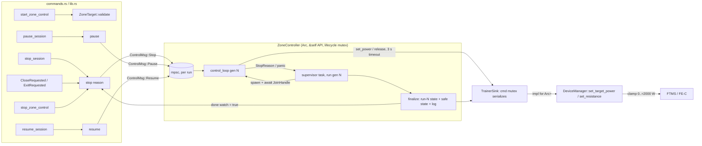

# Zone control & trainer safety — Design
**Spec:** ./spec.md   **Last updated:** 2026-10-18 (rev 3, built)   **Status:** Current

## Overview

The HR controller is rewritten as a **positional PID around a base power**, with the integral kept in watts and **conditional integration** (clamping) for anti-windup. Today's code adds a full P+I+D output to the commanded power on every tick, so it behaves like a double integrator. A Python prototype of the same plant shows today's law overshooting by 23 bpm and swinging 98–158 bpm (±150 W) forever. With the new law and retuned gains it settles with ≤ 1 bpm overshoot on 27 plant variants (see Risks).

The control task gets four changes:
1. **Each run is scoped to a generation** (ADR-12). Every start creates a fresh per-run state `Arc` with its own generation id. A **supervisor task** catches every way that run can end: panic, error, duration complete, sensor lost, trainer unresponsive, or a stop request. Every ending goes through one `finalize()` that marks the run's own state and puts the trainer in a **safe state**. A finalize from an old generation can never touch a newer run's state or trainer output. `stop()` returns only after finalize has released the trainer, and concurrent stops share that completion. A `start()` issued during a stop waits for it.
2. **Trainer I/O goes through a `TrainerSink` trait.** Each command has a 3 s timeout. All commands the controller issues are serialized through one async mutex. Tests can swap in a fake trainer.
3. **A single "send if different" step.** On every tick the loop compares the power it wants with the power it last confirmed sending, and sends again when they differ. "Released" counts as a target (used while paused). This one rule handles power restore after the cadence cut, resend after a reconnect, restore on resume, and retry of a failed pause release.
4. **The PID freezes while its output is not reaching the trainer** (ADR-14): during a cadence-zero cut, the HR-ceiling override (which clears with hysteresis), the `trainer_lost` window, and pause. On exit from any of those it re-seeds from the power actually delivered and ramps under the normal rate limits. A safety cut that cannot be delivered within 3 ticks stops the ride with `TrainerUnresponsive`.

The **safe state** (ADR-11) is reached by **target power 0 W first, then resistance level 0 %**. The release counts as delivered if the 0 W command succeeded. The backend calls this itself from `stop_session`, `pause_session`, window close and app exit, and from the controller's own self-stops. On app close the release has a total budget of 4 s (ADR-17).

Tests are deterministic. The HR settle test is a pure synchronous plant simulation with no clock. Task-level tests use `tokio::time::Instant` together with `#[tokio::test(start_paused = true)]`.

## Architecture



Files touched (Area B):

| File | Change |
|---|---|
| `session/zone_control/pid.rs` | Replace `PidController` with `HrPid` (positional, integral in watts, conditional integration, dt guard, derivative on measurement); `adaptive_gains` gets new values; `HrSmoother` unchanged |
| `session/zone_control/controller.rs` | Generation-scoped runs (`Run` struct), lifecycle mutex, supervisor, `ControlMsg` channel, `TrainerSink` usage, `tokio::time::Instant`, reconcile-send including the "released" target, PID freeze/re-seed, override hysteresis, undelivered-safety-cut stop, pause dt fix, smoothed-HR ceiling, trainer-lost grace, power band function |
| `session/zone_control/trainer.rs` (new) | `TrainerSink` trait, `DeviceManagerSink` impl (command mutex, 3 s timeout, 0 W then resistance 0 % release), `FakeTrainer` (`#[cfg(test)]`) |
| `session/zone_control/lifecycle.rs` (new) | Plain async hook bodies `on_session_stop`, `on_session_pause`, `on_session_resume`, `on_app_close` that take `&ZoneController` (plus the session/storage pieces they need). Tauri handlers call these in one line each (ADR-18) |
| `session/zone_control/types.rs` | `ZoneTarget::validate()`, `ZoneTarget::midpoint()`, new `StopReason` variants, `ZoneControlStatus.stop_reason` |
| `commands.rs` | Validation in `start_zone_control`/`save_user_config`; one-line hook calls in `stop_session`/`pause_session`/`resume_session`; `set_trainer_power` keeps the clamp; `AppState.zone_controller: Arc<ZoneController>` |
| `lib.rs` | One-line `on_app_close` calls from `CloseRequested` and `RunEvent::ExitRequested`; `Arc<ZoneController>` construction |
| `config.rs` | `MAX_TRAINER_WATTS`, `clamp_trainer_watts()` plus its tests |
| `device/manager.rs` | **One line only** (see ADR-5) |
| `Cargo.toml` | dev-dependency `tokio` feature `test-util` (needed for `start_paused`) |

Existing patterns followed:
- `AppError::Session(String)` for validation errors.
- `info!`/`warn!` logging.
- Inline `#[cfg(test)] mod tests` with `assert_approx`.
- The DeviceManager stays behind a `tokio::Mutex`, and no new lock is held across awaits.

## Data and contracts

**`ZoneTarget`**: no shape change.
- New `fn validate(&self) -> Result<(), AppError>`. Rules:
  - `zone` is 0 (custom) or 1..=7 for Power, 0 or 1..=5 for HR.
  - `lower_bound < upper_bound`.
  - Power `upper_bound ≤ 2000`; HR `upper_bound ≤ 250`.
- New `fn midpoint(&self) -> u16`, computed as `((lower as u32 + upper as u32) / 2) as u16`.
- Error messages name the field and the limit, e.g. `"HR zone must be 0 (custom) or 1-5, got 6"`.

**`ZoneControlStatus`**: adds `stop_reason: Option<StopReason>` (additive).
- It is `None` while active.
- After the controller ends, it holds the reason until the next start.
- `phase` gains the values `"paused"`, `"trainer_lost"` and `"stopped"`. Existing values are unchanged.
- While a run is finalizing, the status still shows that run (it does not report `active: false`) until finalize completes.

**`StopReason`**: adds `SessionStopped`, `AppClosing`, `ControllerFault` and `TrainerUnresponsive` (ADR-15). These are externally tagged unit variants, so they serialize as strings like `"ControllerFault"`.
- **Area D** must add those four to the TS `StopReason` union and `stop_reason?: StopReason | null` to `ZoneControlStatus` in `src/lib/tauri.ts`. Existing frontend code ignores unknown fields, so it keeps working without that.

**`stop_zone_control`** keeps returning `Option<StopReason>`.
- If a controller was running or had already ended, it returns that reason.
- If nothing ever ran, it returns `None`. Today it returns `Some(UserStopped)` here; the frontend treats both the same (`try { await stopZoneRide() }`).

**`save_user_config`** additionally rejects:
- `ftp` outside 50..=1000.
- Any HR zone boundary > 250.
- Any power-zone percentage of 0 or > 1000.

The existing ascending checks stay. Message example: `"FTP must be between 50 and 1000 W, got 20"`.

**`set_trainer_power(watts: i16)`**: no signature change. Values above 2000 are clamped by the single clamp (ADR-5). Serde already rejects anything outside the i16 range.

**`AppState.zone_controller`**: changes from `Arc<tokio::Mutex<ZoneController>>` to `Arc<ZoneController>`. Its methods take `&self` and keep their locks internally (ADR-7). This is a compile-time change inside the backend only.

**Constants** (in `controller.rs` unless noted):

| Constant | Value | Notes |
|---|---|---|
| `config::MAX_TRAINER_WATTS` | 2000 | |
| `TRAINER_COMMAND_TIMEOUT` | 3 s | Per command, including waiting for the command mutex and the DeviceManager lock |
| `TRAINER_LOST_STOP_SECS` | 30 | Same as HR sensor lost. Applies only when no safety override is pending |
| `SAFETY_UNDELIVERED_STOP_TICKS` | 3 | Consecutive ticks a pending safety override may stay undelivered before `TrainerUnresponsive` |
| `HR_CEILING_CLEAR_MARGIN_BPM` | 3 | Override clears below ceiling − 3 … |
| `HR_CEILING_CLEAR_SAMPLES` | 2 | … for 2 consecutive HR samples |
| `APP_CLOSE_RELEASE_BUDGET` | 4 s | Total release budget on app close/exit |
| `TRAINER_REFRESH_SECS` | 10 | Periodic re-assert of the target |
| `MAX_TICK_DT_SECS` | 2 × tick period | dt cap |
| `SAFE_RESISTANCE_LEVEL` | 0 | |

## Decisions

### ADR-1: HR control law: positional PID around a base, integral in watts
**Context.** Today `commanded += clamp_rate(Kp·e + Ki·Σe·dt + Kd·Δe/dt)` (`controller.rs:605-650`). Adding a positional output every tick integrates it again. P becomes an integrator, I becomes a double integrator, and with e = 0 a leftover I term keeps ramping the power. A prototype at `scratchpad/sim/oldlaw.py` overshoots 23 bpm and swings 98–158 bpm with 300 W power swings over the last 5 minutes.

**Options.**
- **A. Velocity (incremental) form.** `Δu = Kp(e_k − e_{k−1}) + Ki·e_k·dt + Kd(e_k − 2e_{k−1} + e_{k−2})/dt; u_k = sat(u_{k−1} + Δu)`. Anti-windup comes for free because the only state is the saturated u. The catch is that it has no explicit integral, so B9's "decay the integral when HR is falling" (an AC9 requirement) has nothing to act on.
- **B. Positional around a base**, with the integral stored in watts, conditional integration, and derivative on measurement.
- **C. B with back-calculation anti-windup** (`I += Ki·e·dt + (u_sat − v)/Tt`). This adds a tuning constant `Tt` and its result is harder to hand-compute in tests.

**Decision: B.** Per tick k, with tick dt (seconds), target r = `target.midpoint()`, measurement y_k = median-smoothed HR, and u_base = initial power clamped into the band:

```
if !(dt > 0) || !dt.is_finite():  u_k = u_{k-1}; no state change        (AC11)
dt      = min(dt, MAX_TICK_DT_SECS)                                     (AC8 guard)
e_k     = r − y_k
(Kp,Ki,Kd) = adaptive_gains(|e_k|)
if e_k < 0 and y_{k-1} is Some and y_k < y_{k-1}:  I ← 0.7·I              (AC9)
P_k     = Kp·e_k
D_k     = −Kd·(y_k − y_{k−1})/dt     (0 on first tick)  — derivative on measurement
I*_k    = I + Ki·e_k·dt                                    [watts]
v_k     = u_base + P_k + I*_k + D_k                        (unconstrained demand)
up_k    = 20 if e_k > 0 and u_{k−1} < band_mid − 20 else 10
w_k     = clamp(v_k, u_{k−1} − 30, u_{k−1} + up_k)          (rate limit)
u_k     = clamp(w_k, floor, ceiling)                         (power band)
saturated = |u_k − v_k| > 1e-9
accept  = !saturated || (v_k > u_k && e_k < 0) || (v_k < u_k && e_k > 0)
I       = clamp(accept ? I*_k : I, floor − u_base, ceiling − u_base)
y_{k−1} ← y_k ; return round(u_k) as u16
```

With e = 0 and y stable, P = D = 0 and I is unchanged, so v_k = v_{k−1} = u_{k−1} once settled. Commanded power stops changing. While the output is pinned at the floor, the ceiling or a rate limit, I only moves in the direction that leaves saturation (AC1).

**Gain mapping.** Under the old usage, Kp effectively acted as an integral gain of Kp/5 s per tick, and Ki as a double integrator. Neither carries over directly. The table keeps the three-tier schedule and the thresholds (15 / 5 bpm). Gains are scaled by (Kp × 0.75, Ki × 0.25, Kd × 1), the most robust point of a grid search (`scratchpad/sim/grid.py`, 36 scale combinations × 27 plants):

| abs(e) (bpm) | old (Kp, Ki, Kd) | new Kp (W/bpm) | new Ki (W/(bpm·s)) | new Kd (W·s/bpm) |
|---|---|---|---|---|
| > 15 | 3.0, 0.15, 0.8 | 2.25 | 0.0375 | 0.8 |
| > 5 | 2.0, 0.10, 0.5 | 1.5 | 0.025 | 0.5 |
| ≤ 5 | 1.0, 0.05, 0.3 | 0.75 | 0.0125 | 0.3 |

Storing I in watts (Ki applied at integration time) means that switching gain tier never makes the output jump through the I term.

**Removed: integral reset on zone re-entry** (`controller.rs:577-582`). In the prototype it causes runs that never settle when the initial estimate is high (`grid2.py`: max_settle = ∞ with reset on). Conditional integration already prevents the windup it was patching. The two re-entry tests are rewritten (see Traceability).

**Why.** B satisfies AC1 and AC9 together, gives hand-computable single-tick values for tests, and the prototype shows margin.

**Reversibility:** easy. The change is internal to `pid.rs` and `process_hr_tick`.

> **Amended by ADR-14:** the band clamp now comes *before* the rate limit, and the PID freezes and re-seeds around overrides.

### ADR-2: Deterministic test harness, no real clock
**Context.** AC1 needs a 20-minute plant simulation, and AC4–AC10 need timing without sleeps.

**Options.**
- **A. Pure step function plus a synchronous plant.** Covers the control law only.
- **B. Run the full `control_loop` under `tokio::time::pause` with a simulated HR broadcast.** Exercises everything, but the 0.1 s plant integration interleaves with tokio scheduling, which makes it fragile.
- **C. A for AC1, and tokio paused time for the task-level ACs.**

**Decision: C.**
- **AC1 harness** (`controller.rs` tests, `mod hr_plant_sim`). `FirstOrderLagPlant { tau_s, delay_s, gain_bpm_per_w, rest_bpm, hr }` is integrated with Euler at 0.1 s. A delay line of commanded power models the HR response lag.
  - Each simulated second, `round(hr)` is pushed into a real `HrSmoother`.
  - Every 5 s it calls the real `process_hr_tick(&mut state, &target, &mut pid, &smoother, 5000)` and applies the returned watts.
  - Reference plant: tau = 60 s, delay = 15 s, gain = 0.35 bpm/W, rest = 60 bpm. Target 130–140 (mid 135). Custom zone (band [50, 375] with FTP 250). The plant starts in steady state at 115 bpm (initial power = (115 − 60)/0.35 ≈ 157 W, set as the controller's base).
  - Asserts:
    - (a) peak smoothed HR − 135 ≤ 5 (one half-width).
    - (b) settled: every sample in the last 10 min lies within [130, 140].
    - (c) no sustained oscillation: commanded power varies by ≤ 10 W over the last 5 min.
  - A second test runs a 3 × 3 plant grid (tau 30/60/90, delay 5/15/25, gain 0.25/0.35) with the same asserts, as regression protection.
- **Task-level tests.** The controller switches every `std::time::Instant` to `tokio::time::Instant`, which honours `tokio::time::pause()`. Tests use `#[tokio::test(start_paused = true)]` with a `FakeTrainer` and feed readings through a real `broadcast::Sender<SensorReading>`. Time moves only through `tokio::time::advance` or tokio's auto-advance when idle. This needs the `test-util` feature as a dev-dependency.

**Reversibility:** easy.

### ADR-3: Trainer safe state when control ends
**Context.** AC6 asks for a defined safe state on every exit path.

Today the trainer is left at the last ERG wattage. In ERG, a rider who slows down gets *more* torque, which leads to the "ERG spiral". A trapped high wattage is the hazard.

FTMS 1.0, Bluetooth SIG, sections 4.16.2.1, 4.16.2.2 and 4.16.2.9 ([spec PDF](https://www.bluetooth.org/DocMan/handlers/DownloadDoc.ashx?doc_id=423422)):
- **Reset (0x01)** "shall set the control parameters to their respective default values". Per §4.16.2.1, control permission "remains valid until … the Reset procedure … is initiated by the Client". Reset therefore **revokes control**.
- **Stop or Pause (0x08, parameter 0x01 = Stop, 0x02 = Pause)** only says the server "shall initiate the stop or pause procedure". The resulting resistance is vendor-defined.

ANT+ FE-C defines Basic Resistance (page 48/0x30, 0–100 % in 0.5 % units), Target Power (page 49/0x31) and Track Resistance (page 51/0x33). The trainer runs in the mode of the control page it last received. The [Garmin Connect IQ `AntPlus.FitnessEquipment` docs](https://developer.garmin.com/connect-iq/api-docs/Toybox/AntPlus/FitnessEquipment.html) describe separate basic-resistance and target-power modes. The FE-C profile document itself is ANT+ member-only and was not verified here (see Risks).

**Options.**
- **A. FTMS Reset.** It revokes control, but `TrainerController.control_granted` (`ftms.rs`) is cached and never cleared. The next manual or zone command would get 0x05 "Control not permitted" until reconnect. Fixing that is a `ftms.rs` change in Area C's file. FE-C has no equivalent.
- **B. FTMS Stop (0x08 0x01).** The outcome depends on the vendor. `DeviceManager::stop_trainer` returns `NotSupported` for FE-C.
- **C. ERG at a low wattage (for example 50 W).** Stays in ERG, so a slowing rider still meets rising torque.
- **D. Resistance level 0 % (FTMS 0x04 with value 0; FE-C page 0x30 with value 0).** This uses the existing `DeviceManager::set_resistance(id, 0)` on both protocols. Both protocols leave ERG and the trainer goes to its minimum brake. If the FTMS trainer lacks "Resistance Target Setting Supported" it answers 0x02, so fall back to **target power 0 W**. That is still ERG, but the target is the minimum brake, and it is what the existing cadence-zero cut already sends.

> **Superseded by ADR-11** (release order is now 0 W first, then resistance 0 %; delivered ⇔ 0 W succeeded). The options analysis below still stands.

**Decision (original, superseded): D with a 0 W fallback.**
- `TrainerSink::release()` tries `set_resistance(0)`. On error or timeout it tries `set_target_power(0)`. It logs `info!("Zone control ended ({reason:?}): trainer released via resistance 0%")`, or `warn!` naming the fallback or the double failure.
- Pause uses the same release. Resume clears `sent_power`, so the next tick re-sends the target (ERG mode resumes because Set Target Power switches the mode back).

**Reversibility:** easy. It is one function, and switching to FTMS Reset later needs Area C's `control_granted` fix.

### ADR-4: Re-send model (cadence restore, reconnect, resume)
**Context.** Covers B4 (power mode stuck at 0 W after the cadence cut) and B7 (no re-send after reconnect). Today any failed command stops control immediately with `TrainerDisconnected`, so a reconnect can never be followed up.

**Options.**
- **A. Event hooks**, such as a "trainer reconnected" event from DeviceManager. This needs device-layer changes (Area C) and a new channel.
- **B. Per-tick reconcile.** The loop keeps `sent_power: Option<u16>` (last confirmed sent) and `last_sent_at`. Each tick computes `effective = safety_override.unwrap_or(desired)`:
  - `desired` is the midpoint in Power mode and the PID output in HR mode.
  - `safety_override` is `Some(0)` for cadence zero and `Some(50)` for the HR ceiling.
  - It sends when `sent_power != Some(effective)`, or when `last_sent_at` is older than `TRAINER_REFRESH_SECS`.
  - If the sink reports no connected trainer, or a send fails or times out, it sets `sent_power = None`, `phase = "trainer_lost"`, and `trainer_lost_since = now` if not already set.
  - When `trainer_lost_since` is older than `TRAINER_LOST_STOP_SECS`, the loop returns `TrainerDisconnected` and `finalize` tries the release.

**Decision: B.**
- Cadence back above 0 clears the override → `effective ≠ sent` → re-sent on the next tick (≤ 1 tick).
- Reconnect: `sent=None` → re-sent on the first tick that sees the trainer.
- A reconnect too fast for any tick to see triggers the 10 s refresh.
- **This is a behaviour change.** A transient command failure now holds for up to 30 s instead of stopping at once.

> **Amended by ADR-13, ADR-15 and ADR-16:** the PID freezes while output isn't delivered; HR-ceiling override hysteresis; the 30 s grace applies only when no safety override is pending; pause uses "released" as the reconcile target.

**Reversibility:** easy.

### ADR-5: Where the single power clamp lives
**Context.** Covers B6 and AC7. Two call sites reach the trainer: `commands::set_trainer_power` and the zone controller. Both go through `DeviceManager::set_target_power(&mut self, &str, i16)`. The controller casts `u16 as i16` (wraps above 32767).

**Options.**
- **A. Clamp inside `DeviceManager::set_target_power`.** This is the true choke point, but it is Area C's file.
- **B. A wrapper module that every caller must use.** "One place" only by convention, and a new caller could bypass it.

**Decision: A, kept minimal.**
- `config.rs` gains `pub const MAX_TRAINER_WATTS: i16 = 2000;` and `pub fn clamp_trainer_watts(watts: i32) -> i16` (clamps to 0..=2000). Its tests live in `config.rs`.
- The **only device-file edit** is one inserted first line in `DeviceManager::set_target_power` (currently `device/manager.rs:590`, just after the `fn` signature and before `let result = match …`):
  ```rust
  let watts = config::clamp_trainer_watts(watts as i32);
  ```
  `use crate::config;` already exists (`manager.rs:26`).
- The controller never casts. `DeviceManagerSink::set_power(u16)` passes `config::clamp_trainer_watts(w as i32)`.
- Every computed power is also bounded by the band, which is capped at `MAX_TRAINER_WATTS`.
- Area C should keep this line when merging. If they restructure the function, the clamp must stay first.

**Reversibility:** easy.

### ADR-6: Backend learns about stop, pause and close
**Context.** Today only the UI stops the controller. `stop_session`, `pause_session` and window close never touch it.

**Decision.** Direct calls from the existing command handlers and lifecycle hooks into `ZoneController`'s `&self` API. These are idempotent no-ops when control is inactive:
- `stop_session`: `zone_controller.stop(StopReason::SessionStopped).await` runs **before** `stop_session_with_log` (trainer released first, then the session is saved).
- `pause_session` / `resume_session`: `zone_controller.pause().await` / `.resume().await` (the release on pause is ADR-3).
- `lib.rs` `WindowEvent::CloseRequested`: `stop(StopReason::AppClosing)` inside the existing `block_on`, before the session save. Bounded by the 4 s app-close release budget (ADR-17).
- `lib.rs` switches `builder.run(ctx)` to `builder.build(ctx)?.run(|app, ev| …)`, handling `RunEvent::ExitRequested { .. }` the same way. This covers macOS Cmd+Q and other exits that skip `CloseRequested`; see [`tauri::RunEvent`](https://docs.rs/tauri/latest/tauri/enum.RunEvent.html) (enum is `#[non_exhaustive]`, so the match needs `_ => {}`). A second call is a no-op.
- The controller's self-stops (duration complete, sensor lost, trainer lost, panic) go through the supervisor's `finalize` (ADR-8).

Pause and resume are shared: a session pause and a zone-only pause set the same flag. Area D's UI calls both on Pause, which is idempotent.

> **Amended by ADR-18:** hook bodies move into plain functions in `lifecycle.rs`.

**Alternative rejected.** A broadcast "session state" channel that the controller subscribes to. It adds a new cross-module event type for three call sites.

**Reversibility:** easy.

### ADR-7: Lock scope and command timeout
**Context.** Covers B10. `stop_zone_control` holds the `tokio::Mutex<ZoneController>` while it awaits the task join, so status polling blocks. `command_trainer` has no bound and can wait on the DeviceManager lock behind 4 s scans (C7).

**Decision.**
- `ZoneController { state: Arc<Mutex<ControlLoopState>>, task: Mutex<Option<RunningTask>> }`, where `RunningTask { ctl_tx: mpsc::UnboundedSender<ControlMsg>, supervisor: JoinHandle<()> }`.
- `stop()` takes `RunningTask` out under a brief `task` lock, sends `ControlMsg::Stop(reason)`, **releases the lock**, then awaits the supervisor.
- `status()` only locks `state`, which is never held across an await of trainer I/O.
- `start()` holds `task` for the whole start so that two starts are serialized. It calls `stop_inner` first.
- Every `TrainerSink` call is wrapped in `tokio::time::timeout(TRAINER_COMMAND_TIMEOUT, …)`, and that timeout covers acquiring the DeviceManager lock. A timeout returns `Err(AppError::Session("Trainer command timed out"))` and is treated like any failure (ADR-4).

> **Superseded by ADR-12 (lifecycle and generations) and ADR-17 (command serialization and timeouts).**

**Reversibility:** easy.

### ADR-8: Panic containment
**Decision.**
- `start()` spawns a **supervisor**: `tokio::spawn(async move { let inner = tokio::spawn(control_loop(..)); let reason = match inner.await { Ok(r) => r, Err(e) if e.is_panic() => { error!(…); StopReason::ControllerFault }, Err(_) => StopReason::ControllerFault }; finalize(state, sink, reason).await })`.
- `control_loop` returns `StopReason` (`UserStopped` / `SessionStopped` / `AppClosing` from `ControlMsg::Stop`, the self-stop reasons, or `ControllerFault` if the mpsc closes).
- `finalize` first calls `sink.release()` and logs. While the release runs, the status stays `active: true`. Once the release has completed, delivered or not, it sets `active=false`, `paused=false`, `phase="stopped"` and `stop_reason=Some(reason)` (ADR-21).
- `tokio::Mutex` does not poison, so `finalize` can always lock `state`. The release profile does not set `panic = "abort"` (checked in `Cargo.toml`), so unwinding is caught by the `JoinHandle`.

> **Amended by ADR-12:** `finalize` only touches its own run's state `Arc` and signals that run's `done` watch.

**Reversibility:** easy.

### ADR-9: Validation and a band that cannot panic
**Decision.**
- `ZoneTarget::validate()` is called in `start_zone_control` before the history estimate (which used to overflow at `commands.rs:422`) and again in `start_with_config`.
- `hr_power_band(ftp: Option<u16>, pz: Option<[u16;6]>, zone: u8) -> (u16, u16)` is a pure function:
  - zone 0 (custom) or no zone data: `[MIN_POWER, 1.5·FTP or 400]` (AC2).
  - zone n in 1..=5: floor = pz[n−2]%·FTP, or MIN_POWER for n = 1; ceiling = pz[min(n,5)]%·FTP. The arithmetic is done in u32/f64.
  - Zones > 5 (only reachable if validation is bypassed) are treated as custom.
  - Finally `floor = floor.max(MIN_POWER).min(MAX)`, `ceiling = ceiling.min(MAX).max(floor)`, so floor ≤ ceiling holds for every input.
- The initial HR-mode power is clamped into the same band, which replaces the `estimate.clamp(MIN_POWER, 1.2·FTP)` that panics when FTP < 42.
- `save_user_config` gets the FTP and zone range checks described in Data and contracts.

**Reversibility:** easy.

### ADR-10: Pause accounting and HR-ceiling filtering
**Decision.**
- **Pause accounting.** `resume` sets `last_tick_at = now`, and the loop skips ticks while paused, so the first tick after a resume has a normal dt. `tick_ms` is also capped at `MAX_TICK_DT_SECS` as a backstop.
- **HR ceiling.** The ceiling check uses `hr_smoother.smoothed()` (median of 5), so one spike cannot trip it. It still has to persist for about 3 of 5 samples, roughly 3 s, which is acceptable for a 50 W cut.
- **Ordering.** Duration expiry is now checked **before** the cadence-zero early return. Today a cadence stop prevents duration completion.
- **Previous HR for the AC9 decay.** It is the PID's own `prev_measurement` (the previous tick's smoothed HR), not `last_hr`.

> **Amended by ADR-13 (pause reconcile) and ADR-15 (ceiling hysteresis).** `last_tick_at` now advances on every tick, paused or not.

**Reversibility:** easy.

### Review-1 amendments (ADR-11 to ADR-18)
These record the spec-owner rulings from design review 1 (2026-10-18). Where they conflict with an earlier ADR, they win.

### ADR-11: Release sequence (supersedes ADR-3's decision)
**Ruling.** Send target power 0 W first, then resistance level 0 %.

**Decision.** `TrainerSink::release(budget) -> ReleaseOutcome`:
1. `set_power(0)`. **Release counts as delivered iff this returns `Ok`.**
2. Then `set_resistance(0)`, best effort. Its result is logged but never used to decide whether the release was delivered. FTMS's "no indication = success" (`ftms.rs` timeout branch) therefore never makes a failed release look delivered.
   - For FTMS, step 1 still reports `Ok` on an indication timeout. That is the device layer's existing contract and the spec owner accepted it for the 0 W step.

**Outcome logging:**

| Outcome | Log |
|---|---|
| 0 W `Ok` | `info!("Zone control ended ({reason:?}): trainer released (0 W ok, resistance 0 %: ok\|failed: …)")` |
| 0 W failed, timed out, or out of budget | `error!("Zone control ended ({reason:?}): trainer release NOT confirmed: …")`. The resistance step is still attempted if budget remains |

The same `release()` is the pause target (ADR-13). ERG resumes on the next Set Target Power, because that command switches the mode back.

**Why 0 W first.** It is the command every ERG trainer accepts (the cadence-zero cut already relies on it). It is also the fastest way to remove a trapped high wattage. Resistance 0 % then takes the trainer out of ERG where the trainer supports it. Accepted residual risk: FE-C page 0x30 behaviour is unverified (old Risk 3), which is acceptable because 0 W is already delivered.

**Reversibility:** easy.

### ADR-12: Generation-scoped runs and stop/start exclusivity (supersedes ADR-7's structure)
**Context.** Review found that a finalize from an old run could overwrite a newer run's status or send a release after the new run's initial power. It also found that concurrent `stop()` callers could return before the trainer was released.

**Decision.**
```rust
struct Run {
    gen: u64,
    state: Arc<Mutex<ControlLoopState>>,        // per-run; finalize touches only this
    ctl_tx: mpsc::UnboundedSender<ControlMsg>,
    done: watch::Receiver<Option<StopReason>>,  // Some(reason) once finalize (incl. release) completed
}
pub struct ZoneController {
    lifecycle: tokio::sync::Mutex<()>,             // held for the whole of start() and stop()
    current: std::sync::Mutex<Option<Arc<Run>>>,   // brief, never held across .await
    next_gen: AtomicU64,
    sink: Arc<dyn …> / generic T: TrainerSink,     // shared; carries active_gen (below)
}
```
- **`stop(reason)`:**
  1. Acquire `lifecycle`.
  2. Clone `current`.
  3. If it is `None`, return `None`. If its `done` already holds `Some(r)`, return `Some(r)` without sending anything.
  4. Otherwise send `ControlMsg::Stop(reason)` (ignore send error: the run is already ending by itself).
  5. `done.wait_for(Option::is_some)`, then return that reason.

  `lifecycle` is held until the supervisor's finalize, including the release, has completed. A second concurrent `stop()` blocks on `lifecycle` and then takes the "already done" branch. Both callers therefore return only after the release, with the same reason (the first reason wins).
- **`start(target, …)`:**
  1. Acquire `lifecycle`.
  2. If `current` is `Some` and not done, do the same stop sequence with `UserStopped` and await `done`. This covers a run that is self-finalizing with no `stop()` call.
  3. Allocate `gen = next_gen.fetch_add(1)`.
  4. Set `sink.set_active_gen(gen)`.
  5. Build a **new** `Run` (fresh state `Arc`), store it in `current`, and send the initial power under `gen`.
  6. Spawn the supervisor.
  7. Release `lifecycle`.

  A `start()` issued during an in-flight stop waits on `lifecycle`.
- **Generation fence in the sink.** Every sink call carries its `gen`. After acquiring the command mutex (ADR-17), the sink drops a call whose `gen` < `active_gen` and returns `Err(Stale)`. A command queued by an old run, for example one that had timed out but not yet got the mutex, can therefore never reach the trainer after a newer run's initial command. The old run's release always precedes `set_active_gen(new)`, because `start` awaits `done` first.
- **`status()`** locks only `current` (brief std mutex), then that run's `state`. It never touches `lifecycle`, so it stays responsive during stop and start (AC10).
- **`pause()` / `resume()`** send `ControlMsg` to the current run under a brief `current` lock (no `lifecycle`). They are no-ops if there is no live run.

**Reversibility:** easy (internal).

### ADR-13: Pause reconcile
**Ruling 8.** While paused the reconcile keeps running with **Released** as the target.

**Decision.**
- `sent: Delivered` where `enum Delivered { Unknown, Watts(u16), Released }`.
- On each tick (and immediately on `ControlMsg::Pause` / `Resume`):
  - **Paused:** `effective = Released`. If `sent != Released`, call `release()`. Delivered → `sent = Released`. Not delivered → `sent = Unknown`, enter `trainer_lost` timing; retried on the next tick. After 30 s, stop with `TrainerDisconnected` and a final release attempt.
  - **Resumed:** `effective` goes back to the target. `sent == Released` ≠ target, so it is re-sent on the first reconcile (immediate on `Resume`).
- While paused: time-in-zone is not counted, the PID is frozen (ADR-14), and `last_tick_at` still advances, so the first tick after resume has a normal dt (AC8).

**Reversibility:** easy.

### ADR-14: PID freeze while output is not delivered, re-seed on exit (amends ADR-1)
**Ruling 4.**

**Freeze conditions:** cadence-zero override active, HR-ceiling override active, `trainer_lost` (the last attempt was not delivered, or there is no trainer), or paused.

While frozen, `process_hr_tick` does **not** call `HrPid::update`. There is no integration, no decay, no `prev_measurement` / `u_{k−1}` advance and no gain change. The smoother keeps collecting.

**Re-seed on exit.** On the first tick with no freeze condition, call `HrPid::reseed(delivered)`:
- `u_{k−1} = delivered`, where `delivered` is the power last confirmed delivered: 0 after a cadence cut or pause release, 50 after the HR-ceiling override, the last `Watts(w)` after `trainer_lost`, and 0 if nothing was ever confirmed.
- `prev_measurement = None`, so D = 0 on the first post-freeze tick.
- I is untouched (it was frozen).

The normal update then runs.

**Order change in the law (amends ADR-1).** Band, then rate limit:
```
b_k = clamp(v_k, floor, ceiling)
u_k = clamp(b_k, u_{k−1} − 30, u_{k−1} + up_k)
```
When `u_{k−1}` is inside the band, this is identical to the original order (the band is convex). When `u_{k−1}` is below the band (re-seeded from 0 after a cadence cut), the power **ramps up from 0 W** at ≤ `up_k` per tick instead of jumping to the floor. Conditional integration still compares `u_k` to `v_k`, so the integral does not wind while the ramp is rate-limited.

**Power mode** has no PID. On exit, the reconcile sends the target directly (AC5: within 2 ticks).

**Tests.**
- `hr_ceiling_override_30s_first_post_override_command_at_most_delivered_plus_max_up`: delivered 50 W; first command ≤ 70 W, since `up_k` = 20 in recovery.
- `hr_mode_after_cadence_zero_ramps_up_from_zero`: first command ≤ 20 W, and each later step ≤ 20 W.
- `pid_state_unchanged_during_override`: the integral and `u_{k−1}` are identical before and after 6 frozen ticks.
- `power_mode_restores_target_within_2_ticks_after_cadence_returns` (AC5).

**Reversibility:** easy.

### ADR-15: HR-ceiling override hysteresis and the bounded safety-cut grace
**Ruling 5 (hysteresis).**
- **Enter** when smoothed HR > `max_hr` (checked on every HR sample in the sensor branch, and on every tick).
- **Clear** when smoothed HR < `max_hr − 3` on **2 consecutive HR samples**. The counter resets on any sample ≥ `max_hr − 3`.
- While active, `effective = Watts(SAFETY_POWER)` (50 W). On clear, resume via ADR-14 from the delivered power.

**Ruling 6 (bounded grace).**
- `pending_safety_undelivered_ticks` counts consecutive ticks on which a safety override (cadence-zero or HR-ceiling) is active and `sent != Watts(override)` after that tick's send attempt.
- At **3**, the loop returns the new `StopReason::TrainerUnresponsive`, and `finalize` attempts the release (ADR-11). In practice that is about 3 s in power mode and about 15 s in HR mode at 5 s ticks.
- The 30 s `TRAINER_LOST_STOP_SECS` grace applies **only when no safety override is pending**.

**Tests.**
- `hr_ceiling_clears_only_after_two_samples_below_ceiling_minus_3`
- `single_sample_below_clear_threshold_keeps_override`
- `undelivered_cadence_cut_for_3_ticks_stops_trainer_unresponsive`
- `undelivered_hr_ceiling_cut_for_3_ticks_stops_trainer_unresponsive`
- `trainer_lost_without_override_waits_30s`

**Reversibility:** easy (constants).

### ADR-16: Timeouts are 3 s (ruling 9)
`TRAINER_COMMAND_TIMEOUT` = 3 s everywhere (replaces 2 s).
- With `ftms.rs`'s existing ≤ 2 s indication wait, an already-granted FTMS command fits.
- The first command after connect also runs Request Control, worst case about 4 s. It may time out once. The spawned command task (ADR-17) still completes, and the next tick re-sends.

**Reversibility:** easy.

### ADR-17: Command serialization, timeout mechanics and close budget
**Serialization (review question).**
- `DeviceManagerSink` owns `cmd_lock: Arc<tokio::sync::Mutex<()>>`. Each controller command runs as:
  ```rust
  let task = tokio::spawn(async move {
      let _g = cmd_lock.lock_owned().await;          // waits for any previous (even timed-out) command
      if gen < active_gen.load() { return Err(Stale) }
      let mut dm = dm.lock().await;
      let id = dm.connected_trainer_id().ok_or(..)?;
      dm.set_target_power(&id, config::clamp_trainer_watts(w as i32)).await   // or set_resistance
  });
  timeout(deadline, task).await
  ```
- The guard lives inside the spawned task. When the caller times out, the task keeps running and holds `cmd_lock` until the underlying DeviceManager call returns, including FE-C's `spawn_blocking`. The next controller command therefore waits for it, and controller commands never overlap.
- **Accepted residual:** manual UI commands (`set_trainer_power`, `set_trainer_resistance`) do not take `cmd_lock` and can interleave with controller commands at the DeviceManager lock. This is accepted per the review.
- The control loop does not block its `select!` on a command. It awaits the command future inside `select!` alongside `ctl_rx`, so `ControlMsg::Stop` is seen at once. Dropping the caller's future leaves the spawned command task running to completion, under the generation fence.

**Close/stop bounds (ruling 7).**

| Path | Budget | Real worst case |
|---|---|---|
| `stop_zone_control` / `stop_session` / self-stop | Normal per-command timeouts | Loop exit is immediate. Release = 0 W (≤ 3 s, including waiting on `cmd_lock` and the DeviceManager lock) + resistance 0 % (≤ 3 s) ≈ **6 s**, then return |
| App close (`CloseRequested`) / `ExitRequested` | **4 s total** | `on_app_close` calls `stop_with_budget(AppClosing, 4 s)`. The 0 W send gets `min(3 s, budget)` first, and the resistance step gets whatever remains (skipped if < 250 ms). The UI thread is blocked ≤ **4 s** plus the session save |

- **DeviceManager lock held by a scan or reconnect** (today up to about 4 s, C7): the command waits on the DeviceManager lock inside the timeout. On close the 0 W send may time out, in which case the release is **not confirmed** and is logged at `error!`. The trainer then keeps its last state until it drops the BLE/ANT link as the app exits.
- **Dependency on Area C (C7):** remove DeviceManager lock holding across scans and reconnects. Once that lands, the lock wait is bounded by other short commands.

**Reversibility:** easy.

### ADR-18: Lifecycle hooks as plain functions
**Decision.** New `session/zone_control/lifecycle.rs`:
- `pub async fn on_session_stop(zc: &ZoneController) -> Option<StopReason>`, which calls `zc.stop(SessionStopped)`.
- `on_session_pause(zc)` and `on_session_resume(zc)`.
- `on_app_close(zc)`, which calls `zc.stop_with_budget(AppClosing, APP_CLOSE_RELEASE_BUDGET)`.

They depend only on `ZoneController` (generic over `TrainerSink`), so tests drive them with `FakeTrainer` and paused time:
- `on_session_stop_releases_trainer_before_returning`
- `on_session_pause_releases_and_resume_resends`
- `on_app_close_respects_4s_budget_with_hung_trainer`
- `on_app_close_logs_unconfirmed_release_when_zero_watt_fails` (asserts `ReleaseOutcome::NotConfirmed`)

The Tauri handlers in `commands.rs` and `lib.rs` each gain **one line** calling these, placed before the session save. Only that wiring is checked manually (accepted).

**Reversibility:** easy.

### Review-2 rulings (ADR-19 to ADR-22)
These fold in the spec owner's rulings on the reviewer's non-blocking questions (2026-10-18). Where they conflict with an earlier ADR, they win.

### ADR-19: Hard cap on the close budget (amends ADR-17)
- `ControlMsg::Stop(reason, Option<Duration>)` carries the budget to `finalize`, which hands it to `release(budget)`.
- `ZoneController::stop_with_budget(reason, budget)` wraps its **whole** body (acquiring `lifecycle`, waiting on `done`) in `tokio::time::timeout(budget)`.
- On expiry it logs `error!("Zone control stop ({reason:?}) exceeded {budget:?}: trainer release unconfirmed")` and returns `None`. The supervisor keeps running in the background and still finalizes. The app-close path therefore never blocks longer than 4 s.
- Test: `stop_with_budget_returns_at_budget_when_release_hangs`.

### ADR-20: A dropped `done` sender is a fault (amends ADR-12)
- If `done.wait_for(..)` returns `Err` (the sender was dropped because `finalize` itself panicked), `stop()` treats it as `ControllerFault`. It never unwraps.
- The supervisor runs `finalize` inside its own task and catches a panic there too. The run's state is then marked inactive with `ControllerFault` from the supervisor where possible.
- Test: `finalize_panic_reports_controller_fault_to_stop` (FakeTrainer panics inside `release`).

### ADR-21: Status during finalize (fixes ADR-8 text)
- The run's status stays `active: true` with its last phase while `finalize` is releasing the trainer. Only after the release completes (delivered or not) does it flip to `active: false`, `phase: "stopped"`, `stop_reason: Some(reason)`. This is the contract given to Area D.
- ADR-8's description ("finalize sets active=false … then calls release") is **corrected**: release first, then the status flip.
- Test: `status_active_until_release_completes`.

### ADR-22: Pause and cadence-zero overlap
- While paused, the target is `Released` regardless of any safety override. Released wins.
- The undelivered-safety-tick counter (ADR-15) neither runs nor accumulates while paused. The pause release has its own retry and the 30 s `trainer_lost` timing (ADR-13).
- After resume, a still-active cadence-zero override applies as normal, and the counter starts from 0.
- Test: `paused_with_cadence_zero_sends_release_and_never_trainer_unresponsive`.

**Serde names are fixed:** `SessionStopped`, `AppClosing`, `ControllerFault`, `TrainerUnresponsive` (Area D depends on them).

### Build notes (ADR-23): how the implementation differs from the plan
Recorded during Phase 2. Nothing here changes a ruling.

1. **Slices 4–7 landed as one commit** (`a22c390`). The sink, the generation-scoped lifecycle, the reconcile/freeze logic, pause and the lifecycle hooks share one control loop and one `ZoneController` API, so they could not be committed separately with each step compiling and tested on its own. Each behaviour still has its own tests.
2. **Sink shape.** The design's `TrainerSink` trait became a raw `TrainerBackend` trait (`is_connected`, `send`) plus a concrete `SerializedSink<B>`, which owns the command mutex, timeout, generation fence and `release()`.
   - `FakeTrainer` implements `TrainerBackend`, so every controller test runs through the real serialization and fence code.
   - `ZoneController<B = DeviceManagerBackend>` is generic over the backend.
3. **Constant type.** `config::MAX_TRAINER_WATTS` is `u16` (2000), and `clamp_trainer_watts(i32) -> i16` does the clamp. The `manager.rs` line is exactly as in ADR-5.
4. **A panic in a command task is re-raised in the control task** (`resume_unwind`). A backend panic therefore ends the run as `ControllerFault`, which is what AC4 requires.
5. **The initial target is sent by the control task as its first step,** not by `start()`. It is supervised, fenced and cancellable like every other command. `start()` returns before the initial command is delivered.
6. **Resume does not send immediately.** The next tick re-sends the target: ≤ 1 s in power mode, ≤ 5 s in HR mode, where it ramps from 0 W per ADR-14. Resume also restarts the HR and power sensor-lost timers, so a quiet pause doesn't trip "sensor lost" right after resuming.
7. **The main `select!` is `biased`:** control messages first, then readings, then ticks. Stop and pause are therefore applied before a tick that is due at the same instant.
8. **An HR sensor silent for 15–30 s ("holding power") also freezes the PID,** like the other no-delivery conditions.
9. **`stop_zone_control` returns `None`** when no run ever existed, as specified in Data and contracts.

## Failure modes

| Failure | Detection | Behavior | Recovery |
|---|---|---|---|
| Control task panics | Supervisor `JoinError::is_panic()` | That run's state: `stop_reason=ControllerFault`, inactive. Release (0 W, then resistance 0 %). `error!` log | User restarts the zone ride |
| Trainer command hangs | 3 s `timeout` on the spawned command task | Counts as a failure: `sent=Unknown`, phase `trainer_lost`, PID frozen. The task keeps `cmd_lock` until the DeviceManager call returns | Re-sent next tick. Stops after 30 s (no override pending) or 3 ticks (safety override pending) |
| Trainer disconnects | `connected_trainer_id()` is None, or the send fails | Hold, phase `trainer_lost`, PID frozen | Reconnect → re-sent within 1 tick from the delivered power, or by the 10 s refresh |
| Safety cut (cadence zero / HR ceiling) cannot be delivered | 3 consecutive undelivered ticks | Stop with `TrainerUnresponsive`, release attempt | User restarts |
| 0 W release fails | `set_power(0)` error, timeout or budget exhausted | `error!("… trainer release NOT confirmed")`; resistance 0 % still attempted if budget remains | Trainer's own behaviour on link loss |
| Trainer rejects resistance 0 % (FTMS 0x02) | `set_resistance` error | Logged only; release already counted via 0 W | n/a |
| Stop and start race | `lifecycle` mutex, generation fence | Start waits for finalize. Stale-generation commands are dropped in the sink | n/a |
| Concurrent stops | `lifecycle` mutex | Second caller waits, then returns the same reason after the release | n/a |
| HR spike above max | Smoothed HR > max | Ignored unless it persists in the median | n/a |
| HR hovering at the ceiling | Hysteresis (< max − 3 for 2 samples) | Override stays until it clears, so no chatter | Ramps from 50 W |
| App closed mid-ride | `CloseRequested` / `ExitRequested` | Stop(AppClosing) + release within a **4 s** total budget, 0 W first | Unconfirmed → `error!` |
| DeviceManager lock held by scan or reconnect (C7) | Command timeout | Commands fail; on close the release may be unconfirmed | Area C's lock-scope fix |
| Invalid target or config from UI | `validate()` | `Err(AppError::Session(msg))`, nothing started | User corrects it |
| HR plant faster or slower than tuned for | Not detected | Slower settling. Grid shows 0/27 failures across tau 30–90 s, delay 5–25 s, gain 0.25–0.5 | Retune gains (pure table) |
| Initial estimate far too high (+60 W) | Not detected | Overshoot of up to 18 bpm in simulation; the HR ceiling safety and the 30 W/tick ramp-down limit it | Better estimate; out of AC1 scope |

## Migration and rollback
- No schema or persisted-data changes. The command shapes are additive (`stop_reason` field, new enum variants).
- Rollback means reverting the branch. Persisted data is unaffected.
- Frontend compatibility: the current UI keeps working. It already stops zone control explicitly, and the backend's own stop is idempotent.

## Traceability

| AC | Component(s) | Test(s) (planned names) |
|---|---|---|
| AC1 | `pid.rs` HrPid, `process_hr_tick`, sim harness | `hr_pid_zero_error_stable_hr_holds_power`, `hr_pid_integral_frozen_while_at_band_ceiling`, `hr_pid_integral_frozen_while_rate_limited`, `hr_pid_integral_unwinds_when_error_reverses_at_ceiling`, `hr_pid_first_tick_reference_value` (hand-computed), `hr_plant_20bpm_below_settles_without_overshoot_or_oscillation`, `hr_plant_grid_settles_across_lag_and_delay`, `pid_state_unchanged_during_override`, `hr_ceiling_override_30s_first_post_override_command_at_most_delivered_plus_max_up`, `hr_mode_after_cadence_zero_ramps_up_from_zero` |
| AC2 | `hr_power_band` | `custom_hr_zone_band_is_min_to_150pct_ftp`, `custom_hr_zone_without_ftp_caps_at_400`, `custom_hr_150_160_commands_above_55pct_ftp` |
| AC3 | `ZoneTarget::validate`, `hr_power_band`, `validate_user_config(&SessionConfig)` | `power_zone_8_rejected`, `hr_zone_6_rejected`, `zone_0_custom_accepted`, `lower_equal_upper_rejected`, `power_bound_above_2000_rejected`, `hr_bound_above_250_rejected`, `midpoint_of_max_bounds_does_not_overflow`, `hr_band_floor_never_exceeds_ceiling_for_any_ftp` (FTP 1..=2000 × zone 0..=7), `initial_power_with_tiny_ftp_does_not_panic`, `ftp_below_50_rejected`, `ftp_above_1000_rejected`, `non_increasing_hr_zones_rejected` (already passes; regression) |
| AC4 | supervisor, `finalize` | `control_task_panic_reports_controller_fault_and_releases_trainer` (FakeTrainer panics on first `set_power`), `self_stop_on_duration_complete_releases_trainer` |
| AC5 | reconcile-send, ADR-14 re-seed | `power_mode_restores_target_within_2_ticks_after_cadence_returns`, `target_resent_within_2_ticks_after_trainer_reconnect`, `trainer_lost_without_override_waits_30s` |
| AC6 | `ZoneController::{stop,stop_with_budget,pause,resume}`, `finalize`, `TrainerSink::release`, `lifecycle.rs`, safety-cut bound | `release_sends_zero_watts_before_resistance_zero`, `release_delivered_iff_zero_watts_ok`, `release_not_confirmed_when_zero_watts_fails_even_if_resistance_ok`, `pause_releases_trainer_and_resume_resends_target`, `failed_pause_release_is_retried_next_tick`, `paused_trainer_lost_30s_stops_trainer_disconnected`, `sensor_lost_stop_releases_trainer`, `stop_when_inactive_is_noop`, `undelivered_cadence_cut_for_3_ticks_stops_trainer_unresponsive`, `undelivered_hr_ceiling_cut_for_3_ticks_stops_trainer_unresponsive`, `hr_ceiling_clears_only_after_two_samples_below_ceiling_minus_3`, `single_sample_below_clear_threshold_keeps_override`, `on_session_stop_releases_trainer_before_returning`, `on_session_pause_releases_and_resume_resends`, `on_app_close_respects_4s_budget_with_hung_trainer`, `on_app_close_logs_unconfirmed_release_when_zero_watt_fails`; lifecycle/stop races: `stop_then_start_old_generation_never_commands_after_new_initial`, `two_concurrent_stops_both_return_after_release`, `start_during_in_flight_stop_waits_for_release`, `self_finalize_racing_start_does_not_touch_new_run_status`, `stale_generation_command_dropped_by_sink`. One-line Tauri wiring: manual check |
| AC7 | `config::clamp_trainer_watts`, manager.rs line, `DeviceManagerSink` | `clamp_trainer_watts_caps_at_2000`, `clamp_trainer_watts_negative_is_zero`, `clamp_trainer_watts_u16_max_does_not_wrap` |
| AC8 | `last_tick_at` advances every tick, dt cap | `pause_10_minutes_adds_zero_time_in_zone`, `first_tick_after_resume_uses_normal_dt` |
| AC9 | HrPid `prev_measurement` | `integral_decays_when_smoothed_hr_falls_between_ticks`, `no_integral_decay_when_smoothed_hr_rises_above_zone` (driven by real successive ticks; the injected-`last_hr` tests are replaced) |
| AC10 | `DeviceManagerSink` spawned command + timeout + `cmd_lock`; `status()` lock independence | `hung_trainer_command_times_out_within_3s_and_counts_as_failure`, `next_command_waits_for_timed_out_previous_command`, `status_responsive_while_stop_awaits_task` |
| AC11 | HrPid dt guard, smoothed ceiling | `hr_pid_zero_dt_returns_unchanged_power`, `hr_pid_negative_dt_returns_unchanged_power`, `single_hr_spike_above_max_does_not_cut_power`, `sustained_hr_above_max_cuts_to_safety_power` |
| AC12 | all | `cd src-tauri && cargo test`, `npm run check`. Each slice records its test failing before the fix. |

All task-level tests run under `#[tokio::test(start_paused = true)]` with `FakeTrainer`. `FakeTrainer` records `(gen, Cmd, tokio::time::Instant)` and has scriptable behaviour per call: Ok, Err, Hang(duration), PanicOnce.

`DeviceManagerSink` can't be built without a real DeviceManager. Its spawn, lock, timeout and fence logic is therefore factored into a generic `SerializedSink<B: TrainerBackendCalls>` that is tested with a fake backend. `DeviceManagerSink` is a thin impl of `TrainerBackendCalls`.

## Risks and spikes
1. **Riskiest: gains that satisfy AC1 exist and are robust.** The spike is done in Python (`/tmp/claude-1001/-home-mpereira-Extra-repos-personal-training-app/7aca0652-ae45-4f8f-9b9d-c5cb23cc4579/scratchpad/sim/{hrsim,grid,grid2,oldlaw}.py`):
   - With the old gains, the new law fails 10/27 plants (worst overshoot 15 bpm).
   - With the scaled gains it fails 0/27 (worst 1 bpm, settle ≤ 230 s).
   - The old law overshoots 23 bpm and oscillates without end.

   The band-then-rate order (ADR-14) is identical in normal operation, so this result still holds. Slice 1 ports the harness to Rust **first**, against the current code, to confirm that it fails before the fix.
2. **Second riskiest: lifecycle concurrency (ADR-12).** Mitigated by deterministic race tests under paused time. Slice 4 builds the lifecycle before any reconcile logic depends on it.
3. **FTMS timing under 3 s.** `ftms.rs` waits ≤ 2 s for an indication and treats a timeout as success. The first command after connect also runs Request Control (worst case about 4 s), so it may time out once and be retried. No spec conflict remains at 3 s.
4. **FE-C page 0x30 unverified:** accepted, because 0 W is sent first and decides delivery.
5. **Tauri wiring:** only the one-line calls are manual (accepted). Hook bodies are tested via `lifecycle.rs`.
6. **Close blocks the UI thread up to 4 s** (`block_on`) plus the session save. Accepted per ruling 7.
7. **Cross-area dependencies.**
   - **Area C:**
     - Keep the one clamp line in `set_target_power` (ADR-5).
     - Remove DeviceManager lock holding across scans and reconnects (C7). Without it, commands and the close-time release can time out behind a scan.
     - Resistance level 0 must still mean minimum resistance after C13 scaling.
   - **Area D:**
     - Add the new `StopReason` variants and `stop_reason` to the TS types.
     - Expect the new phases.
     - Edits the same `commands.rs`/`lib.rs` handler lists.
   - **Area E:** may touch `Cargo.toml` (B adds the `tokio` `test-util` dev-dependency).

   All file overlaps are textual merges at most.

## Implementation plan
Each slice is one commit with its tests (failing test first). The riskiest work comes first.

1. **AC1 harness and new HR law.**
   - Add the plant simulation test against the current `process_hr_tick` and confirm it fails.
   - Implement `HrPid` per ADR-1 and ADR-14: dt guard, derivative on measurement, conditional integration, integral in watts, band-then-rate, `reseed()`, decay on smoothed HR falling. Add the new gain table.
   - Remove the re-entry reset and replace the old PID and re-entry tests.
   - Covers AC1, AC9 and the AC11 dt part.
2. **Band and validation.** `hr_power_band`, `ZoneTarget::validate`/`midpoint`, `validate_user_config`, wiring in `start_zone_control`/`save_user_config`, and the initial-power clamp into the band. Covers AC2 and AC3.
3. **Single clamp.** `config::clamp_trainer_watts` plus the one-line `manager.rs` insertion, and removal of `as i16`. Covers AC7.
4. **Sink and lifecycle core.**
   - `TrainerSink` trait, `SerializedSink` (spawned command, `cmd_lock`, 3 s timeout, generation fence), `release()` per ADR-11, `DeviceManagerSink`, `FakeTrainer`.
   - `tokio::time::Instant` and the `test-util` dev-dependency.
   - Generation-scoped `Run`, `lifecycle` mutex, supervisor and finalize, `done` watch, `stop`/`stop_with_budget`/`start` per ADR-12, `stop_reason` status field and new `StopReason` variants, `Arc<ZoneController>` in `commands.rs`/`lib.rs`.
   - Includes all race tests.
   - Covers AC4, AC10, and the AC6 controller part.
5. **Reconcile, freeze and safety bounds.**
   - `Delivered` state, refresh, `trainer_lost` grace, PID freeze and re-seed, HR-ceiling hysteresis on smoothed HR, undelivered-safety-cut stop, cadence restore and reconnect resend, duration check before the cadence early return.
   - Covers AC5, the AC11 ceiling part, and AC6 (`TrainerUnresponsive`).
6. **Pause.** "Released" as the paused target with retry, immediate reconcile on Pause and Resume, `last_tick_at` on every tick, dt cap. Covers AC8 and AC6 pause.
7. **Lifecycle hooks.** `lifecycle.rs` functions plus tests, then the one-line calls in `stop_session`/`pause_session`/`resume_session`, `CloseRequested` and `RunEvent::ExitRequested`. Finish with the manual check in `tauri dev` with the simulator. Covers the AC6 wiring.
8. **Final.** Full `cargo test` and `npm run check`; `design.md` Status: Current with a Verification section; `spec.md` Status: Built.

## Verification
- **Rust:** `cd src-tauri && cargo test`: 347 passed (289 at baseline; 85 in `session::zone_control`, plus config and commands tests). The zone-control suite was run 6 times in a row with the same result. `cargo check --features production` is clean.
- **Frontend:** `npm test` (71 passed) and `npm run check` (0 errors, 0 warnings); no frontend files changed.

**"Fails before" evidence:**
- AC1: the plant harness was first run against the old controller and failed (peak smoothed HR 158 > 140 on the reference plant; 147 on the grid).
- Mutation checks on the final code:
  - Disabling the safety-cut counter fails both `undelivered_*` tests.
  - Removing the PID re-seed fails both ramp tests.
  - Making `stop()` return without waiting for finalize fails 8 lifecycle and race tests.
- The other new tests target APIs or behaviour that did not exist before: validation, band function, generations, release, pause release. They are written against the specified contract.

| AC | Test(s) | Location |
|---|---|---|
| AC1 | `hr_plant_20bpm_below_settles_without_overshoot_or_oscillation`, `hr_plant_grid_settles_across_lag_and_delay`, `hr_pid_zero_error_stable_hr_holds_power`, `hr_pid_integral_frozen_while_at_band_ceiling`, `hr_pid_integral_frozen_while_rate_limited`, `hr_pid_integral_unwinds_when_error_reverses_at_ceiling`, `hr_pid_first_tick_reference_value`, `pid_state_unchanged_during_override`, `hr_ceiling_override_30s_first_post_override_command_at_most_delivered_plus_max_up`, `hr_mode_after_cadence_zero_ramps_up_from_zero`, `output_below_band_ramps_into_band_under_rate_limit` | `pid.rs`, `controller.rs` |
| AC2 | `custom_hr_zone_band_is_min_to_150pct_ftp`, `custom_hr_zone_without_ftp_caps_at_400`, `custom_hr_150_160_commands_above_55pct_ftp` | `controller.rs` |
| AC3 | `power_zone_8_rejected`, `power_zone_7_accepted`, `hr_zone_6_rejected`, `zone_0_custom_accepted`, `lower_equal_upper_rejected`, `power_bound_above_2000_rejected`, `hr_bound_above_250_rejected`, `midpoint_of_max_bounds_does_not_overflow`, `hr_band_floor_never_exceeds_ceiling_for_any_ftp`, `initial_power_with_tiny_ftp_does_not_panic`, `initial_power_estimate_clamped_into_hr_band`, `ftp_below_50_rejected`, `ftp_above_1000_rejected`, `non_increasing_hr_zones_rejected` (regression; already rejected before), `hr_zone_above_250_rejected`, `zero_power_zone_percentage_rejected` | `types.rs`, `controller.rs`, `commands.rs` |
| AC4 | `control_task_panic_reports_controller_fault_and_releases_trainer`, `finalize_panic_reports_controller_fault_to_stop`, `self_stop_on_duration_complete_releases_trainer` | `controller.rs` |
| AC5 | `power_mode_restores_target_within_2_ticks_after_cadence_returns`, `target_resent_within_2_ticks_after_trainer_reconnect`, `trainer_lost_without_override_waits_30s` | `controller.rs` |
| AC6 | `release_sends_zero_watts_before_resistance_zero`, `release_delivered_iff_zero_watts_ok`, `release_not_confirmed_when_zero_watts_fails_even_if_resistance_ok`, `release_respects_budget_when_trainer_hangs` (`trainer.rs`); `stop_releases_trainer_with_zero_watts_then_resistance`, `stop_when_inactive_is_noop`, `second_stop_after_finish_returns_first_reason_without_commands`, `sensor_lost_stop_releases_trainer`, `pause_releases_trainer_and_resume_resends_target`, `failed_pause_release_is_retried_next_tick`, `paused_trainer_lost_30s_stops_trainer_disconnected`, `paused_with_cadence_zero_sends_release_and_never_trainer_unresponsive`, `undelivered_cadence_cut_for_3_ticks_stops_trainer_unresponsive`, `undelivered_hr_ceiling_cut_for_3_ticks_stops_trainer_unresponsive`, `hr_ceiling_clears_only_after_two_samples_below_ceiling_minus_3`, `single_sample_below_clear_threshold_keeps_override`, `two_concurrent_stops_both_return_after_release`, `start_during_in_flight_stop_waits_for_release`, `stop_then_start_old_generation_never_commands_after_new_initial`, `self_finalize_racing_start_does_not_touch_new_run_status`, `stop_with_budget_returns_at_budget_when_release_hangs`, `stale_generation_command_dropped_by_sink` (`controller.rs`, `trainer.rs`); `on_session_stop_releases_trainer_before_returning`, `on_session_stop_without_zone_ride_is_noop`, `on_session_pause_releases_and_resume_resends`, `on_app_close_respects_4s_budget_with_hung_trainer`, `on_app_close_reports_unconfirmed_release_when_zero_watt_fails` (`lifecycle.rs`) | see column |
| AC7 | `clamp_trainer_watts_caps_at_2000`, `clamp_trainer_watts_negative_is_zero`, `clamp_trainer_watts_u16_max_does_not_wrap`; one-line clamp in `DeviceManager::set_target_power` | `config.rs`, `device/manager.rs` |
| AC8 | `pause_10_minutes_adds_zero_time_in_zone`, `first_tick_after_resume_uses_normal_dt` | `controller.rs` |
| AC9 | `integral_decays_when_smoothed_hr_falls_between_ticks`, `no_integral_decay_when_smoothed_hr_rises_above_zone`, `no_integral_decay_when_hr_below_target_and_falling` | `pid.rs` |
| AC10 | `hung_trainer_command_times_out_within_3s_and_counts_as_failure`, `next_command_waits_for_timed_out_previous_command` (`trainer.rs`); `status_responsive_while_stop_awaits_task` (`controller.rs`) | see column |
| AC11 | `hr_pid_zero_dt_returns_unchanged_power`, `hr_pid_negative_dt_returns_unchanged_power` (`pid.rs`); `single_hr_spike_above_max_does_not_cut_power`, `sustained_hr_above_max_cuts_to_safety_power` (`controller.rs`) | see column |
| AC12 | All of the above. Every test uses `#[tokio::test(start_paused = true)]` or is synchronous; there are no real sleeps | — |

**Unproven, needs a person:**
- The one-line Tauri wiring in `stop_session`, `pause_session`, `resume_session`, `CloseRequested` and `RunEvent::ExitRequested` has not been exercised in a running app. Manual check: `npm run tauri dev` with the dev simulator, start a zone ride, then (a) Stop session, (b) Pause/Resume, (c) close the window, (d) Cmd+Q on macOS. Each should log `Zone control ended (...): trainer released`.
- FE-C page 0x30 behaviour on real hardware (accepted risk).

